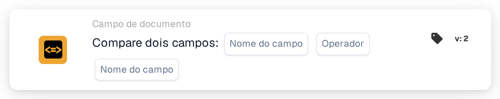

# Compare dois campos

<figure><figcaption>
Versão 2
</figcaption></figure>

## **Propósito:**

Este cartão de fluxo de trabalho foi concebido para automatizar ações comparando os valores de dois campos de documento especificados. Permite uma tomada de decisões dinâmica com base nos dados dos campos e assegura que os fluxos de trabalho são executados com base em comparações entre diferentes valores de documento.

## **Componentes do cartão:**

1. **Nome do campo (1)**
   * **Descrição:** Especifica o primeiro campo de documento a comparar.
   * **Detalhe:** Tem de corresponder ao identificador exato do primeiro campo dentro do documento.
2. **Operador**
   * **Descrição:** Define o tipo de comparação a realizar entre os dois campos.
   * **Opções:**
     * **Igual a (=):** Verifica se os valores dos dois campos são iguais.
     * **Não é igual (≠):** Garante que os valores dos dois campos são diferentes.
     * **Maior que (>):** Confirma que o valor do primeiro campo é superior ao do segundo campo.
     * **Maior ou Igual (≥):** Valida que o valor do primeiro campo é igual ou superior ao do segundo campo.
     * **Menor que (<):** Verifica se o valor do primeiro campo é inferior ao do segundo campo.
     * **Menor ou igual (≤):** Garante que o valor do primeiro campo é inferior ou igual ao do segundo campo.
3. **Nome do campo (2)**
   * **Descrição:** Especifica o segundo campo de documento a comparar com o primeiro campo.
   * **Detalhe:** Deve corresponder ao identificador exato do segundo campo dentro do documento.

## **Funcionalidade:**

**Avaliação da condição:** O sistema avalia se os valores dos dois campos especificados cumprem a condição de comparação definida pelo operador.

**Execução da ação:**

* **Condição Verdadeira:**\
  Se os valores dos dois campos corresponderem à condição de comparação, o sistema aciona as ações associadas. Estas ações podem incluir a atualização de registos ou o acionamento de alertas.
* **Condição Falsa:**\
  Se os valores dos dois campos não corresponderem à condição especificada, podem ser executadas ações alternativas ou nenhuma ação, consoante a configuração dos fluxos de trabalho.

## **Configuração:**

* Os utilizadores configuram o cartão selecionando os dois campos a comparar a partir de uma lista de campos disponíveis no sistema. O operador é selecionado a partir de uma lista pendente de opções de comparação disponíveis.

## **Conclusão:**

O cartão de fluxo de trabalho "Compare Two Fields" é uma ferramenta essencial para comparar dados entre campos dentro de documentos. Ao automatizar ações com base em comparações de campos, este cartão ajuda a otimizar a tomada de decisões, apoia a validação de dados e reforça a automação do fluxo de trabalho.

<!-- workflow-card-practical-example-20261021 -->

## Exemplo prático

**Quando usar:** Verifique se uma referência copiada é igual à referência original.

**Configuração:** Selecione os campos de texto `purchase_order_number` e `confirmed_order_number` e o operador igual.

**Resultado esperado e contraexemplo:** Valores `PO-DEMO-001` e `PO-DEMO-001` aprovados. Um segundo valor de `PO-DEMO-002` falha.

Esta é uma configuração ilustrativa e resultado esperado. Utilize campos, usuários e grupos configurados em sua organização de teste; não é uma afirmação de que este exemplo foi executado.
