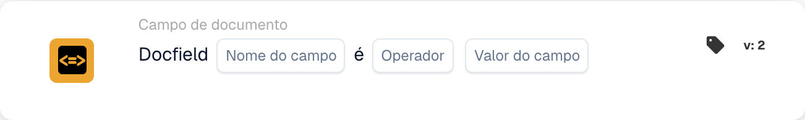

# Comparar um campo do documento com um valor de referência

<figure><figcaption>
Campos do cartão na versão apresentada. Os campos ainda não estão configurados.
</figcaption></figure>

## **Propósito:**

Este cartão de fluxo de trabalho foi concebido para automatizar ações comparando o valor de um campo de documento especificado com um valor ou condição de referência. Assegura uma tomada de decisões dinâmica e precisa nos fluxos de trabalho, com base na validação dos dados do documento.

## **Componentes do cartão:**

1. **Nome do campo**
   * **Descrição:** Especifica o nome do campo de documento a avaliar.
   * **Detalhe:** Tem de corresponder ao identificador exato do campo dentro do documento.
2. **Operadores**
   * **Descrição:** Define o tipo de comparação a realizar entre o valor do campo e o valor de referência.
   * **Opções:**
     * **Igual a (=):** Verifica se o valor do campo corresponde ao valor de referência.
     * **Não é igual (≠):** Garante que o valor do campo é diferente do valor de referência.
     * **Maior que (>):** Confirma que o valor do campo é superior ao valor de referência.
     * **Maior ou Igual (≥):** Valida que o valor do campo é igual ou superior ao valor de referência.
     * **Menor que (<):** Verifica se o valor do campo é inferior ao valor de referência.
     * **Menor ou igual (≤):** Garante que o valor do campo é inferior ou igual ao valor de referência.

## **Funcionalidade:**

* **Avaliação da condição:** O sistema verifica se o valor do campo de documento, em relação à sua coluna associada, cumpre a condição de comparação especificada pelo operador e pelo valor de referência.
* **Execução da ação:**
  * **Condição Verdadeira:**\
    Se o valor do campo de documento cumprir a condição especificada (por exemplo, é igual ao valor de referência), o sistema aciona as ações associadas. Estas podem incluir a atualização de registos, o avanço do fluxo de trabalho ou a geração de notificações.
  * **Condição Falsa:**\
    Se o valor do campo de documento não cumprir a condição especificada, são executadas ações alternativas ou nenhuma ação, consoante a configuração do fluxo de trabalho.

## **Configuração:**

* O utilizador seleciona o nome do campo do documento relevante e escolhe o operador no menu pendente. De seguida, o utilizador especifica o valor do campo de referência para concluir a configuração.

## **Conclusão:**

O cartão de fluxo de trabalho "DocField Comparison Validation" é uma ferramenta robusta para o processamento dinâmico de documentos. Ao automatizar ações com base em comparações de campos, este cartão simplifica os fluxos de trabalho, aumenta a precisão e apoia a tomada de decisões orientada por dados.

<!-- workflow-card-practical-example-20261021 -->

## Exemplo prático

**Quando usar:** Revise faturas acima de um valor definido.

**Configuração:** Selecione o campo numérico `net_total`, operador `>` e valor de referência `1000`.

**Resultado esperado e contra-exemplo:** Um valor de `1200` é aprovado. `1000` e `900` falham porque a comparação é estritamente maior que.

Esta é uma configuração ilustrativa e resultado esperado. Utilize campos, usuários e grupos configurados em sua organização de teste; não é uma afirmação de que este exemplo foi executado.
