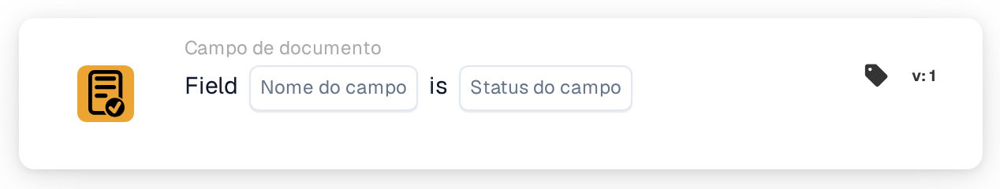
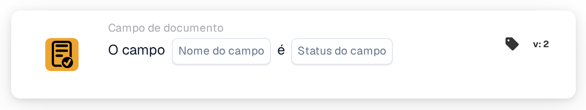

# Verificar a presença e o conteúdo de um campo

<figure><figcaption>
Versão 1
</figcaption></figure>

<figure><figcaption>
Versão 2
</figcaption></figure>

## Quando utilizar

Utilize esta carta para verificar se um campo do documento está vazio ou em falta, por exemplo quando uma fatura sem número necessita de uma verificação adicional. Trata-se de uma condição; configure a ação seguinte separadamente.

**Localização:** Workflow padrão → condições adicionais (AND) → Campo do documento.

## Configuração — versão 2

| Definição | Valor do exemplo |
| --- | --- |
| Campo | `invoice_id` — número da fatura |
| Estado do campo | Vazio ou em falta (`field_empty`) |

Selecione um campo realmente configurado na sua organização. A opção `field_not_empty` verifica se o campo contém um valor.

<!-- workflow-card-practical-example-20261021 -->

## Exemplo prático

| Valor do exemplo | Resultado esperado para `field_empty` |
| --- | --- |
| Campo vazio ou em falta | Condição satisfeita |
| `DEMO-001` | Condição não satisfeita |
| Número presente mas incorreto | Condição não satisfeita — o campo continua a conter um valor |

Estes exemplos mostram os resultados esperados. Para validar o próprio número, adicione uma condição adequada ao conteúdo; esta carta verifica o estado do campo. Na versão 2, os espaços no início e no fim do texto são removidos antes de verificar se o campo está vazio.

## Vídeo de exemplo com um administrador

Quando uso esta carta, onde a encontro e como deteto números de fatura em falta. Os exemplos mostram os resultados esperados.



[Abrir vídeo com legendas em português](https://docbits-videos.fra1.cdn.digitaloceanspaces.com/settings-assistant/workflow-card-field-status-admin/v1/pt-theme-v4.html)

[Ler transcrição](https://docbits-videos.fra1.cdn.digitaloceanspaces.com/settings-assistant/workflow-card-field-status-admin/v1/pt.txt)
