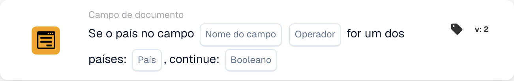

# Se o país no campo for um dos

<figure><figcaption>
Campos do cartão na versão apresentada. Os campos ainda não estão configurados.
</figcaption></figure>

Use esta condição quando uma etapa adicional de processamento deva ser aplicada a documentos de países específicos, por exemplo Alemanha e França. O cartão compara o país lido de um campo do documento com uma lista de países configurada.

**Localização:** Workflow padrão → condições adicionais (AND) → Campo do documento. Configure a ação seguinte separadamente em THEN.

## Configuração — versão 2

| Definição | Valor |
| --- | --- |
| Campo | Um campo de texto existente que contenha o nome do país |
| Operador | `is` |
| Países | `Germany, France` |
| Valor de continuação | `true` |

<!-- workflow-card-practical-example-20261021 -->

## Exemplo prático

| Valor do país no campo | Condição esperada |
| --- | --- |
| `Germany` | Satisfeita |
| `France` | Satisfeita |
| `United States` | Não satisfeita |

Os nomes dos países apresentados como código são valores de entrada fixos para este exemplo.

## Limites e verificações

`false` não inverte a comparação. Com essa definição, mesmo um país correspondente não produz uma condição positiva. Para verificar a condição oposta, selecione `isnot` com `true`.

Trate separadamente campos ausentes e valores de país vazios; eles podem devolver um resultado de dados em falta em vez de uma falta de correspondência normal.

A análise do código-fonte da versão de desenvolvimento de 22 de outubro de 2026 mostra um erro de conversão para entradas ISO como `DE` e `DEU`. Por isso, estes exemplos usam nomes de países completos. Verifique separadamente o tratamento de códigos ISO na versão instalada.
