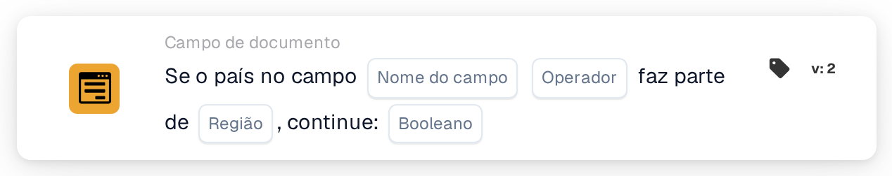

# Se o país estiver no campo

<figure><figcaption>
Versão 2
</figcaption></figure>

Utilização prevista: uma etapa adicional de processamento depende de um grupo de países. O exemplo abaixo descreve uma regra de pertença à União Europeia.

## Limitação atual — código-fonte verificado em 22 de outubro de 2026

Os testes locais do código-fonte com o tipo nativo da seleção de região falham antes da comparação do país e devolvem `missing_variable` ou `error`. Os nomes completos dos países não contornam este problema. Não foi verificada uma execução bem-sucedida no backend implementado para esta versão.

**Localização:** Workflow padrão → condições adicionais (AND) → Campo do documento. Configure a ação seguinte separadamente em THEN.

## Configuração — versão 2

| Definição | Valor |
| --- | --- |
| Campo | Um campo de texto existente que contenha o nome do país |
| Operador | `is` |
| Região | União Europeia (UE) |
| Valor de continuação | `true` |

<!-- workflow-card-practical-example-20261021 -->

## Exemplo previsto — verifique a correção antes da utilização

Verifique a correção e ambos os casos do exemplo na sua versão instalada antes de ativar esta regra. A tabela descreve a regra de negócio prevista, não uma execução bem-sucedida confirmada.

| Valor do país no campo | Agrupamento de países previsto |
| --- | --- |
| `Germany` | Dentro da UE |
| `United States` | Fora da UE |

Os nomes dos países apresentados como código são valores de entrada fixos para este exemplo.

## Limites e verificações

`false` não inverte a comparação. Com essa definição, mesmo um país correspondente não produz uma condição positiva. Para verificar a condição oposta, selecione `isnot` com `true`.

Trate separadamente campos ausentes e valores de país vazios; eles podem devolver um resultado de dados em falta em vez de uma falta de correspondência normal.

O problema de conversão ISO para entradas como `DE` e `DEU` é independente. Substituir códigos ISO por nomes completos de países não resolve o erro de seleção de região.

Os grupos disponíveis, incluindo UE, Schengen e NAFTA, vêm da implementação do cartão. Confirme os países incluídos na sua versão antes de usar um grupo numa regra de negócio.
