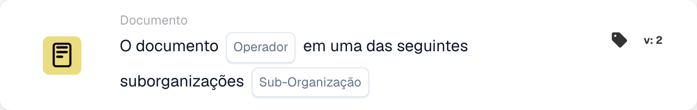

# Documento

Os cartões desta categoria no seletor **Adicionar cartão** do Workflow Builder:

<figure><figcaption>
Cartões disponíveis na categoria selecionada. Configure os campos antes de utilizar. Algumas etiquetas desta versão da interface ainda não estão traduzidas ou têm uma tradução incorreta. As explicações desta página usam os termos corretos; a imagem mostra a interface real.
</figcaption></figure>

<!-- workflow-card-example-condition_sub_org_is_isnot_in_list-20261021 -->

### Documente em uma das várias suborganizações

<figure><figcaption>
Campos do cartão na versão apresentada. Os campos ainda não estão configurados.
</figcaption></figure>

`CONDITION_SUB_ORG_IS_ISNOT_IN_LIST` · versão 2

Selecione as suborganizações is-one-of e configuradas `Demo North` e `Demo South`. Um documento pertencente a qualquer uma das unidades selecionadas é aprovado; `Demo Default` falha. Isto verifica a suborganização do documento; isso não muda isso.
