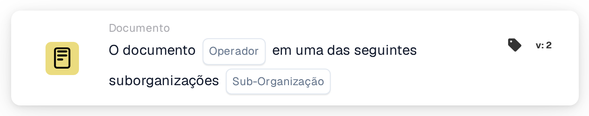

# Operador de documentos para suborganizações um dos

<figure><figcaption>
Versão 2
</figcaption></figure>

## Propósito:

Este cartão de fluxo de trabalho verifica se um documento pertence a uma de várias suborganizações. Em vez de comparar o documento com uma única suborganização, compara-o com uma lista, de modo que um único cartão abrange todo um grupo de suborganizações que devem ser tratadas da mesma forma. Consoante o resultado, o fluxo de trabalho continua com a condição verdadeira ou com a falsa.

Para comparar com uma única suborganização, pode ser utilizado o cartão **Document Operator for Sub-Organizations**.

## Componentes do cartão:

1. **Operador**
   * **Descrição:** Define se o documento deverá pertencer a uma das suborganizações indicadas ou a nenhuma delas.
   * **Opções:**
     * **Is:** A condição é verdadeira se a suborganização do documento for uma das suborganizações indicadas.
     * **Is Not:** A condição é verdadeira se a suborganização do documento não estiver na lista.
2. **Sub-org**
   * **Descrição:** A lista de suborganizações com as quais o documento é comparado.
   * **Detalhe:** Podem ser selecionadas uma ou mais suborganizações da organização. É comparada a suborganização à qual o documento está atribuído.

## Funcionalidade:

* **Avaliação da condição:** O sistema lê a suborganização do documento e verifica se é uma das suborganizações selecionadas no cartão.
* **Execução da ação:**
  * **Condição Verdadeira:**\
    Com **Is**, a suborganização do documento está na lista; com **Is Not**, não está. O fluxo de trabalho continua com a condição verdadeira, por exemplo para encaminhar o documento para a equipa responsável por estas suborganizações ou aplicar regras que só se aplicam a elas.
  * **Condição Falsa:**\
    Se a condição não for cumprida, o fluxo de trabalho continua com a condição falsa, por exemplo para aplicar regras gerais ou encaminhar o documento para outro destino.
* **Dados em falta:** Se o documento não estiver atribuído a nenhuma suborganização, ou se não houver nenhuma suborganização selecionada no cartão, o cartão não avalia a condição. Regista os dados em falta no registo do fluxo de trabalho em vez de continuar com a condição falsa.

## Configuração:

* O cartão pode ser adicionado a partir da categoria **Documento**. Em seguida, podem ser escolhidos o operador (**Is** ou **Is Not**) e, no campo **Sub-org**, as suborganizações a verificar. Por fim, define-se a condição de continuação (verdadeira ou falsa), que determina o passo seguinte do fluxo de trabalho.

## Conclusão:

O cartão de fluxo de trabalho "Document Operator for Sub-Organizations one of" permite que uma única condição abranja várias suborganizações ao mesmo tempo. Assim, os fluxos de trabalho mantêm-se curtos quando várias suborganizações partilham as mesmas regras de processamento, e os documentos são tratados no contexto organizacional correto.
