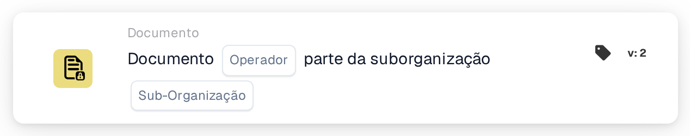

# Operador de documentos para suborganizações

<figure><figcaption>
Versão 2
</figcaption></figure>

## Propósito:

Este cartão de fluxo de trabalho avalia se um documento faz parte de uma sub-organização específica. Com base nesta avaliação, o fluxo de trabalho pode continuar ou acionar diferentes ações consoante o documento esteja ou não associado à sub-organização especificada.

## Componentes do cartão:

1. **Operador**
   * **Descrição:** Define se o documento tem de fazer parte da sub-organização especificada ou não.
   * **Opções:**
     * **Is:** O documento tem de fazer parte da sub-organização especificada para que a condição seja verdadeira.
     * **Não é:** O documento não pode fazer parte da sub-organização especificada para que a condição seja verdadeira.
2. **Suborganização**
   * **Descrição:** Especifica a sub-organização com a qual o documento deve ser comparado.
   * **Detalhe:** Deve corresponder ao identificador da sub-organização. A comparação verifica se o documento pertence à sub-organização especificada.

## Funcionalidade:

* **Avaliação da condição:** O sistema avalia se o documento faz parte da sub-organização especificada. Esta avaliação verifica a sub-organização do documento face à fornecida pelo utilizador.
* **Execução da ação:**
  * **Condição Verdadeira:**\
    Se o documento fizer parte da sub-organização especificada, o fluxo de trabalho continua com a condição verdadeira. Isto pode acionar ações adicionais, como encaminhar o documento para um departamento específico, aplicar regras específicas da sub-organização ou ativar funcionalidades adaptadas a essa sub-organização.
  * **Condição Falsa:**\
    Se o documento não fizer parte da sub-organização especificada, o fluxo de trabalho continua com a condição falsa. Isto permite executar ações alternativas, como enviar notificações, interromper o fluxo de trabalho ou aplicar regras gerais fora do âmbito da sub-organização.

## Configuração:

* Os utilizadores configuram o cartão selecionando o campo do documento que contém o documento e especificando a sub-organização a verificar. O operador é depois escolhido a partir de uma lista pendente para definir se o documento tem de fazer parte ou não da sub-organização especificada. Por fim, os utilizadores definem a condição de continuação (verdadeira ou falsa), que determina o passo seguinte no fluxo de trabalho.

## Conclusão:

O cartão de fluxo de trabalho "Document in Sub-organization" é uma ferramenta útil para automatizar ações com base no facto de um documento pertencer a uma sub-organização específica. Ao assegurar que os documentos são processados de acordo com regras específicas da sub-organização, este cartão melhora a eficiência do fluxo de trabalho e garante que as ações são executadas no contexto organizacional correto.

<!-- workflow-card-practical-example-20261021 -->

## Exemplo prático

**Quando usar:** Rotear documentos pertencentes a uma unidade de negócios.

**Configuração:** Selecione a suborganização `Demo North` e o operador igual.

**Resultado esperado e contra-exemplo:** Um documento em `Demo North` é aprovado. Um documento em `Demo South` falha.

Esta é uma configuração ilustrativa e resultado esperado. Utilize campos, usuários e grupos configurados em sua organização de teste; não é uma afirmação de que este exemplo foi executado.
