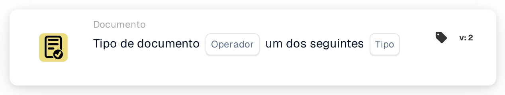

# Tipo de documento Operação um dos

<figure><figcaption>
Versão 2
</figcaption></figure>

## **Propósito:**

Este cartão foi concebido para gerir ações sobre documentos em função do seu tipo, utilizando uma lógica condicional simples (is/is not) para acionar ou impedir fluxos de trabalho específicos. Isto permite um controlo preciso sobre como os diferentes tipos de documentos são processados dentro do sistema ERP.

## **Componentes do cartão:**

1. **Operador**
   * **Descrição**: Determina a lógica condicional aplicada aos tipos de documento.
   * **Opções**:
     * **is**: A operação será acionada se o tipo do documento corresponder a um dos tipos especificados na lista.
     * **não é**: A operação será acionada se o tipo do documento não corresponder a nenhum dos tipos listados.
2. **Lista de tipos de documentos**
   * **Descrição**: Especifica uma lista de tipos de documento aos quais a condição se aplicará.
   * **Detalhe**: Inclui uma variedade de tipos de documento, como "Invoice", "Purchase Order", etc., com base nos quais a condição (is/is not) será avaliada.

## Funcionalidade:

* **Avaliação da condição:** O sistema verifica se o tipo de documento corresponde à condição do operador (is ou is not) face à lista de tipos de documento especificada.
* **Execução da ação:**
  * **Condição Verdadeira:**\
    Se o tipo de documento cumprir a condição especificada (estar ou não na lista), o fluxo de trabalho continua. Isto pode acionar processos como aprovações de documentos, validações específicas ou ações de encaminhamento.
  * **Condição Falsa:**\
    Se o tipo de documento não cumprir a condição, são executadas ações alternativas, como rejeitar o documento ou interromper o fluxo de trabalho.

## Configuração:

* Os utilizadores configuram o cartão selecionando o campo de tipo de documento e definindo o operador (is ou is not). De seguida, especificam a lista de tipos de documento a verificar. A configuração é direta, envolvendo menus pendentes para a seleção do campo e do operador e um campo para introduzir a lista de tipos de documento.

## Conclusão:

O cartão de fluxo de trabalho "Document Type Condition" desempenha um papel crucial na gestão de operações baseadas em documentos com precisão e flexibilidade. Ao utilizar uma lógica condicional simples, ajuda a assegurar que os documentos são processados de forma adequada, melhorando a eficiência e a conformidade. Documentar este cartão com clareza ajudará os utilizadores a compreender como implementá-lo e utilizá-lo eficazmente, tornando-o uma parte valiosa da documentação do seu sistema ERP.

<!-- workflow-card-practical-example-20261021 -->

## Exemplo prático

**Quando usar:** Utilize a mesma validação para vários tipos de documentos.

**Configuração:** Selecione o operador is-one-of e os tipos `Invoice` e `Credit Note`.

**Resultado esperado e contra-exemplo:** Um `Invoice` passa; um `Order` não.

Esta é uma configuração ilustrativa e resultado esperado. Utilize campos, usuários e grupos configurados em sua organização de teste; não é uma afirmação de que este exemplo foi executado.
