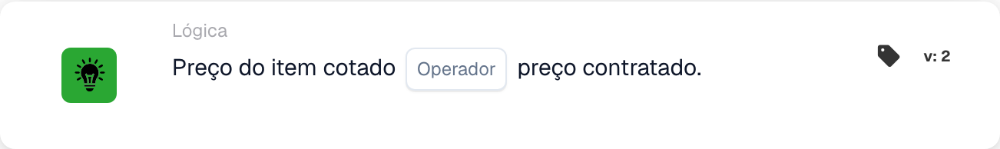

# Preço do item cotado

<figure><figcaption>
Campos do cartão na versão apresentada. Os campos ainda não estão configurados.
</figcaption></figure>

## **Objetivo:**

Este cartão DocBits compara o preço cotado de um item com seu preço contratado, permitindo que os fluxos de trabalho acionem ações com base na correspondência ou na diferença entre os dois valores. Ajuda a garantir a consistência dos preços e a conformidade com os termos do contrato.

## **Funcionalidade:**

* **Comparação de Preços:** Este cartão avalia se o preço do item cotado atende à condição especificada em relação ao preço contratado.
* **Operadores:** As seguintes condições podem ser aplicadas:
  * **Igual a (=):** Verifica se o preço cotado corresponde ao preço contratado.
  * **Diferente (≠):** Garante que o preço cotado seja diferente do preço contratado.

## **Uso:**

Este cartão é particularmente útil em fluxos de trabalho de compras, vendas ou gerenciamento de contratos, onde é crucial validar se os preços cotados estão alinhados com os termos contratuais acordados antes de prosseguir com as aprovações ou o processamento de pedidos.

## **Exemplo de cenário:**

* Um usuário configura o cartão para verificar se o preço cotado **é igual (=)** ao **preço contratado**. Se os preços corresponderem, o fluxo de trabalho segue para aprovação; caso contrário, aciona uma notificação para revisão manual para resolver a discrepância.

Ao usar o cartão "Preço do item cotado versus preço contratado", as organizações podem aplicar políticas de preços, manter a conformidade do contrato e reduzir erros em transações financeiras.

## Versão 3: Qualquer um ou Todos

A versão 3 adiciona `match_any` e `match_all`. Qualquer um requer pelo menos uma linha comparável bem-sucedida; All requer que cada linha comparada satisfaça o operador selecionado. A versão 2 retém tudo. Uma seleção não definida na v3 é padronizada como Todos e é registrada. Nenhuma linha comparável está faltando dados, não há uma correspondência bem-sucedida. Consulte [Cartões de comparação de cotações](../../cards-overview/quote-comparison-guide.md) para resultados mistos, linhas ignoradas e testes.
