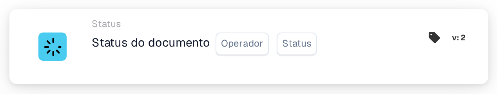

# Condição de status de documento único

<figure><figcaption>
Versão 2
</figcaption></figure>

**Propósito**

Este cartão de fluxo de trabalho foi adaptado para gerir operações sobre documentos com base num único estado de documento especificado. Ao simplificar a condição a um estado, o cartão foca-se em gatilhos de fluxo de trabalho muito específicos, sendo ideal para atividades de processamento de documentos direcionadas dentro de um sistema ERP.

**Componentes do cartão**

1. **Operador**
   * **Descrição**: Especifica o método para avaliar o estado do documento face à condição selecionada.
   * **Opções**:
     * **is**: Aciona a operação se o estado atual do documento corresponder ao estado selecionado.
     * **não é**: Aciona a operação se o estado atual do documento não corresponder ao estado selecionado.
2. **Estado**
   * **Descrição**: Permite a seleção de um único estado de documento para definir a condição.
   * **Exemplos de estados**: "Erro", "Erro de exportação", "Pronto em validação", "Pronto em revisão", "Aprovação pendente", "Segunda aprovação pendente".
   * **Detalhe**: Os utilizadores escolhem um estado a partir de uma lista pendente ou de um conjunto de botões de opção. Esse estado serve então como critério para a operação do cartão.

**Funcionalidade**

* **Identificação do estado do documento**: Identifica o estado atual de um documento à medida que é processado pelo sistema ERP.
* **Avaliação da condição**:
  * Com base no operador selecionado (`is` ou `is not`), o cartão verifica se o estado atual do documento está alinhado com o critério de estado escolhido.
* **Execução da ação**:
  * **Condição Verdadeira**: Se o estado corresponder (ou não corresponder, consoante o operador), a ação correspondente é iniciada. Pode tratar-se de encaminhamento para processamento adicional, geração de notificações ou outros fluxos de trabalho predefinidos.
  * **Condição Falsa**: Se a condição não for cumprida, não é tomada qualquer ação, ou é acionado um caminho alternativo.
* **Integração com outros fluxos de trabalho**: Apesar de ser concebido para a avaliação de um único estado, este cartão pode ser integrado eficazmente em sequências de fluxo de trabalho mais amplas para assegurar um tratamento preciso dos documentos.

**Interações do utilizador**

* **Configuração**: Os utilizadores configuram o cartão selecionando um operador e escolhendo depois um estado de entre as opções disponíveis. Este processo de seleção é direto e concebido para evitar confusões.
* **Monitorização e relatórios**: Permite a monitorização através de relatórios ou painéis gerados pelo sistema que acompanham o processamento dos documentos com base no seu estado, ajudando a supervisionar a eficácia dos fluxos de trabalho implementados.
* **Tratamento de erros e notificações**: Configurável para alertar os utilizadores sobre quaisquer anomalias de processamento ou para assinalar documentos que não cumprem as condições definidas, assegurando atenção e resolução rápidas.

#### Conclusão

O cartão de fluxo de trabalho "Single Document Status Condition" simplifica a gestão de documentos ao focar-se em condições de estado individuais. Esta especificação é útil em casos em que é necessário um controlo preciso sobre os fluxos de documentos, especialmente em ambientes com critérios de processamento rigorosos. Documentar esta versão do cartão com clareza assegurará que os utilizadores compreendem plenamente a sua aplicação e a conseguem integrar eficazmente nas suas operações diárias, reforçando tanto a conformidade como a eficiência no processamento de documentos.

<!-- workflow-card-complete-example-20261021 condition_doc_status_is_isnot -->

### Exemplo de status único

**Configuração:** Escolha o operador `is` e o status `Pending Approval`. Adicione uma ação de revisão a seguir apropriada para esse status.

**Resultado esperado e contra-exemplo:** A condição é verdadeira para um documento atualmente `Pending Approval`; é falso para um documento com status `Ready in Validation`. Use o status real selecionado em sua versão. A alteração de um status não exporta o documento por si só.

Esta é uma configuração de teste ilustrativa e resultado esperado; não foi executado. Use dados e destinatários configurados na sua organização de teste.
