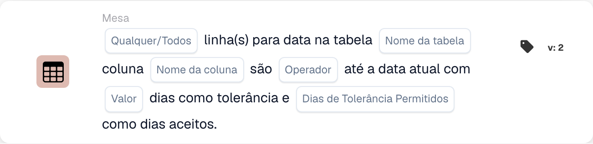

# Tabela

Os cartões desta categoria no seletor **Adicionar cartão** do Workflow Builder:

<figure><figcaption>
Cartões disponíveis na categoria selecionada. Configure os campos antes de utilizar. Algumas etiquetas desta versão da interface ainda não estão traduzidas ou têm uma tradução incorreta. As explicações desta página usam os termos corretos; a imagem mostra a interface real.
</figcaption></figure>

<!-- workflow-card-example-condition_table_column_exists-20261021 -->

### A tabela do documento contém uma coluna

<figure><figcaption>
Campos do cartão na versão apresentada. Os campos ainda não estão configurados. Algumas etiquetas desta versão da interface ainda não estão traduzidas ou têm uma tradução incorreta. As explicações desta página usam os termos corretos; a imagem mostra a interface real.
</figcaption></figure>

`CONDITION_TABLE_COLUMN_EXISTS` · versão 2

Selecione a tabela `lines`, a coluna `article_number` e o operador existe. Uma tabela preenchida contendo essa coluna é aprovada; a mesma tabela sem a coluna falha na comparação de existência. Uma tabela ausente ou vazia pode produzir um resultado de dados faltantes e não é prova de uma comparação negativa bem-sucedida.

<!-- workflow-card-example-condition_compare_table_date_to_current_date-20261021 -->

### Datas em uma tabela em relação à data de referência

<figure><figcaption>
Campos do cartão na versão apresentada. Os campos ainda não estão configurados. Algumas etiquetas desta versão da interface ainda não estão traduzidas ou têm uma tradução incorreta. As explicações desta página usam os termos corretos; a imagem mostra a interface real.
</figcaption></figure>

`CONDITION_COMPARE_TABLE_DATE_TO_CURRENT_DATE` · versão 2

Para a data de referência `2026-10-21`, compare a tabela `lines`, coluna `delivery_date`, posterior a, Todos e tolerância de dia zero. As linhas datadas de `2026-10-22` e `2026-10-23` satisfazem a comparação. Uma linha datada `2026-10-20` faz com que All falhe. Teste datas ausentes e inválidas separadamente.
