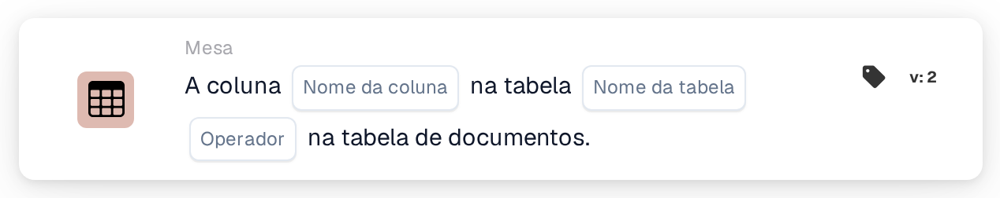

# A coluna existe na tabela

<figure><figcaption>
Versão 2
</figcaption></figure>

## Propósito:

Este cartão de fluxo de trabalho verifica se uma tabela do documento contém uma coluna específica. Pode ser utilizado para executar cartões seguintes apenas para documentos cuja tabela contenha os dados necessários, por exemplo uma coluna de data de entrega ou de número do item, ou para encaminhar para outro destino documentos com uma estrutura de tabela diferente. Consoante o resultado, o fluxo de trabalho continua com a condição verdadeira ou com a falsa.

## Componentes do cartão:

1. **Nome da coluna**
   * **Descrição:** O nome da coluna que o cartão procura.
   * **Detalhe:** O nome da coluna é comparado sem distinguir maiúsculas de minúsculas.
2. **Nome da tabela**
   * **Descrição:** O nome da tabela do documento que é verificada.
   * **Detalhe:** O nome da tabela é comparado sem distinguir maiúsculas de minúsculas.
3. **Operador**
   * **Descrição:** Define se a coluna deverá existir na tabela ou não.
   * **Opções:**
     * **É:** A condição é verdadeira se a tabela contiver a coluna.
     * **Não é:** A condição é verdadeira se a tabela não contiver a coluna.

## Funcionalidade:

* **Avaliação da condição:** O cartão procura a tabela do documento com o nome indicado e verifica se a primeira linha dessa tabela tem uma coluna com o nome indicado. A coluna encontrada, ou as colunas que existiam em vez dela, são anotadas no registo do fluxo de trabalho.
* **Execução da ação:**
  * **Condição Verdadeira:**\
    Com **É**, a coluna está na tabela. Com **Não é**, não está. O fluxo de trabalho continua com a condição verdadeira, por exemplo para executar uma comparação nesta coluna.
  * **Condição Falsa:**\
    Se a condição não for cumprida, o fluxo de trabalho continua com a condição falsa.
* **Dados em falta:** O cartão não avalia a condição e regista os dados em falta no registo do fluxo de trabalho se não estiver definido nenhum nome de coluna ou nenhum nome de tabela no cartão, se o documento não tiver nenhuma tabela com o nome indicado, ou se essa tabela não tiver linhas ou a sua primeira linha não tiver colunas.
* **Erros:** Se não estiver definido nenhum operador, ou estiver definido um operador diferente de **É** ou **Não é**, o cartão comunica um erro de configuração.

## Configuração:

* O cartão pode ser adicionado a partir da categoria **Mesa**. Em seguida, podem ser definidos o nome da coluna, o nome da tabela e o operador (**É** ou **Não é**). Por fim, define-se a condição de continuação (verdadeira ou falsa), que determina o passo seguinte do fluxo de trabalho.

## Conclusão:

O cartão de fluxo de trabalho "Column Exists in Table" verifica a estrutura de uma tabela do documento antes de os seus dados serem utilizados. Colocado antes de outros cartões de tabela, ajuda a assegurar que esses cartões só são executados em documentos que contêm a coluna esperada.
