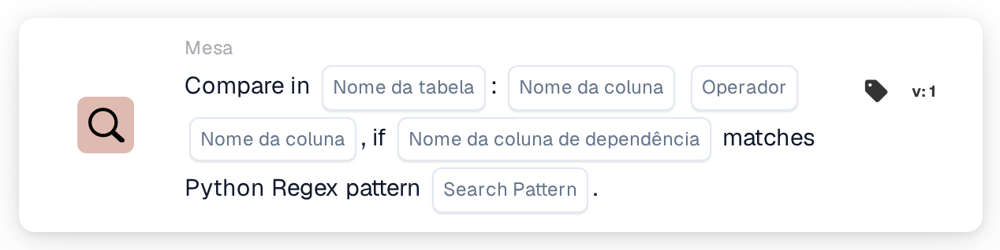
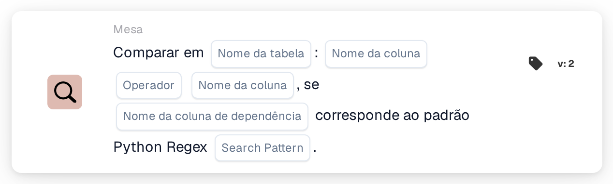

# Comparar em

<figure><figcaption>
Versão 1
</figcaption></figure>

<figure><figcaption>
Versão 2
</figcaption></figure>

## **Propósito:**

Este cartão DocBits realiza uma comparação entre duas colunas de uma tabela especificada, permitindo aos utilizadores definir condições com base nos valores de cada coluna. Adicionalmente, este cartão inclui uma funcionalidade de dependência, em que a comparação só ocorre se o valor de uma terceira coluna corresponder a um padrão regex de Python especificado. Esta configuração é útil para verificações condicionais que dependem de vários pontos de dados dentro de um conjunto de dados.

## **Funcionalidade:**

* **Comparação de colunas com dependência:** Este cartão compara valores em duas colunas especificadas com base numa condição definida, que só é aplicada se o valor de uma terceira coluna de "dependência" corresponder a um padrão regex de Python definido.
* **Operadores:** Os utilizadores podem escolher os seguintes operadores para a comparação de colunas:
  * **Igual a (=):** Verifica se os valores das duas colunas são exatamente iguais.
  * **Não é igual (≠):** Garante que os valores das duas colunas não são iguais.
  * **Maior que (>):** Confirma que os valores da primeira coluna são superiores aos da segunda coluna.
  * **Maior ou Igual (≥):** Garante que os valores da primeira coluna são superiores ou iguais aos da segunda coluna.
  * **Menor que (<):** Verifica se os valores da primeira coluna são inferiores aos da segunda coluna.
  * **Menor ou igual (≤):** Garante que os valores da primeira coluna são inferiores ou iguais aos da segunda coluna.
* **Dependência regex:** Este cartão inclui uma funcionalidade de dependência que permite aos utilizadores definir um padrão regex para uma terceira coluna. A condição de comparação só é aplicada se pelo menos um valor na coluna de dependência corresponder ao padrão regex.

## **Utilização:**

Este cartão é particularmente útil em cenários onde é necessária uma lógica condicional complexa, como verificações de qualidade que dependem de relações entre pontos de dados, com condições adicionais baseadas na formatação dos dados ou em padrões específicos.

***

## **Exemplo de cenário:**

* Um utilizador configura o cartão para comparar as colunas "Quantity" e "Threshold" numa tabela "Stock" com a condição **Quantidade ≥ Limite**. Esta comparação só ocorre se a coluna "Item Code" corresponder ao padrão regex para formatos de código específicos, como **^A\d{3}$** (indicando um código de item que começa por "A" seguido de três dígitos).

Ao utilizar o cartão "Conditional Column Comparison", as organizações podem criar comparações avançadas e dependentes de padrões dentro de conjuntos de dados, permitindo um processamento de dados afinado e uma maior precisão em fluxos de trabalho condicionais.
