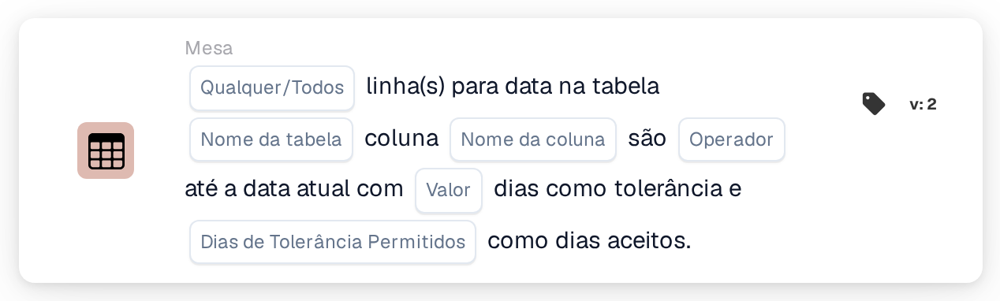

# Data da tabela face à data atual

<figure><figcaption>
Versão 2
</figcaption></figure>

A forma como a janela de tolerância é calculada, com exemplos como "hoje ou amanhã", é explicada em [Date Tolerances](../date-tolerances.md).

## Propósito:

Este cartão de fluxo de trabalho compara uma data em cada linha de uma tabela do documento, por exemplo uma data de entrega, com a data atual. Pode ser definida uma tolerância em dias e podem ser escolhidos os dias da semana que contam, de modo que, por exemplo, sejam utilizados apenas dias úteis. Pode ser utilizado para verificar se as datas de um documento estão no passado, são hoje, estão dentro de alguns dias ou no futuro. Consoante o resultado, o fluxo de trabalho continua com a condição verdadeira ou com a falsa.

## Componentes do cartão:

1. **Qualquer/Todos**
   * **Descrição:** Define se uma linha ou todas as linhas da tabela deverão cumprir a condição.
   * **Opções:**
     * **Qualquer:** A condição é verdadeira se pelo menos uma linha cumprir a condição.
     * **Todos:** A condição só é verdadeira se todas as linhas cumprirem a condição.
2. **Nome da tabela**
   * **Descrição:** O nome da tabela do documento que contém as datas.
3. **Nome da coluna**
   * **Descrição:** A coluna da tabela que contém a data.
4. **Operador**
   * **Descrição:** Define como a data na tabela é comparada com a data atual, tendo em conta a tolerância.
   * **Opções:**
     * **É igual a:** A data está dentro do intervalo de tolerância em torno da data atual.
     * **Não é igual a:** A data está fora do intervalo de tolerância.
     * **Maior que:** A data está depois do intervalo de tolerância.
     * **Maior ou igual:** A data está dentro ou depois do intervalo de tolerância.
     * **Menor que:** A data está antes do intervalo de tolerância.
     * **Menor ou igual:** A data está dentro ou antes do intervalo de tolerância.
5. **Valor**
   * **Descrição:** A tolerância em dias.
   * **Detalhe:** O intervalo de tolerância abrange este número de dias antes e depois da data atual. Apenas são contados os dias selecionados em **Dias de Tolerância Permitidos**. Se não for definido nenhum valor, é utilizada uma tolerância de 0 dias, pelo que o intervalo é apenas a data atual.
6. **Dias de Tolerância Permitidos**
   * **Descrição:** Os dias da semana que contam como dias aceites.
   * **Opções:** De Segunda-feira a Domingo; podem ser selecionados vários dias.

## Funcionalidade:

* **Avaliação da condição:** O cartão lê a data na coluna selecionada para cada linha da primeira tabela com o nome indicado e compara-a com a data atual (a data em UTC). O intervalo de tolerância é calculado contando o número de dias indicado para a frente e para trás a partir da data atual. Os dias da semana que não estão selecionados não são contados, pelo que o intervalo se estende para além deles, e esses dias permanecem dentro do intervalo. Por exemplo, com uma tolerância de 2 dias, apenas segunda-feira a sexta-feira selecionados e uma sexta-feira como data atual, o intervalo vai de quarta-feira até à terça-feira seguinte.
* **Dias aceites:** Além da comparação, a data de cada linha deverá coincidir com um dos dias da semana selecionados. Uma linha só cumpre a condição se ambas as verificações forem bem-sucedidas. Os resultados de todas as linhas são depois combinados com **Qualquer** ou **Todos**.
* **Execução da ação:**
  * **Condição Verdadeira:**\
    As datas cumprem o operador selecionado e coincidem com dias aceites, para qualquer uma ou para todas as linhas. O fluxo de trabalho continua com a condição verdadeira.
  * **Condição Falsa:**\
    Se a condição não for cumprida, o fluxo de trabalho continua com a condição falsa, por exemplo para enviar o documento para uma revisão manual.
* **Dados em falta:** O cartão não avalia a condição e regista os dados em falta no registo do fluxo de trabalho se não estiverem definidos no cartão o nome da tabela, o nome da coluna ou os dias aceites, se o documento não tiver nenhuma tabela com o nome indicado, se uma linha da tabela não tiver a coluna, ou se a tabela não tiver linhas. Se não estiver definida nenhuma opção **Qualquer/Todos**, o cartão anota isso no registo e utiliza **Todos**.
* **Erros:** Se um valor na coluna de data não puder ser lido como data, o cartão termina com um erro.

## Configuração:

* O cartão pode ser adicionado a partir da categoria **Mesa**. Em seguida, podem ser definidos **Qualquer** ou **Todos**, o nome da tabela, o nome da coluna, o operador, a tolerância em dias e os dias da semana aceites. Por fim, define-se a condição de continuação (verdadeira ou falsa), que determina o passo seguinte do fluxo de trabalho.

## Conclusão:

O cartão de fluxo de trabalho "Table Date to Current Date" verifica as datas dos itens de linha em relação ao dia de hoje, com uma tolerância que pode ser limitada aos dias úteis ou a qualquer outro conjunto de dias da semana. Isto ajuda a assinalar documentos com datas demasiado cedo, demasiado tarde ou em dias que não são aceites.
