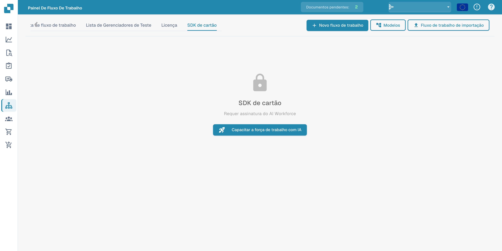

# Card SDK

O **Card SDK** permite que parceiros e programadores criem cartões de fluxo de trabalho personalizados para o DocFlow. Empacote um cartão como uma aplicação de parceiro e carregue-o, ou importe-o diretamente do GitHub.

<figure><figcaption>
Card SDK com indicação da subscrição AI Workforce necessária.
</figcaption></figure>

## Como funciona

- **Baixar modelo do SDK** — comece a partir do modelo oficial que contém a estrutura esperada.
- **Enviar arquivo ZIP** — o ZIP tem de conter `app.json` e uma pasta `.docflowcompose/flow/` com as definições dos cartões (máximo 10 MB). Upload &#x26; Validate verifica o pacote antes de ele ser aceite.
- **Importação do GitHub** — importe uma definição de cartão diretamente de um repositório GitHub.
- **Submissões** — acompanhe o estado dos cartões que submeteu.

Depois de validados e aceites, os seus cartões personalizados aparecem na biblioteca **Adicionar cartão** juntamente com os cartões integrados.
