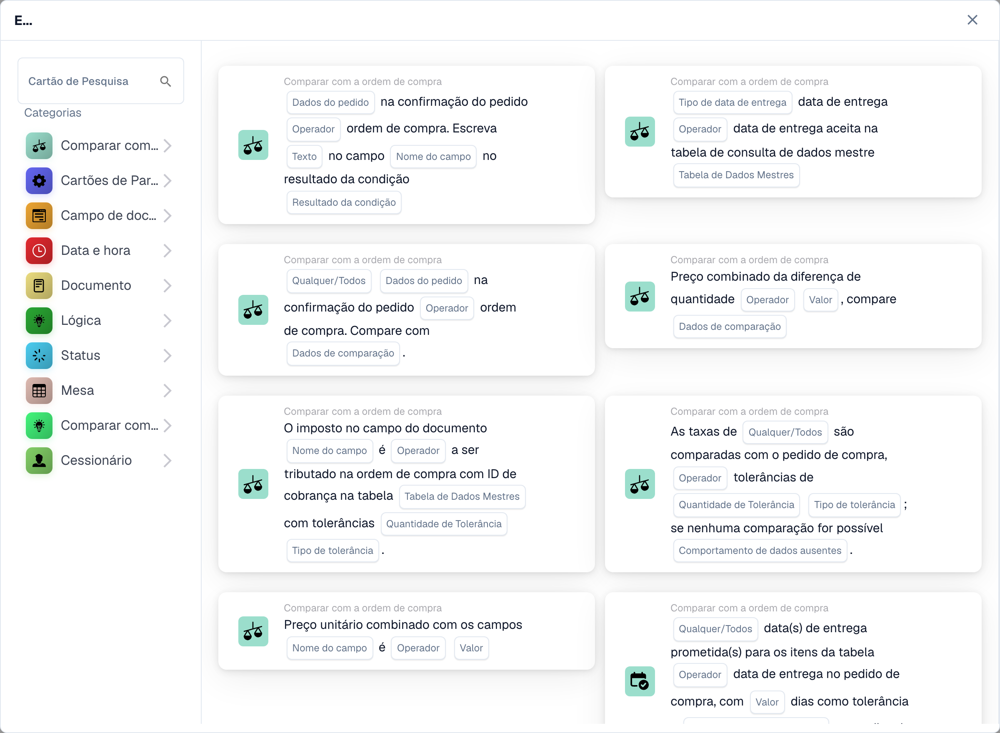

# Cartões

Os cartões são os blocos de construção de todo fluxo de trabalho. Você os combina nos grupos **Quando / E / Então** para descrever quando um fluxo de trabalho é executado e o que ele faz. Esta seção explica os cartões disponíveis e o que cada um faz.

<figure><figcaption>
Cartões disponíveis na categoria selecionada. Configure os campos antes de utilizar. Algumas etiquetas desta versão da interface ainda não estão traduzidas ou têm uma tradução incorreta. As explicações desta página usam os termos corretos; a imagem mostra a interface real.
</figcaption></figure>

## Grupos de cartões

* **Quando** — os cartões acionadores que iniciam um fluxo de trabalho (por exemplo, tipo de documento, tipo de documento um dos).
* **E** — cartas de condição que também devem ser verdadeiras antes da execução das ações. Isso inclui _Comparar com pedido de compra_ (correspondência de pedido de compra), comparações de _Campo de documento_, condições de _Data e hora_, _Lógica_, _Status_, _Tabela_ e _Assignee_.
* **Então** — cartões de ação que fazem o trabalho: definir campos, aprovar/rejeitar, alterar status, exportar, criar tarefas, atribuir documentos, manipular tabelas e executar ações (chamar API, enviar solicitação HTTPS, executar fluxo de trabalho, cálculos de IA).

## Guias de referência de cartões

Para uma referência completa de cada cartão e suas opções, consulte as páginas do _guia completo_ nesta seção (Cartões de Condição, Cartões de Correspondência de PO, Cartões de Atribuição e Usuário, Cartões de Tarefa, Cartões de Campo e Tabela e os cartões de Ação).

## Combinando cartas

Para ver combinações comprovadas de cartões que resolvem cenários de negócios comuns, consulte os **Guias de padrões de fluxo de trabalho**.

[Cartões lógicos: referência completa](cards-overview/logic-cards-guide.md).
