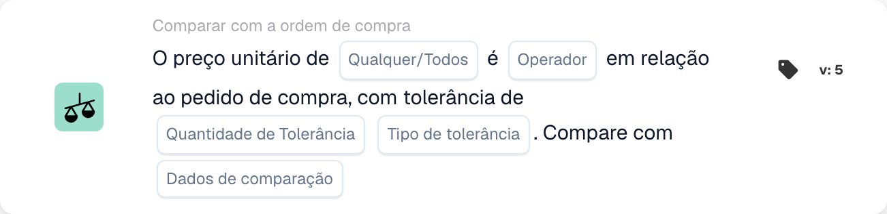

# Versões e disponibilidade do cartão

<figure><figcaption>
Campos do cartão na versão apresentada. Os campos ainda não estão configurados.
</figcaption></figure>

Um cartão em um fluxo de trabalho salvo mantém o ID e a versão do cartão. Um modelo mais recente pode adicionar campos ou alterar comportamento sem alterar todos os fluxos de trabalho salvos anteriormente. Verifique a versão no cartão real antes de aplicar as instruções para uma versão mais recente.

## Antes de alterar um cartão salvo

1. Registre seus campos e o resultado atual em dados de teste representativos.
2. Compare sua versão com a referência, incluindo padrões e comportamento de dados ausentes.
3. Atualize ou substitua a placa somente por meio da ação do construtor compatível e revise suas configurações novamente.
4. Valide o gráfico e teste casos de aprovação, falha e dados ausentes antes de ativar o fluxo de trabalho alterado.

Não edite um tipo de cartão técnico armazenado apenas para corrigir sua ortografia. Os fluxos de trabalho existentes podem depender desse identificador. Uma versão não suportada é um erro de execução, não uma falsa condição comercial.

## Se um cartão documentado estiver ausente

Verifique o grupo Quando, E ou Então selecionado, categoria, construtor Padrão versus Avançado, módulos ativados, permissões e versão implementada com seu administrador. Um cartão mencionado em uma integração técnica ou referência mais recente não está necessariamente habilitado para sua organização. Não crie ou importe uma definição de cartão adivinhada para contornar um modelo ausente.

As condições adicionais do calendário descritas em alguns materiais de desenvolvimento não são um conjunto selecionável confirmado em todas as versões. O configurador de variável de documento também é implementado sem um modelo de UI geralmente propagado. Utilize os cartões efetivamente disponíveis em seu ambiente e solicite esclarecimentos antes de depender de algum indisponível.

## Referências que dependem da versão

- [Cartões de exportação](export-cards-guide.md): status do resultado e exportação imediata versus em fila.
- [Cartões de comparação PO](po-comparison-versions-guide.md): direção de comparação e base de tolerância.
- [Cartões de comparação de cotações](quote-comparison-guide.md): Qualquer/Todos e preços comparáveis ausentes.
- [Cartões lógicos](logic-cards-guide.md): tags, variáveis de organização e tipos de entrada.

Use [Logs de fluxo de trabalho](../workflow-logs.md) para distinguir sucesso, uma condição falsa, dados ausentes, um erro de configuração e um cartão ignorado. Registre o estado do documento e as configurações do cartão com um resultado de teste; uma captura de tela do seletor de cartões por si só não estabelece o comportamento do tempo de execução.
