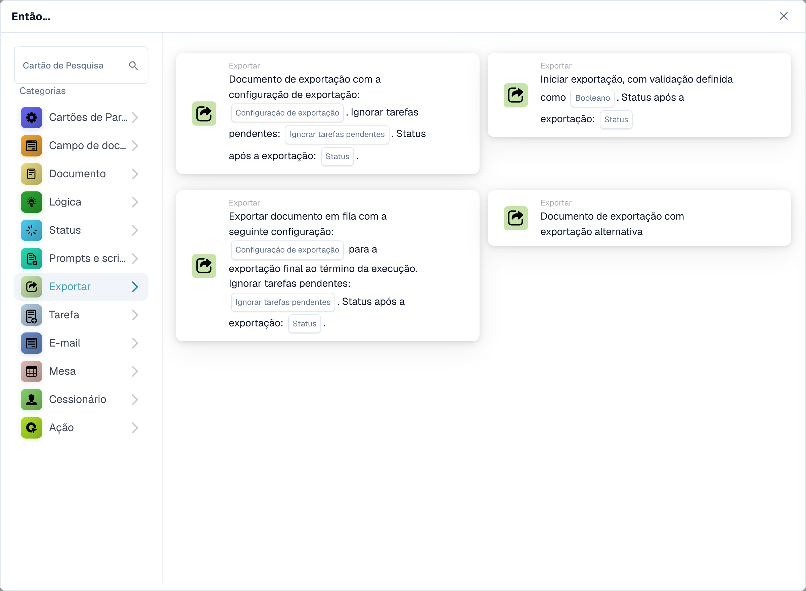

# Cartões de exportação de fluxo de trabalho e status do documento

<figure><figcaption>
Cartões disponíveis na categoria selecionada. Configure os campos antes de utilizar. Algumas etiquetas desta versão da interface ainda não estão traduzidas ou têm uma tradução incorreta. As explicações desta página usam os termos corretos; a imagem mostra a interface real.
</figcaption></figure>

Escolha se deseja exportar imediatamente ou enfileirar uma configuração para a exportação final no final da execução. Essas escolhas são separadas do status que o documento deverá ter após uma exportação bem-sucedida.

| Cartão | Quando a exportação é executada | Configurações importantes |
| --- | --- | --- |
| Iniciar exportação com validação (`EXPORT`) | Inicia a exportação usando as configurações de exportação definidas no documento. | Validação e, a partir da v4, Status após exportação. |
| Exportar com configuração de exportação (`ACTION_EXPORT_WITH`) | Exporta utilizando a configuração selecionada durante a execução do cartão. | Configuração de exportação, Ignorar tarefas pendentes e, a partir da v3, Status após exportação. |
| Exportação de fila com configuração (`ACTION_EXPORT_WITH_CONFIG_DEFERRED`) | Coleta a configuração para a exportação final no final da execução. Adicionar uma solicitação de exportação à fila não prova que a exportação final foi bem-sucedida. | Configuração de exportação, Ignorar tarefas pendentes e, a partir da v3, Status após exportação. |
| Exportação Alternativa (`ACTION_ALTERNATE_EXPORT`) | Usa a rota de exportação alternativa documentada em seu cartão. | Não presuma que ele tenha a mesma versão ou opções de status dos três cartões acima. |

## Status após exportação

| Valor | Significado após uma exportação bem-sucedida | Uso típico |
| --- | --- | --- |
| `finished` | Exportado e fechado. | O processamento foi concluído. |
| `exported` | Exportado, mas permanece aberto para processamento posterior. | A aprovação ou outro fluxo de trabalho ainda precisa ser seguido. |

Iniciar Exportação v4, Exportar com Configuração de Exportação v3 e Exportar na fila v3 oferecem esta seleção. Versões anteriores mantêm `finished`. Uma seleção ausente volta para `finished` e é registrada; um valor inválido é rejeitado antes da exportação. Um cartão antigo salvo não adquire o novo comportamento apenas porque existe uma nova versão do modelo. Inspecione a versão do cartão e teste novamente qualquer atualização explícita.

As condições de status do documento e Mudança de Status também oferecem `exported` em releases contendo a atualização de status correspondente. A alteração do status por si só não realiza uma exportação. Use o resultado e os registros da exportação para estabelecer se os dados realmente chegaram ao seu destino.

## Exportação imediata com configuração

1. Adicione o cartão em Então e selecione uma configuração de exportação válida.
2. Escolha se deseja ignorar as tarefas pendentes. Mantenha esta opção desligada se as tarefas precisarem bloquear a exportação.
3. Na v3, selecione `finished` ou `exported` deliberadamente.
4. Teste com um documento em status de processamento permitido e, em seguida, inspecione o resultado e o destino do cartão.

Se as tarefas pendentes impedirem a exportação, o cartão regista uma exportação recusada. Resolva as tarefas e organize o gatilho de fluxo de trabalho pretendido ou tente novamente. Este cartão não promete esperar e retomar automaticamente. O tempo limite também não prova que o sistema remoto não fez nada; inspecione o histórico de exportação antes de repetir uma operação que possa criar duplicatas.

## Exportação de fila com configuração

Adicione este cartão quando a exportação for coletada para a etapa final da execução. Selecione a configuração, a política de tarefas pendentes e o status do resultado. O cartão registra a configuração solicitada; inspecionar o resultado final da exportação separadamente. A mensagem de confirmação da solicitação na fila não é uma confirmação de um lançamento contábil.

Por exemplo, selecione `exported` quando uma exportação bem-sucedida deve deixar o documento disponível para aprovação posterior. Selecione `finished` quando nenhum processamento adicional for necessário. Verifique novamente o estado final, bem como o destino da exportação.

## Verificações necessárias

Teste uma configuração válida, uma configuração ausente, tarefas pendentes com ambas as configurações e ambos os status de resultados. Teste a versão já utilizada em um fluxo de trabalho existente antes de alterá-la. Para uma exportação em fila verifique a execução final; para uma exportação imediata verifique seu próprio resultado. Revise [Logs de fluxo de trabalho](../workflow-logs.md) e não confunda um cartão ignorado com sucesso.

<!-- workflow-card-complete-example-20261021 action_export_with_config_deferred -->

### Exemplo de exportação diferida

**Configuração:** Na v3, escolha a configuração de teste `DEMO_EXPORT`, deixe Ignorar tarefas pendentes desativada e selecione `exported` como o status após a exportação. Coloque o cartão na rota validada pretendida.

**Resultado esperado e contraexemplo:** O cartão coleta uma solicitação de exportação para o final da execução do workflow. Somente a execução final bem-sucedida estabelece que o destino recebeu os dados e que o documento permanece aberto como `exported`. O sucesso de um cartão na fila por si só não prova a exportação; uma tarefa de bloqueio não resolvida não deve ser tratada como entrega.

Esta é uma configuração de teste ilustrativa e resultado esperado; não foi executado. Use dados e destinatários configurados na sua organização de teste.
