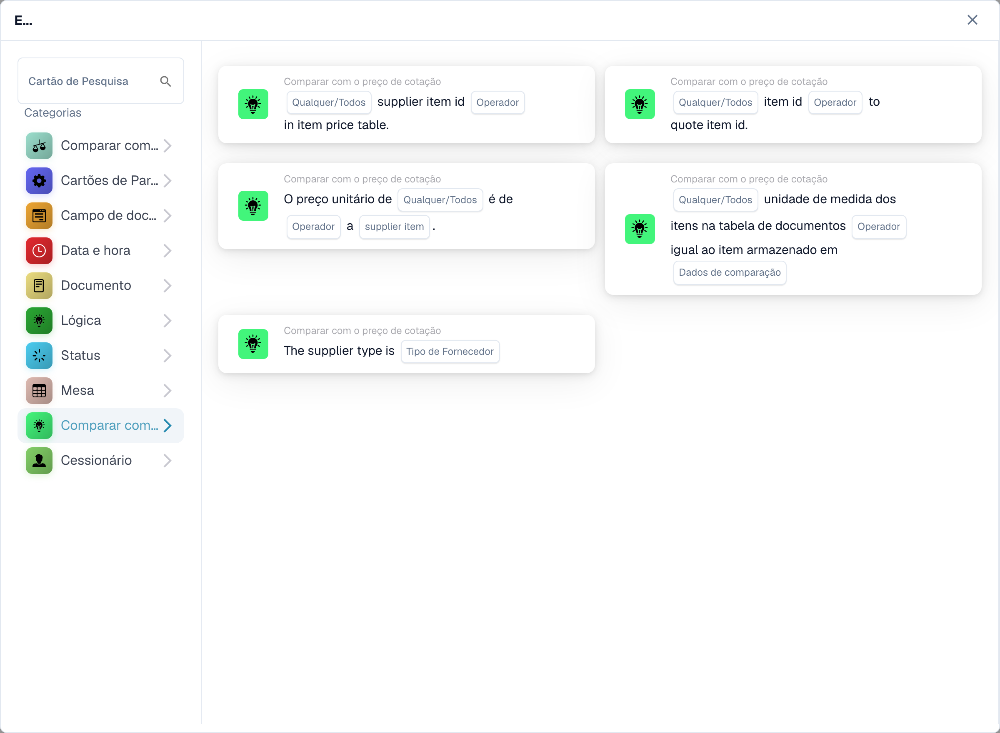

# Cartões de comparação de cotações

<figure><figcaption>
Cartões disponíveis na categoria selecionada. Configure os campos antes de utilizar. Algumas etiquetas desta versão da interface ainda não estão traduzidas ou têm uma tradução incorreta. As explicações desta página usam os termos corretos; a imagem mostra a interface real.
</figcaption></figure>

Estas condições E usam os dados de cotação ou item do fornecedor disponíveis no documento. Configure e teste-os depois que os dados de cotação necessários forem carregados. Um identificador de item correspondente não prova, por si só, que seu preço ou unidade de medida esteja correto.

## Selecione o cheque

| Tipo de cartão | Verificação e configuração |
| --- | --- |
| `CONDITION_QUOTES_ITEM_NUMBER_COMPARISON` | Verifica o identificador do item em relação aos dados de preço do item. Selecione os campos de comparação e Qualquer/Todos oferecidos pelo cartão. |
| `CONDITION_SPECIFY_SUPPLIER_TYPE` | Compara o tipo de fornecedor dos dados da cotação com `supplier_type`. Esta é uma verificação de classificação de fornecedor, não uma comparação de preços. |
| `CONDITION_QUOTE_SUPPLIER_ITEM_NUMBER_EXISTS` | Verifica se o ID do item do fornecedor está ou não presente nos dados de preço do item; escolha o operador e Qualquer/Todos. Dados de cotação ou item ausentes devem ser investigados no log. |
| `CONDITION_QUOTE_PRICE_MATCH` | Compara um preço unitário com o preço do fornecedor selecionado: `ManagedPrice` ou `LastPrice`. Escolha Qualquer/Todos e o operador de comparação numérico. As linhas sem um número comparável em ambos os lados são ignoradas e registradas; se nenhuma linha for comparável, o cartão reporta dados faltantes do documento. |
| `CONDIITON_UNIT_OF_MEASURE_EQUAL` | Verifica a unidade de medida em relação aos dados relacionados. O tipo técnico contém um erro ortográfico retido; não o altere no JSON do fluxo de trabalho armazenado. Um preço expresso por unidades diferentes necessita de atenção especial. |
| `CONDITION_ITEM_QUOTES_TO_CONTRACTED_PRICE` | Compara preços cotados e contratados. A versão 3 adiciona Qualquer/Todos; Veja abaixo. |

Os rótulos visíveis podem variar de acordo com a versão e o idioma da interface do usuário. Selecione pela verificação real, não apenas pelo nome da categoria. Por exemplo, Preço do item cotado pode aparecer em Lógica, enquanto as outras verificações de cotação aparecem em Comparar com preço de cotação.

## Preço do item cotado: versão 3

Escolha o operador de igualdade ou desigualdade e se qualquer reta comparada ou toda reta comparada deve satisfazê-lo:

- `match_any`: uma linha comparável bem-sucedida é suficiente.
- `match_all`: toda linha comparada deve satisfazer o operador selecionado.

A versão 2 mantém o comportamento Todos. Uma configuração Qualquer/Todos não definida na v3 volta para Todos e é registrada. Um cartão sem linhas comparáveis ​​reporta dados faltantes; a ausência de preço não é prova de igualdade ou desigualdade. Inspecione as linhas ignoradas e o lado ausente no log.

Por exemplo, duas linhas comparáveis produzem resultados verdadeiros e falsos para igualdade. Qualquer passe; Tudo falha. Com a desigualdade, o resultado da comparação para cada linha muda primeiro e Qualquer/Todos combina esses resultados. Ele não inverte o resultado final de All para implementar Any.

## Casos de teste

Use IDs exatos de item e fornecedor, a fonte de preço pretendida e unidades correspondentes. Teste todas as linhas correspondentes, um resultado misto, sem preços comparáveis, dados de cotação ausentes e um ID de fornecedor errado. Verifique o resultado da comparação e quais linhas foram ignoradas. Mantenha a aprovação ou exportação atrás das verificações comerciais que são realmente necessárias; uma verificação de identificador bem-sucedida não é uma validação completa da aquisição.

Consulte [Correspondência de PO](../and/compare-with-purchase-order/po-matching-complete-guide.md) para comparações de pedidos de compra e [Registros de fluxo de trabalho](../workflow-logs.md) para solução de problemas.

<!-- workflow-card-complete-example-20261021 condition_quotes_item_number_comparison -->

### Exemplo de comparação de número de item

**Configuração:** Prepare duas linhas de cotação comparáveis: o item do fornecedor `DEMO-S1` é mapeado para o item `DEMO-I1` em ambos os lados; o item do fornecedor `DEMO-S2` possui o item de documento `DEMO-I2` e o item de matriz `DEMO-I9`. Escolha igualdade e `match_all`.

**Resultado esperado e contra-exemplo:** O resultado da condição é falso com `match_all`, porque um número de item comparável é diferente. O resultado é verdadeiro com `match_any`, porque o primeiro número do item corresponde. A pesquisa usa o número do item do fornecedor. Uma entrada de matriz sem número de item é ignorada e registrada; se nenhuma linha for comparável, o resultado da condição será falso. Um registro de intervalo de datas por si só não é uma condição de validade separada.

Esta é uma configuração de teste ilustrativa e resultado esperado; não foi executado. Use dados e destinatários configurados na sua organização de teste.

<!-- workflow-card-complete-example-20261021 condition_quote_supplier_item_number_exists -->

### Exemplo de existência de item de fornecedor

**Configuração:** O documento possui os números de item do fornecedor `DEMO-S1` e `DEMO-S2`; os dados de preço do item do fornecedor carregados contêm apenas `DEMO-S1`. Escolha o operador de presença e `match_all`.

**Resultado esperado e contra-exemplo:** O resultado da condição é falso com `match_all` e verdadeiro com `match_any`. Com o operador de ausência, a segunda linha é um resultado de ausência positivo. A existência não prova que o preço do item, a classificação da unidade ou do fornecedor estejam corretos. Carregue primeiro os dados de cotação válidos e inspecione os erros de dados ausentes.

Esta é uma configuração de teste ilustrativa e resultado esperado; não foi executado. Use dados e destinatários configurados na sua organização de teste.

<!-- workflow-card-complete-example-20261021 condition_quote_price_match -->

### Exemplo de preço do fornecedor

**Configuração:** Para duas linhas casadas escolha `ManagedPrice`, igualdade e `match_all`. Os preços dos documentos são `10` e `12`; os preços gerenciados correspondentes são `10` e `13`, em moedas e unidades correspondentes.

**Resultado esperado e contra-exemplo:** O resultado da condição é falso com `match_all` e verdadeiro com `match_any`. Mudar para `LastPrice` usa uma fonte diferente e deve ser testado de forma independente. Uma linha sem um preço numérico comparável é ignorada e registrada; se nenhuma linha for comparável, o cartão reporta dados faltantes do documento, e não igualdade.

Esta é uma configuração de teste ilustrativa e resultado esperado; não foi executado. Use dados e destinatários configurados na sua organização de teste.

<!-- workflow-card-complete-example-20261021 condition_specify_supplier_type -->

### Exemplo de classificação de fornecedor

**Configuração:** Escolha o tipo de fornecedor `Contract`. Prepare duas entradas de fornecedor de cotação carregadas com `managed_class` igual a `contract`.

**Resultado esperado e contra-exemplo:** A condição é verdadeira quando toda entrada carregada possui essa classificação. A condição é falsa se uma entrada tiver classificação `managed`. O valor `Nonmanaged` selecionável é normalizado para `unmanaged` pelo backend. Esta classificação não está relacionada com a forma jurídica do fornecedor. Os dados de cotação ausentes não correspondem.

Esta é uma configuração de teste ilustrativa e resultado esperado; não foi executado. Use dados e destinatários configurados na sua organização de teste.

<!-- workflow-card-complete-example-20261021 condiiton_unit_of_measure_equal -->

### Exemplo de unidade de medida

**Configuração:** Prepare linhas de cotação associadas com a unidade do documento `EA` e a unidade de comparação do fornecedor `EA`. Selecione igualdade e `match_all`. Mantenha a versão do cartão que pretende testar.

**Resultado esperado e contra-exemplo:** A condição é verdadeira para combinar unidades comparáveis; uma segunda linha comparável usando `KG` em vez de `EA` torna a condição falsa com `match_all`. As unidades de comparação ausentes são ignoradas e registradas; se nenhum for comparável, o cartão reportará dados faltantes. A versão 3 pode aplicar o mapeamento de unidade configurado, portanto verifique esse mapeamento separadamente. A correspondência de preços por si só não estabelece unidades de correspondência.

Esta é uma configuração de teste ilustrativa e resultado esperado; não foi executado. Use dados e destinatários configurados na sua organização de teste.
