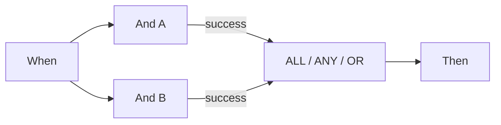

# P0: ligar corretamente Wait ALL, Wait ANY e OR

ALL exige uma saída ligada correspondente de **cada origem distinta**. ANY e OR precisam de pelo menos uma origem correspondente. Ligar verde e laranja da mesma origem continua a contar uma única vez. OR não cria uma bifurcação exclusiva nem cancela outras ações. ANY também não garante que o ramo mais rápido vença.

O escalonador analisado espera primeiro por todos os predecessores de entrada. Se um ramo não escolhido deixar um predecessor inacessível, a execução normal ignora a junção bloqueada. O modo de teste pode avaliá-la com os resultados disponíveis. **Um teste parcial verde não prova que uma execução documental prossiga pelo mesmo grafo.**

Para duas verificações obrigatórias, execute ambas e ligue as saídas necessárias a ALL. Para percursos alternativos nesta versão, use a ação Then final comum do caso v2. Essa convergência aplica-se a percursos mutuamente exclusivos; não é uma barreira para várias ações simultâneas.

Verifique separadamente origem, saída ligada, saída escolhida e acessibilidade efetiva. Um erro na origem continua a ser erro global mesmo que ANY/OR tenha sucesso depois. No código analisado, um ALL não satisfeito também inclui um detalhe de erro; a cor laranja, por si só, não basta.

## Cartões e parâmetros de exemplo

Os valores descrevem parâmetros de cartões, não um workflow completo importável. Substitua YOUR_* por seleções próprias de teste. O designer gere o ID oculto do chamador. Catálogo: Dev, DocFlow 2.10.38, 21 de outubro de 2026; confirme versões e permissões da organização.

`node_type`: `all`, `any`, `or`

## Casos de teste de negócio

| Caso | Entrada / configuração | Resultado esperado |
| --- | --- | --- |
| MERGE-01 | A=success; B=success | ALL/ANY/OR: join=success |
| MERGE-02 | A=success; B=failed_condition; B→failed_condition: — | ALL: join=failed_condition, workflow=error; ANY/OR: join=success, workflow=failed_condition |
| MERGE-03 | A=success; B=error | ANY/OR: join=success; workflow=error |
| MERGE-04 | A=success; B=não alcançado | teste: avaliar; escalonador: ignorar |
| MERGE-05 | A→success + A→failed_condition; B→success | sources=2 |

## Provas e limites

Resultados selecionados de cartões e nós foram verificados com dados sintéticos em Advanced Test. As respostas estão no pacote. As ações documentais são simuladas e não provam execução persistida nem entrega externa.

[Continuar a aprender](../workflow-learning-path.md) · [Pacote de formação](../workflow-training-kit.md)
