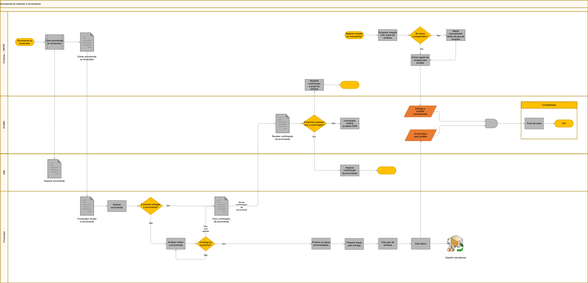

# Fluxo de encomenda e processamento de materiais

Este documento descreve o fluxo de trabalho para encomendar materiais a fornecedores, rececionar mercadorias e processar faturas, com integração entre os fornecedores, o sistema INFOR ERP e o DocBits para gestão de documentos.

### Visão geral do processo

1. **Ordering Materials**
   * Iniciar a encomenda junto do fornecedor.
   * Enviar a encomenda ao fornecedor através do INFOR.
2. **Receção da confirmação do pedido**
   * O fornecedor confirma a receção da encomenda.
   * Criação e envio da confirmação da encomenda.
3. **Receção e inspeção das mercadorias**
   * Rececionar as mercadorias do fornecedor.
   * Registar a receção das mercadorias no INFOR e confrontar com a guia de entrega.
4. **Processamento da fatura**
   * Rececionar a fatura e enviá-la para o DocBits para processamento.
   * Verificar e confirmar os detalhes da fatura com a encomenda e a receção das mercadorias.
5. **Passos finais**
   * Arquivar a encomenda e os documentos relacionados no DocBits.
   * Atualizar o INFOR com os detalhes da transação para a contabilidade financeira.

### Pontos de decisão e ações

* **As mercadorias rececionadas correspondem à encomenda?**
  * Sim: Prosseguir com o processamento da fatura.
  * Não: É necessária uma verificação e atualização manual.
* **A fatura está correta de acordo com as mercadorias rececionadas e os detalhes da encomenda?**
  * Sim: Concluir a transação e atualizar os registos financeiros.
  * Não: São necessárias análise e correções adicionais.

### Pontos de integração

* **INFOR ERP**: Sistema principal para o processamento de encomendas, a receção de mercadorias e a contabilidade financeira.
* **DocBits**: Gestão de documentos para o processamento e o arquivo de faturas e confirmações de encomenda.

### Notas

* Garanta que todos os documentos são verificados e arquivados para efeitos de arquivo.
* As discrepâncias nos detalhes da encomenda ou da fatura devem ser resolvidas prontamente para evitar atrasos.

<figure><figcaption>
Exemplo de fluxo de encomendas de materiais, confirmações, receções de mercadorias e faturas entre fornecedor, compras, IDM, DocBits e contabilidade. Adapte as verificações e as integrações à sua configuração.
</figcaption></figure>
