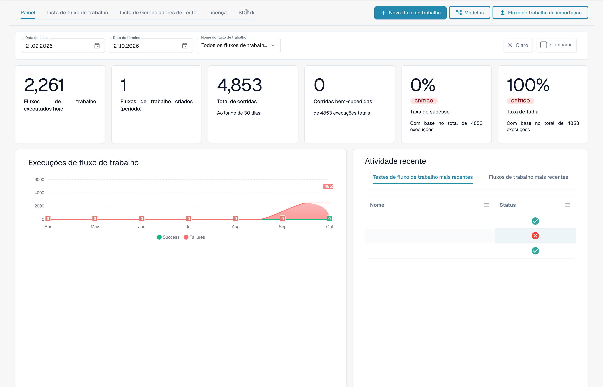
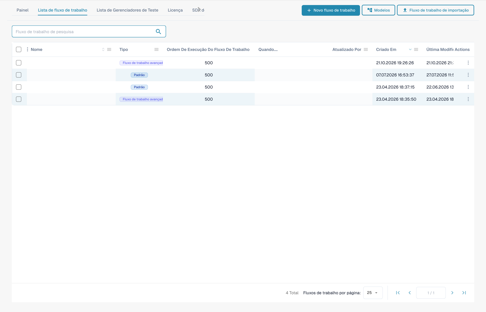

# Guias de padrões de fluxo de trabalho

**Versão:** 1.0 **Última atualização:** 23 de outubro de 2025

***

## Visão geral

Este diretório contém guias abrangentes de padrões de fluxo de trabalho que demonstram como combinar vários cartões de fluxo de trabalho para resolver cenários comerciais comuns. Cada padrão fornece instruções de implementação passo a passo, exemplos completos e práticas recomendadas.

**O que são padrões de fluxo de trabalho?**

Os padrões de fluxo de trabalho são soluções comprovadas e reutilizáveis para desafios comuns de processamento de documentação. Em vez de começar do zero, você pode usar esses padrões como modelos e adaptá-los às suas necessidades específicas.

***

## Visão geral do criador de fluxo de trabalho

Cada padrão nesta página é montado no **Construtor de fluxo de trabalho**. Você pode acessá-lo em **Painel de fluxo de trabalho → Lista de fluxo de trabalho → Adicionar fluxo de trabalho** (ou abrindo um fluxo de trabalho existente). O painel fornece o histórico de execução e as taxas de sucesso/falha de todos os seus fluxos de trabalho:

<figure><figcaption><p>O Workflow Dashboard — totais de execuções, taxas de sucesso/falha e atividade recente de cada workflow. Os nomes e as referências confidenciais de documentos estão ocultos.</p></figcaption></figure>

A guia **Lista de fluxo de trabalho** lista cada fluxo de trabalho com seu tipo, ordem de execução e gatilho. Use **Adicionar fluxo de trabalho** para criar um novo ou clique em um fluxo de trabalho para abri-lo no construtor:

<figure><figcaption><p>A Workflow List — cada linha é um workflow que você pode abrir, ativar/desativar ou editar. Os nomes e as referências confidenciais de documentos estão ocultos.</p></figcaption></figure>

Um fluxo de trabalho inclui três grupos de cartões: **Quando** (acionador), **E** (condições adicionais) e **Então** (ações). O exemplo não guardado mostra esta estrutura. O tipo de documento, a suborganização e o utilizador ainda precisam de ser selecionados:

<figure><figcaption><p>Exemplo não guardado com cartões Quando, E e Então. Configure todos os campos antes da execução. Algumas etiquetas desta versão da interface ainda não estão traduzidas ou têm uma tradução incorreta. As explicações desta página usam os termos corretos; a imagem mostra a interface real.</p></figcaption></figure>

Clique em **Adicionar cartão** em qualquer grupo para abrir a biblioteca de cartões. Os cartões são organizados por categoria (comparar com pedido de compra, cartões de parceiro, campo de documento, data e hora, documento, lógica, status, tabela, responsável, …) para que você possa encontrar o bloco de construção que cada padrão exige:

<figure><figcaption><p>Cartões disponíveis na categoria selecionada. Configure os campos antes de utilizar. Algumas etiquetas desta versão da interface ainda não estão traduzidas ou têm uma tradução incorreta. As explicações desta página usam os termos corretos; a imagem mostra a interface real.</p></figcaption></figure>

***

## Padrões Disponíveis

### 1. [Padrão de Integração API](api-integration-pattern.md)

**Complexidade:** Médio | **Tempo de configuração:** 45-60 minutos

Aprenda como integrar DocBits com APIs externas para buscar, validar e armazenar dados de sistemas externos.

**Casos de uso:**

* Obtenha preços em tempo real de sistemas externos
* Valide as informações do fornecedor em bancos de dados mestres
* Procure detalhes do produto em sistemas de catálogo
* Obtenha taxas de câmbio de serviços monetários
* Verifique endereços com serviços de geocodificação

**Cartões usados:** CALL\_API, CONDITION\_HTTPS\_REQUEST\_STATUS, ACTION\_SET\_FIELD\_TO\_TEXT, CONDITION\_COMPARE\_TWO\_DOCFIELD\_VALUES

[**Ver padrão completo →**](api-integration-pattern.md)

***

### 2. [Padrão de gerenciamento de tarefas](task-management-pattern.md)

**Complexidade:** Baixa-Média | **Tempo de configuração:** 30-45 minutos

Domine a arte de criar, atribuir, rastrear e gerenciar tarefas nos fluxos de trabalho DocBits para processos de aprovação e revisão.

**Casos de uso:**

* Crie fluxos de trabalho de aprovação
* Atribuir tarefas de revisão aos usuários
* Lidar com exceções que requerem intervenção humana
* Encaminhar problemas aos gerentes
* Crie cadeias de aprovação em vários níveis
* Acompanhe a conclusão das tarefas e os prazos

**Cartões usados:** tasks\_create, ACTION\_ASSIGN\_TO\_USER, ACTION\_SEND\_EMAIL\_TO\_GROUPS, CONDITION\_TASK\_STATUS

[**Ver padrão completo →**](task-management-pattern.md)

***

### 3. [Padrão de correspondência PO](po-matching-pattern.md)

**Complexidade:** Médio-Alto | **Tempo de configuração:** 60-90 minutos

Implemente fluxos de trabalho abrangentes de correspondência de pedidos de compra para validar faturas em relação a pedidos de compra com roteamento baseado em tolerância.

**Casos de uso:**

* Validar faturas em relação a pedidos de compra
* Detecte erros de preços antes do pagamento
* Identifique discrepâncias de quantidade
* Aplicar controles de aquisição
* Evite pagamentos duplicados
* Automatize a correspondência de três vias

**Cartões usados:** PURCHASE\_ORDER\_FULL\_MATCH, CONDITION\_DOC\_TO\_PO\_UNIT\_PRICE, CONDITION\_DOC\_TO\_PO\_QUANTITY, CONDITION\_DOC\_TO\_PO\_TAX\_LINES

[**Ver padrão completo →**](po-matching-pattern.md)

***

### 4. [Padrão Lógico de Decisão](decision-logic-pattern.md)

**Complexidade:** Médio | **Tempo de configuração:** 30-45 minutos

Implemente árvores de decisão complexas e lógica de roteamento condicional para processar documentos por diferentes caminhos com base em regras de negócios.

**Casos de uso:**

* Encaminhar documentos por limites de valor
* Aplicar regras diferentes para diferentes tipos de documentos
* Implementar lógica de aprovação multinível
* Lidar com políticas de negócios complexas
* Crie roteamento dinâmico com base em vários critérios
* Implementar matrizes de aprovação

**Cartões usados:** CONDITION\_DOC\_FIELD\_AMOUNT, CONDITION\_DOC\_TYPE\_IS\_ISNOT, CONDITION\_SUPPLIER\_STATUS\_IS\_ISNOT, ACTION\_ASSIGN\_TO\_USER

[**Ver padrão completo →**](decision-logic-pattern.md)

***

### 5. [Padrão de transformação de dados](data-transformation-pattern.md)

**Complexidade:** Médio | **Tempo de configuração:** 30-45 minutos

Transforme, calcule, formate e enriqueça dados de documentos para prepará-los para exportação, realizar cálculos e padronizar formatos.

**Casos de uso:**

* Calcular totais, subtotais, impostos
* Converta moedas ou unidades
* Formatar datas, números, texto
* Derive valores de campos existentes
* Enriqueça os dados de fontes externas
* Padronize formatos de dados
* Validar cálculos

**Cartões usados:** ACTION\_CALCULATE\_FIELD, ACTION\_SET\_FIELD\_TO\_TEXT, ACTION\_COPY\_FIELD\_VALUE, CALL\_API, CONDITION\_COMPARE\_TWO\_DOCFIELD\_VALUES

[**Ver padrão completo →**](data-transformation-pattern.md)

***

## Guia de seleção de padrões

### Por Complexidade

| Complexidade      | Padrões                                                                                                                                                                                      | Melhor para                               |
| --------------- | --------------------------------------------------------------------------------------------------------------------------------------------------------------------------------------------- | -------------------------------------- |
| **Baixo-Médio**  | [Gerenciamento de Tarefas](task-management-pattern.md)                                                                                                                                                 | Iniciantes, fluxos de trabalho simples            |
| **Médio**      | <p><a href="api-integration-pattern.md">Integração API</a><br><a href="decision-logic-pattern.md">Lógica de Decisão</a><br><a href="data-transformation-pattern.md">Transformação de Dados</a></p> | Usuários intermediários, fluxos de trabalho padrão |
| **Médio-Alto** | [Correspondência PO](po-matching-pattern.md)                                                                                                                                                         | Usuários avançados, validação complexa     |

***

### Por caso de uso

| Eu preciso...                     | Use este padrão                                              |
| -------------------------------- | ------------------------------------------------------------- |
| Integrar com sistemas externos  | [Padrão de Integração API](api-integration-pattern.md)         |
| Crie fluxos de trabalho de aprovação        | [Padrão de gerenciamento de tarefas](task-management-pattern.md)         |
| Validar em relação a pedidos de compra | [Padrão de correspondência PO](po-matching-pattern.md)                 |
| Rota com base nas condições        | [Padrão Lógico de Decisão](decision-logic-pattern.md)           |
| Calcular e transformar dados     | [Padrão de transformação de dados](data-transformation-pattern.md) |

***

### Por Indústria/Departamento

| Indústria/Departamento    | Padrões Recomendados                                                                                                                        |
| ---------------------- | ------------------------------------------------------------------------------------------------------------------------------------------- |
| **Finanças/Contabilidade** | [Correspondência de PO](po-matching-pattern.md), [Gerenciamento de Tarefas](task-management-pattern.md), [Transformação de Dados](data-transformation-pattern.md) |
| **Aquisições**        | [Correspondência de PO](po-matching-pattern.md), [Lógica de decisão](decision-logic-pattern.md), [Integração de API](api-integration-pattern.md)           |
| **Operações**         | [Gerenciamento de Tarefas](task-management-pattern.md), [Lógica de Decisão](decision-logic-pattern.md)                                                  |
| **TI/Integração**     | [Integração de API](api-integration-pattern.md), [Transformação de Dados](data-transformation-pattern.md)                                        |
| **Todos os Departamentos**    | [Lógica de Decisão](decision-logic-pattern.md), [Gerenciamento de Tarefas](task-management-pattern.md)                                                  |

***

## Como usar esses padrões

### Etapa 1: escolha um padrão

1. Revise as descrições dos padrões acima
2. Identifique qual padrão corresponde ao seu caso de uso
3. Verifique a complexidade e o tempo estimado de configuração
4. Revise a seção "Quando usar" no guia de padrões

### Etapa 2: revisar os pré-requisitos

Cada guia de padrão lista:

* Conhecimento necessário
* Guias relacionados para ler primeiro
* Cartões que serão usados
* Requisitos de configuração

### Etapa 3: siga as instruções passo a passo

Cada padrão fornece:

* Exemplo completo de fluxo de trabalho
* Guia de implementação passo a passo
* Modelos de configuração
* Exemplos do mundo real
* Dicas para solução de problemas

### Etapa 4: personalize de acordo com suas necessidades

* Adapte o exemplo às suas regras de negócios
* Ajuste limites e tolerâncias
* Modificar lógica de roteamento
* Adicione/remova etapas conforme necessário
* Teste minuciosamente antes do uso em produção

### Etapa 5: monitorar e otimizar

* Acompanhe o desempenho do fluxo de trabalho
* Monitore as taxas de sucesso
* Colete feedback do usuário
* Refinar configuração
* Personalizações de documentos

***

## Combinações de padrões

Muitos cenários do mundo real exigem a combinação de vários padrões:

### Exemplo 1: Processamento completo de fatura

```
1. API Integration Pattern → Fetch current pricing
2. Data Transformation Pattern → Calculate totals
3. PO Matching Pattern → Validate against PO
4. Decision Logic Pattern → Route based on variance
5. Task Management Pattern → Create approval tasks
```

### Exemplo 2: Aprovação de fatura de alto valor

```
1. Data Transformation Pattern → Calculate amounts
2. Decision Logic Pattern → Check thresholds
3. Task Management Pattern → Multi-level approval
4. API Integration Pattern → Notify external systems
```

### Exemplo 3: Tratamento de Exceções

```
1. PO Matching Pattern → Detect variances
2. Decision Logic Pattern → Classify exception severity
3. Task Management Pattern → Create review tasks
4. Data Transformation Pattern → Calculate impact
```

***

## Modelos de padrão

Cada padrão inclui estas seções padronizadas:

1. **Visão geral** - O que o padrão faz
2. **Quando usar** - Casos de uso apropriados
3. **Exemplo completo** - Cenário do mundo real
4. **Passo a passo** - Instruções de implementação
5. **Configuração** - Modelos de configuração de cartão
6. **Diagrama de fluxo de trabalho** - Representação visual
7. **Variações Avançadas** - Implementações alternativas
8. **Tratamento de erros** - Problemas e soluções comuns
9. **Lista de Verificação de Teste** - Etapas de validação
10. **Padrões Relacionados** - Padrões complementares
11. **Guias Relacionados** - Documentação de referência

***

## Obtendo ajuda

### Recursos de suporte a padrões

**Documentação:**

* [Índice completo do guia de fluxo de trabalho](..)
* [Guias de cartões individuais](../then/action)
* [Referência de cartões de condição](../and/condition-cards-complete-guide.md)
* [Mapa de vinculação de fluxo de trabalho](https://github.com/Fellow-Consulting-AG/docbits/tree/main/WORKFLOW_LINKING_MAP.md)

**Recursos Adicionais:**

* [Guia de referência rápida](https://github.com/Fellow-Consulting-AG/docbits/tree/main/WORKFLOW_LINKING_QUICK_REFERENCE.md)
* [Notas de versão de outubro de 2025](https://github.com/Fellow-Consulting-AG/docbits/tree/main/readme/administration-and-setup/workflow/changelog/2025-10-october.md)
* [Referência de versão de cartão](../cards-overview/po-comparison-versions-guide.md)

**Contato:**

* Feedback sobre padrão: docs@docbits.com
* Suporte Técnico: support@docbits.com
* Ajuda de implementação: consultor@docbits.com

***

## Estatísticas de padrão

| Métrica                      | Valor               |
| --------------------------- | ------------------- |
| **Padrões totais**          | 5                   |
| **Total de cartões cobertos**     | 30+                 |
| **Documentação Combinada**  | \~1.200 linhas       |
| **Cenários de exemplo**       | 25+                 |
| **Modelos de configuração** | 15+                 |
| **Diagramas de fluxo de trabalho**       | 5 diagramas completos |
| **Referências cruzadas**        | Mais de 87 links internos  |

***

## Contribuindo para Padrões

Tem um padrão de fluxo de trabalho que beneficiaria outras pessoas?

**Diretrizes de contribuição de padrões:**

1. **Documente seu fluxo de trabalho**
   * Cenário de negócios claro
   * Implementação passo a passo
   * Exemplos de configuração de trabalho
   * Resultados de testes do mundo real
2. **Seguir modelo de padrão**
   * Use estrutura de seção padrão
   * Incluir todos os elementos necessários
   * Forneça diagramas/exemplos
   * Adicionar guia de solução de problemas
3. **Enviar para revisão**
   * E-mail para: docs@docbits.com
   * Incluir: descrição do padrão, casos de uso, guia de implementação
   * Analisaremos e possivelmente adicionaremos à documentação oficial

**Benefícios:**

* Ajude outros usuários DocBits
* Seja reconhecido na documentação
* Melhore a base geral de conhecimento do produto
* Receba feedback sobre sua implementação

***

## Registro de alterações

### Versão 1.0 (23 de outubro de 2025)

* Lançamento inicial de 5 padrões de fluxo de trabalho abrangentes
* Padrão de integração de API adicionado
* Padrão de gerenciamento de tarefas adicionado
* Padrão de correspondência PO adicionado
* Padrão lógico de decisão adicionado
* Padrão de transformação de dados adicionado
* Link de referência cruzada implementado (87 links)
* Guia de seleção de padrões criado

***

## Próximas etapas

**Novo em padrões de fluxo de trabalho?**

1. Comece com [Padrão de gerenciamento de tarefas](task-management-pattern.md) - mais fácil de entender
2. Revise [Padrão lógico de decisão](decision-logic-pattern.md) - fundamental para todos os fluxos de trabalho
3. Explore [Padrão de integração de API](api-integration-pattern.md) - necessidade comum de integração

**Pronto para implementar?**

1. Escolha seu padrão na lista acima
2. Leia o guia de padrões completo
3. Revise os pré-requisitos e guias relacionados
4. Siga as instruções passo a passo
5. Teste com documentos de amostra
6. Implantar na produção
7. Monitore e otimize

**Precisa de mais ajuda?**

* Revise [Visão geral da documentação do fluxo de trabalho](..)
* Verifique [Guia de referência rápida](https://github.com/Fellow-Consulting-AG/docbits/tree/main/WORKFLOW_LINKING_QUICK_REFERENCE.md)
* Entre em contato com a equipe de suporte

***

**Última atualização:** 23 de outubro de 2025 **Mantido por:** Equipe de documentação **Versão:** 1.0
