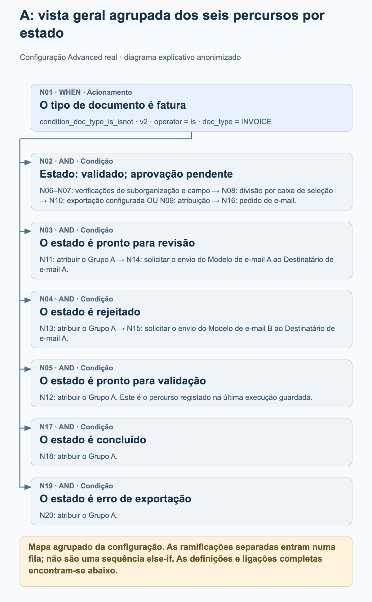
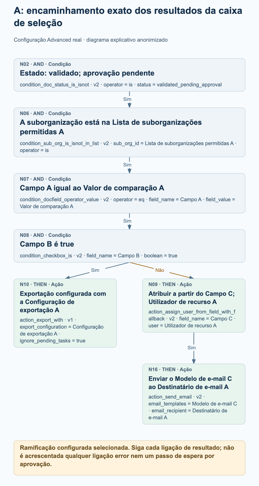
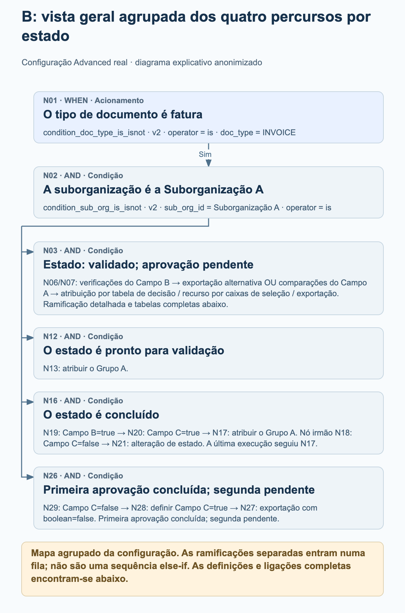
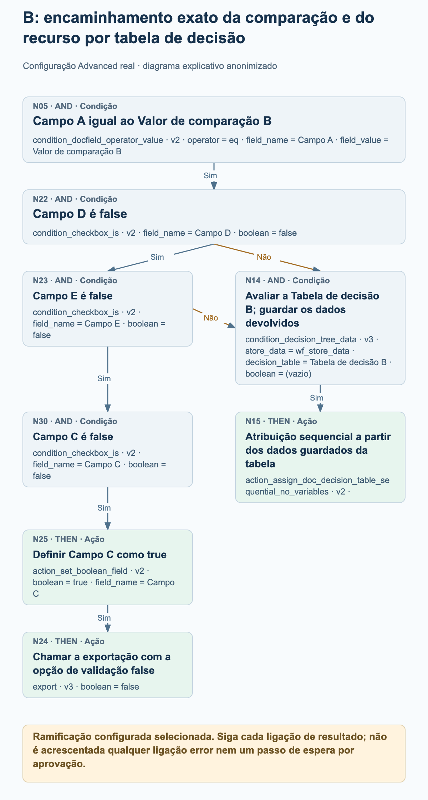

# Exemplos avançados de workflows em produção

Dois workflows Advanced ativos em produção mostram como o encaminhamento real de faturas combina ramificações por estado, decisões baseadas em caixas de seleção, atribuição e ações de exportação configuradas. Os quatro diagramas de processo explicam partes selecionadas de cada grafo; as definições completas dos nós e as ligações são apresentadas separadamente.

Revisão das fontes apenas para leitura em 27 de outubro de 2026: ambas as configurações atuais correspondem aos dados de nós, cartões, versões, definições e ligações guardados com as últimas execuções registadas. O exemplo A tem 20 nós e 19 ligações; o exemplo B tem 30 nós e 30 ligações. Ambas as execuções registadas têm o estado global failed_condition, embora cada uma contenha uma ação de atribuição a grupo bem-sucedida. Trata-se de configurações observadas e de registos de execução guardados, não de testes recém-executados. Os valores de organização, campo, utilizador, grupo, tabela, modelo e destinatário estão anonimizados. As designações neutras preservam as distinções dentro de cada exemplo e não identificam a mesma entidade real em exemplos diferentes.

## Como ler estes grafos

Cada ligação segue um resultado específico: success, failed_condition ou error. Estes exemplos contêm ligações success e failed_condition; nenhum dos grafos configura uma ligação error. Uma condição não satisfeita é um resultado normal de uma condição e não deve ser interpretada como um erro técnico.

Várias ligações success de saída acrescentam vários destinos à fila de execução. Não criam uma cadeia else-if nem significam que as ações sejam executadas em paralelo. Um destino é processado, no máximo, uma vez numa única execução do grafo. Siga as ligações reais, em vez de deduzir o fluxo de controlo a partir da posição de um cartão.

Um destino com mais de uma ligação de entrada não é automaticamente uma junção que espera por todas as entradas. No exemplo B, qualquer uma das ligações failed_condition configuradas pode colocar o cartão de condição normal N14 na fila; este não é um ponto de decisão ALL ou ANY separado.

As atribuições não provam que uma pessoa aprovou um documento. Não se pode deduzir um passo de espera, uma aprovação concluída ou a receção num sistema externo a partir de uma atribuição ou de um cartão de exportação configurado. Os diagramas não acrescentam nenhum desses passos.

As vistas gerais agrupadas resumem os percursos por estado e agrupam explicitamente os nós seguintes. Os diagramas de detalhe expandem os percursos selecionados de caixas de seleção ou de recurso. Utilize as listas completas de nós e ligações para examinar todo o grafo configurado.

## A. Encaminhamento por estado com um percurso de exportação ou atribuição controlado por uma caixa de seleção

Uma fatura é encaminhada para seis verificações de estado. A ramificação de documentos validados com aprovação pendente verifica ainda uma lista de suborganizações permitidas, compara o Campo A e testa o Campo B. O resultado da caixa de seleção seleciona um cartão de exportação configurado ou uma ação de atribuição a partir de um campo, seguida de um e-mail. Outros percursos por estado atribuem o Grupo A, e dois desses percursos enviam depois um e-mail configurado.

### A: vista geral agrupada dos seis percursos por estado

<figure><figcaption>N01 encaminha para seis verificações de estado separadas. A vista geral agrupa a ramificação N02 mais longa e mostra os percursos configurados de atribuição e e-mail para os outros estados. É um mapa agrupado da configuração, não um registo de execução nem uma sequência else-if.</figcaption></figure>

### A: encaminhamento exato dos resultados da caixa de seleção

<figure><figcaption>Ramificação expandida N02 → N06 → N07 → N08. Campo B=true segue success até ao cartão de exportação configurado N10 com ignore_pending_tasks=true. A ligação failed_condition conduz ao cartão de atribuição a partir de campo N09, cujo success conduz ao cartão de e-mail N16. Não se pressupõe qualquer resultado de exportação, aprovação humana ou passo de espera.</figcaption></figure>

### O que a última execução guardada mostra efetivamente

Execução guardada: 26 de outubro de 2026, 12:01:54 UTC. N01 e a verificação ready_for_validation N05 devolveram success; a atribuição N12 devolveu depois success. As outras cinco verificações de estado devolveram failed_condition, e os restantes nós não têm resultado registado nesta execução. O registo global é failed_condition. Esta execução demonstra, portanto, o percurso de atribuição a grupo N01 → N05 → N12; não demonstra os percursos de caixa de seleção, exportação ou e-mail.

- Depois de N01 devolver success, as verificações de estado N02, N03, N04, N05, N17 e N19 são colocadas na fila através de ligações success separadas. Não constituem uma sequência else-if.
- A ramificação de aprovação detalhada é N02 → N06 → N07 → N08 através de success. N08 testa se o Campo B é true. A sua ligação success conduz a N10; a sua ligação failed_condition conduz a N09.
- N10 é action_export_with v1, configurado com a Configuração de exportação A e ignore_pending_tasks=true. O diagrama apresenta a configuração e não afirma que a exportação tenha sido bem-sucedida ou que tenha havido receção externa. Neste cartão, ignore_pending_tasks=true desativa a verificação de tarefas pendentes para o pedido de exportação; esta opção é específica do exemplo.
- N09 está configurado para atribuir a partir do Campo C com o Utilizador de recurso A. Apenas a sua ligação success conduz a N16, configurado com o Modelo de e-mail C e o Destinatário de e-mail A.
- O Campo C tem de conter um ID de utilizador. Um ID de utilizador sem correspondência pode recorrer ao utilizador de recurso configurado; a ausência do campo no documento pode causar uma falha antes de se chegar ao recurso. O recurso não garante a atribuição em todos os casos de campo em falta.
- N11, N12, N13, N18 e N20 configuram o mesmo Grupo A dentro deste exemplo. Apenas N11 e N13 têm nós de e-mail subsequentes ligados: N14 e N15.

Configuração completa dos nós

| Nó | Cartão | Configuração |
| --- | --- | --- |
| N01 | condition_doc_type_is_isnot · v2 | operator = is; doc_type = INVOICE |
| N02 | condition_doc_status_is_isnot · v2 | operator = is; status = validated_pending_approval |
| N03 | condition_doc_status_is_isnot · v2 | operator = is; status = ready_for_review |
| N04 | condition_doc_status_is_isnot · v2 | operator = is; status = rejected |
| N05 | condition_doc_status_is_isnot · v2 | operator = is; status = ready_for_validation |
| N06 | condition_sub_org_is_isnot_in_list · v2 | sub_org_id = Lista de suborganizações permitidas A; operator = is |
| N07 | condition_docfield_operator_value · v2 | operator = eq; field_name = Campo A; field_value = Valor de comparação A |
| N08 | condition_checkbox_is · v2 | field_name = Campo B; boolean = true |
| N09 | action_assign_user_from_field_with_fallback · v2 | field_name = Campo C; user = Utilizador de recurso A |
| N10 | action_export_with · v1 | export_configuration = Configuração de exportação A; ignore_pending_tasks = true |
| N11 | doc_group_assign · v2 | groups = Grupo A; use_decision_table = (vazio) |
| N12 | doc_group_assign · v2 | groups = Grupo A; use_decision_table = (vazio) |
| N13 | doc_group_assign · v2 | groups = Grupo A; use_decision_table = (vazio) |
| N14 | action_send_email · v2 | email_templates = Modelo de e-mail A; email_recipient = Destinatário de e-mail A |
| N15 | action_send_email · v2 | email_templates = Modelo de e-mail B; email_recipient = Destinatário de e-mail A |
| N16 | action_send_email · v2 | email_templates = Modelo de e-mail C; email_recipient = Destinatário de e-mail A |
| N17 | condition_doc_status_is_isnot · v2 | operator = is; status = finished |
| N18 | doc_group_assign · v2 | groups = Grupo A; use_decision_table = (vazio) |
| N19 | condition_doc_status_is_isnot · v2 | operator = is; status = export_error |
| N20 | doc_group_assign · v2 | groups = Grupo A; use_decision_table = (vazio) |

Ligações configuradas completas

| Nó | Caminho do resultado | Nó |
| --- | --- | --- |
| N01 | success | N02 |
| N01 | success | N03 |
| N01 | success | N04 |
| N01 | success | N05 |
| N08 | failed_condition | N09 |
| N08 | success | N10 |
| N07 | success | N08 |
| N06 | success | N07 |
| N02 | success | N06 |
| N03 | success | N11 |
| N04 | success | N13 |
| N05 | success | N12 |
| N13 | success | N15 |
| N11 | success | N14 |
| N09 | success | N16 |
| N01 | success | N17 |
| N17 | success | N18 |
| N19 | success | N20 |
| N01 | success | N19 |

## B. Encaminhamento por tabelas de decisão com percursos de recurso por caixas de seleção e ramificações por estado

Uma fatura da Suborganização A é encaminhada para quatro verificações de estado. O percurso de documentos validados com aprovação pendente utiliza o Campo B, duas comparações alternativas do Campo A, tabelas de decisão e verificações adicionais de caixas de seleção. O percurso de documentos concluídos utiliza os Campos B e C antes de atribuir o Grupo A ou de configurar uma alteração de estado. Um percurso separado de segunda aprovação pendente define o Campo C e chama a exportação quando a condição configurada é satisfeita.

### B: vista geral agrupada dos quatro percursos por estado

<figure><figcaption>N01 e N02 conduzem a quatro verificações de estado ligadas separadamente. A vista geral agrupa a ramificação maior de tabelas de decisão, mantém o percurso de atribuição de documentos prontos para validação e a divisão por caixas de seleção de documentos concluídos, e resume o percurso de exportação com segunda aprovação pendente. As listas completas de nós e ligações preservam todos os 30 nós e 30 ligações.</figcaption></figure>

### B: encaminhamento exato da comparação e do recurso por tabela de decisão

<figure><figcaption>Ramificação configurada selecionada após N01 → N02 → N03 → N07: N05 compara o Campo A com o Valor de comparação B. Qualquer uma das ligações failed_condition de N22 (Campo D=false) ou N23 (Campo E=false) pode colocar a Tabela de decisão B na fila através do cartão de condição normal N14, seguido da atribuição sequencial N15. O success de N23 continua, em alternativa, por N30 → N25 → N24. Não se pressupõe uma junção ALL, um cartão ANY, uma aprovação concluída ou uma receção externa.</figcaption></figure>

### O que a última execução guardada mostra efetivamente

Execução guardada: 27 de outubro de 2026, 11:56:25 UTC. N01, N02, a verificação do estado finished N16, a verificação Campo B=true N19, a verificação Campo C=true N20 e a atribuição a grupo N17 devolveram success. N03, N12, N18 e N26 devolveram failed_condition; os outros nós não têm resultado registado nesta execução. O registo global é failed_condition. Esta execução demonstra o percurso de atribuição de documentos concluídos, não qualquer um dos percursos de tabela de decisão, uma alteração de estado ou uma exportação.

- Depois de as verificações de fatura e da Suborganização A devolverem success, N02 coloca as verificações de estado N03, N12, N16 e N26 na fila. O grafo não espera pela conclusão de uma ramificação de estado antes de definir outra.
- Quando N03 devolve success, N06 testa Campo B=false e N07 testa Campo B=true. O success de N06 conduz à definição de Campo B=true em N10 e, em seguida, ao cartão de exportação alternativa N11. O success de N07 coloca na fila ambas as comparações do Campo A: N04 e N05.
- N06 e N07 são colocados na fila antes da atualização do Campo B em N10. Ambas as verificações avaliam o campo antes dessa atualização; definir Campo B=true não faz com que N07 devolva success mais tarde na mesma passagem pelo grafo. Os cartões colocados na fila posteriormente podem observar valores devolvidos por ações anteriores; as ramificações não são instantâneos isolados.
- O percurso do Valor de comparação A conduz à Tabela de decisão A em N08 e à atribuição sequencial N09. O percurso do Valor de comparação B verifica Campo D=false em N22, Campo E=false em N23 e Campo C=false em N30 antes de definir Campo C=true em N25 e chamar a exportação N24.
- Um resultado failed_condition de N22 ou de N23 pode colocar N14 na fila, o cartão de condição normal da Tabela de decisão B. N14 não é uma junção que espera por todas as entradas nem um novo cartão ANY. A sua ligação success conduz à atribuição sequencial N15.
- Para documentos concluídos, N19 testa Campo B=true e depois coloca N18 e N20 na fila. Campo C=true em N20 conduz à atribuição ao Grupo A em N17. Campo C=false em N18 conduz ao cartão de alteração de estado N21, configurado com validated_pending_approval e trigger_docflow=true. Não se trata de um passo de espera.
- O percurso approved_pending_second_approval executa N29 → N28 → N27 através de success: testar Campo C=false, definir Campo C=true e depois chamar a exportação. Os cartões de exportação N24 e N27 mantêm boolean=false. Trata-se de uma opção de validação, não de uma instrução para desativar a chamada de exportação.
- Ambos os cartões de condição de tabela de decisão guardam dados em wf_store_data. As respetivas ações de atribuição sequencial não têm definições próprias. As regras das tabelas e os destinatários reais não são publicados, e o grafo não comprova uma aprovação concluída.
- A exportação alternativa N11 depende dos atributos de exportação do tipo de documento. Não é possível deduzir qualquer configuração ou destino de exportação a partir das definições vazias do nó. A alteração de estado N21 solicita o acionamento posterior de workflows; não acrescenta uma ligação implícita de regresso a esta mesma passagem pelo grafo.

Configuração completa dos nós

| Nó | Cartão | Configuração |
| --- | --- | --- |
| N01 | condition_doc_type_is_isnot · v2 | operator = is; doc_type = INVOICE |
| N02 | condition_sub_org_is_isnot · v2 | sub_org_id = Suborganização A; operator = is |
| N03 | condition_doc_status_is_isnot · v2 | operator = is; status = validated_pending_approval |
| N04 | condition_docfield_operator_value · v2 | operator = eq; field_name = Campo A; field_value = Valor de comparação A |
| N05 | condition_docfield_operator_value · v2 | operator = eq; field_name = Campo A; field_value = Valor de comparação B |
| N06 | condition_checkbox_is · v2 | field_name = Campo B; boolean = false |
| N07 | condition_checkbox_is · v2 | field_name = Campo B; boolean = true |
| N08 | condition_decision_tree_data · v3 | store_data = wf_store_data; decision_table = Tabela de decisão A; boolean = (vazio) |
| N09 | action_assign_doc_decision_table_sequential_no_variables · v2 | — |
| N10 | action_set_boolean_field · v2 | boolean = true; field_name = Campo B |
| N11 | action_alternate_export · v2 | — |
| N12 | condition_doc_status_is_isnot_in_list · v2 | operator = is; status = ready_for_validation |
| N13 | doc_group_assign · v2 | groups = Grupo A; use_decision_table = (vazio) |
| N14 | condition_decision_tree_data · v3 | store_data = wf_store_data; decision_table = Tabela de decisão B; boolean = (vazio) |
| N15 | action_assign_doc_decision_table_sequential_no_variables · v2 | — |
| N16 | condition_doc_status_is_isnot_in_list · v2 | operator = is; status = finished |
| N17 | doc_group_assign · v2 | groups = Grupo A; use_decision_table = (vazio) |
| N18 | condition_checkbox_is · v2 | field_name = Campo C; boolean = false |
| N19 | condition_checkbox_is · v2 | field_name = Campo B; boolean = true |
| N20 | condition_checkbox_is · v2 | field_name = Campo C; boolean = true |
| N21 | staus_change · v3 | status = validated_pending_approval; trigger_docflow = true |
| N22 | condition_checkbox_is · v2 | field_name = Campo D; boolean = false |
| N23 | condition_checkbox_is · v2 | field_name = Campo E; boolean = false |
| N24 | export · v3 | boolean = false |
| N25 | action_set_boolean_field · v2 | boolean = true; field_name = Campo C |
| N26 | condition_doc_status_is_isnot_in_list · v2 | operator = is; status = approved_pending_second_approval |
| N27 | export · v3 | boolean = false |
| N28 | action_set_boolean_field · v2 | boolean = true; field_name = Campo C |
| N29 | condition_checkbox_is · v2 | field_name = Campo C; boolean = false |
| N30 | condition_checkbox_is · v2 | field_name = Campo C; boolean = false |

Ligações configuradas completas

| Nó | Caminho do resultado | Nó |
| --- | --- | --- |
| N01 | success | N02 |
| N02 | success | N03 |
| N03 | success | N06 |
| N03 | success | N07 |
| N07 | success | N04 |
| N07 | success | N05 |
| N06 | success | N10 |
| N10 | success | N11 |
| N02 | success | N12 |
| N12 | success | N13 |
| N16 | success | N19 |
| N20 | success | N17 |
| N19 | success | N20 |
| N19 | success | N18 |
| N18 | success | N21 |
| N04 | success | N08 |
| N02 | success | N16 |
| N05 | success | N22 |
| N22 | success | N23 |
| N25 | success | N24 |
| N02 | success | N26 |
| N22 | failed_condition | N14 |
| N23 | failed_condition | N14 |
| N28 | success | N27 |
| N26 | success | N29 |
| N29 | success | N28 |
| N23 | success | N30 |
| N30 | success | N25 |
| N08 | success | N09 |
| N14 | success | N15 |

## Antes de adaptar um exemplo

Substitua cada designação neutra por um valor adequado da sua própria organização. Preserve a distinção entre definições que referem o mesmo campo e definições que referem campos diferentes; não reutilize estes marcadores como identificadores reais.

Verifique explicitamente cada ligação de resultado, incluindo o encaminhamento failed_condition e os destinos com várias ligações de entrada. Escolha o tratamento de erros adequado ao seu processo, em vez de assumir que o grafo trata um percurso error sem ligação.

Reveja as definições de exportação, as opções de validação e o tratamento de tarefas pendentes à luz dos seus requisitos. Uma ação de exportação configurada ou um registo de nó bem-sucedido não comprova a receção num sistema externo.

Valide o workflow adaptado num ambiente de teste autorizado, incluindo cada resultado relevante das condições e os casos de dados de atribuição em falta. Estes exemplos de produção foram consultados sem serem alterados nem executados novamente.
