# Padrão Lógico de Decisão

**Tipo de padrão:** Encaminhamento condicional e lógica **Complexidade:** Média **Configuração estimada:** 30–45 minutos **Casos de uso comuns:** Encaminhamento de múltiplos caminhos, processamento condicional, árvores de decisão, implementação de regras de negócio

***

No editor no modo Standard, selecione «Adicionar cartão» no grupo «E....» e abra a categoria «Lógica». A tela mostra uma condição baseada em uma tabela de decisão; nenhuma tabela foi selecionada e o armazenamento dos resultados ainda não foi configurado. Selecione a tabela e configure o armazenamento dos resultados retornados para o documento ou para a organização fornecedora. Em seguida, configure as demais condições, ações e conexões do fluxo de trabalho e teste seu comportamento.

<figure>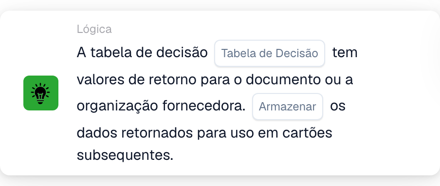<figcaption><p>Editor no modo Standard: categoria «Lógica» aberta por «Adicionar cartão» no grupo «E....»; a tabela de decisão da condição ainda não foi selecionada e o armazenamento dos resultados ainda não foi configurado.</p></figcaption></figure>

***

## Visão geral do padrão

#### Diagrama: Visão geral

<figure>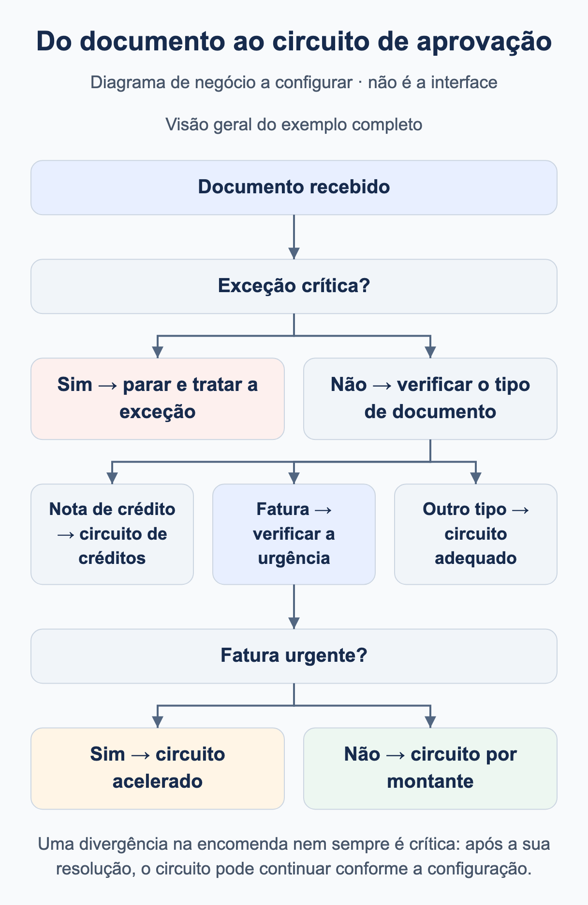<figcaption><p>Visão geral do exemplo completo: verificar exceções críticas, o tipo de documento e a urgência antes de escolher o circuito de aprovação. Cada tratamento e cada ligação têm de ser configurados; o diagrama não representa um comportamento automático do produto.</p></figcaption></figure>

Estes diagramas explicam regras de negócio a configurar. Complementam a imagem da biblioteca acima. No modo Advanced, ligue explicitamente cada percurso. Numa sequência linear Standard, defina as condições que permitem as respetivas ações.

Este padrão demonstra como implementar lógica de decisão complexa em workflows do DocBits. Com cartões de condição, encaminha documentos com base em atributos do documento, valores de campo e regras de negócio através de diferentes caminhos de processamento.

**O que este padrão faz:**

1. Avalia várias condições em sequência ou em paralelo
2. Encaminha documentos por diferentes caminhos com base em condições
3. Implementa regras de negócio e políticas
4. Trata árvores de decisão complexas
5. Combina vários critérios para decisões de encaminhamento

***

## Quando utilizar este padrão

Utilize este padrão quando precisar de:

* ✅ Encaminhar documentos por limiares de valor
* ✅ Aplicar regras diferentes a tipos de documento diferentes
* ✅ Implementar lógica de aprovação em vários níveis
* ✅ Tratar políticas de negócio complexas
* ✅ Criar encaminhamento dinâmico com base em múltiplos critérios
* ✅ Implementar lógica de tratamento de exceções
* ✅ Criar matrizes de aprovação

**Não utilize este padrão quando:**

* ❌ um fluxo de trabalho linear simples for suficiente
* ❌ todos os documentos seguirem o mesmo caminho
* ❌ não for necessário processamento condicional

***

## Tipos de lógica de decisão

Os exemplos IF-THEN, AND, OR e aninhados abaixo são independentes. Os respetivos limites ilustram cada princípio; não formam uma única matriz de aprovação. A matriz completa seguinte utiliza quatro faixas sem sobreposição. Um valor desconhecido ou um erro de avaliação não equivale automaticamente a False: defina e teste separadamente o seu tratamento.

### 1. Lógica IF-THEN simples

#### Diagrama: Condição simples

<figure>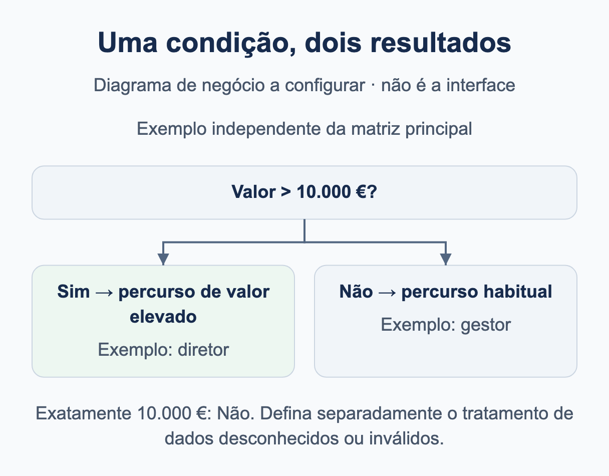<figcaption><p>Exemplo IF-THEN independente: um valor estritamente superior a 10.000 € seleciona o diretor; caso contrário, o gestor. A igualdade permanece no segundo ramo. Configure os destinos.</p></figcaption></figure>

<details>
<summary>Princípio IF-THEN: uma condição, dois resultados</summary>

```
IF condition:
  → Ação A
ELSE:
  → Ação B
```

</details>

**Exemplo:**

Explicação visual: [condição simples](#diagrama-condicao-simples).

<details>
<summary>Exemplo IF-THEN: limite de valor</summary>

```
IF Amount > €10,000:
  → Atribuir ao diretor
ELSE:
  → Atribuir ao gestor
```

</details>

#### Diagrama: Critérios E e OU

<figure>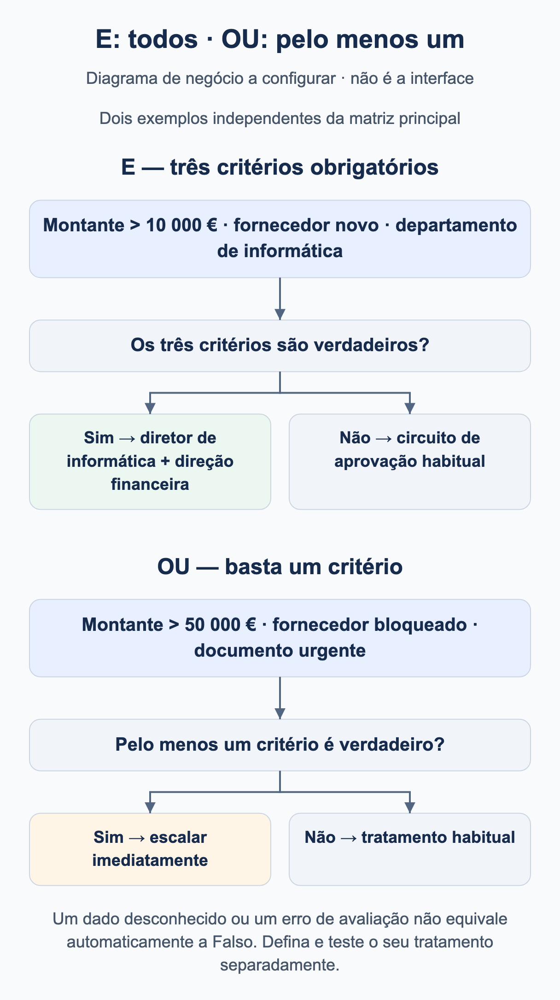<figcaption><p>Dois exemplos independentes: E exige os três critérios; OU exige pelo menos um. Os seus limites ilustrativos não substituem os intervalos da matriz completa. As saídas e o tratamento de dados desconhecidos ou erros têm de ser configurados.</p></figcaption></figure>

### 2. Vários critérios (lógica E)

<details>
<summary>Princípio AND: todos os critérios</summary>

```
IF condition1 AND condition2 AND condition3:
  → Ação A
ELSE:
  → Ação B
```

</details>

**Exemplo:**

Explicação visual: [critérios E e OU](#diagrama-criterios-e-e-ou).

<details>
<summary>Exemplo AND: três critérios</summary>

```
IF Amount > €10,000 AND Supplier = "New" AND Department = "IT":
  → Atribuir ao diretor de TI + CFO (duas aprovações)
ELSE:
  → Workflow de aprovação habitual
```

</details>

### 3. Critérios alternativos (lógica OU)

Explicação visual: [critérios E e OU](#diagrama-criterios-e-e-ou).

<details>
<summary>Princípio OR: pelo menos um critério</summary>

```
IF condition1 OR condition2 OR condition3:
  → Ação A
ELSE:
  → Ação B
```

</details>

**Exemplo:**

Explicação visual: [critérios E e OU](#diagrama-criterios-e-e-ou).

<details>
<summary>Exemplo OR: valor, bloqueio ou urgência</summary>

```
IF Amount > €50,000 OR Supplier is "Blocked" OR Document tem a marca "Urgent":
  → Escalar imediatamente
ELSE:
  → Processamento habitual
```

</details>

### 4. Árvore de decisão aninhada

#### Diagrama: Decisões aninhadas

<figure>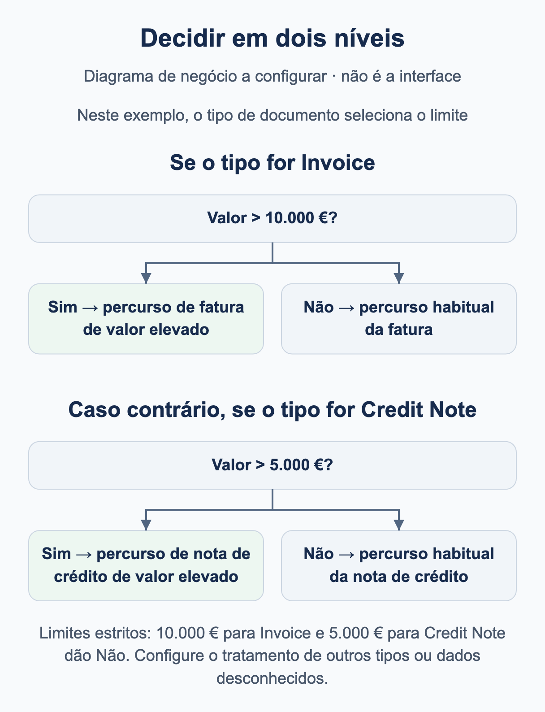<figcaption><p>Exemplo aninhado independente: o tipo de documento seleciona um teste de valor. Os limites são estritos: 10.000 € numa fatura e 5.000 € numa nota de crédito não satisfazem «superior a». Defina o tratamento de outros tipos e dados desconhecidos.</p></figcaption></figure>

<details>
<summary>Princípio de decisão aninhada</summary>

```
IF condition1:
  IF condition2:
    → Ação A
  ELSE:
    → Ação B
ELSE:
  IF condition3:
    → Ação C
  ELSE:
    → Ação D
```

</details>

**Exemplo:**

Explicação visual: [decisões aninhadas](#diagrama-decisoes-aninhadas).

<details>
<summary>Exemplo aninhado: fatura e nota de crédito</summary>

```
IF Document_Type = "Invoice":
  IF Amount > €10,000:
    → Workflow de faturas de valor elevado
  ELSE:
    → Workflow habitual de faturas
ELSE IF Document_Type = "Credit Note":
  IF Amount > €5,000:
    → Workflow de notas de crédito de valor elevado
  ELSE:
    → Workflow habitual de notas de crédito
```

</details>

***

## Exemplo completo de fluxo de trabalho

### Cenário: Matriz de aprovação de faturas

**Regras de negócio:**

1. Antes do encaminhamento por valor, pare e trate as exceções críticas, incluindo um fornecedor bloqueado. Uma divergência face à encomenda nem sempre é crítica: depois de resolvida pelas compras, o percurso pode prosseguir conforme configurado. Verifique depois o tipo de documento.
2. Para uma fatura urgente, siga o percurso acelerado deste exemplo em vez das faixas de valor habituais.
3. Para uma fatura não urgente com valor válido:
   * valor < 1.000 €: aprovação automática;
   * 1.000 € ≤ valor < 10.000 €: aprovação do gestor;
   * 10.000 € ≤ valor < 50.000 €: verificações do fornecedor seguidas da aprovação do diretor; um fornecedor não bloqueado com menos de 180 dias requer a aprovação do diretor seguida da aprovação do CFO; os outros fornecedores também são sujeitos a uma verificação de risco;
   * valor ≥ 50.000 €: aprovação executiva descrita no percurso D.
4. Um valor ausente ou inválido segue a revisão manual explicitamente configurada neste exemplo. Trata-se de uma política de exemplo, não de um recurso automático do produto.
5. Depois de criar uma tarefa, aguarde o resultado. A rejeição interrompe a cadeia e segue o tratamento configurado; resultados pendentes não permitem prosseguir. Crie a tarefa do CFO apenas após a aprovação positiva do diretor.

#### Diagrama: Faixas de valor

<figure>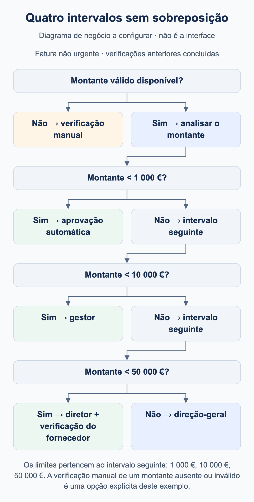<figcaption><p>Limites do nível 2: menos de 1 000 €; de 1 000 € inclusive a 10 000 € exclusive; de 10 000 € inclusive a 50 000 € exclusive; 50 000 € ou mais. Cada teste segue o resultado negativo do anterior. A verificação manual de um montante ausente ou inválido tem de ser configurada explicitamente.</p></figcaption></figure>

Os valores-limite de 1.000 €, 10.000 € e 50.000 € entram na faixa superior. Configure e teste as verificações prévias, a espera pelos resultados e as ligações entre percursos. Uma tarefa criada não comprova a aprovação nem a exportação do documento.

**Implementação ilustrativa:** adapte os nomes técnicos e o pseudocódigo aos cartões realmente disponíveis na sua versão. Estes blocos descrevem um exemplo a configurar, não um ficheiro importável. Verifique os resultados da execução e os efeitos secundários.

Explicação visual: [visão geral](#diagrama-visao-geral), [faixas de valor](#diagrama-faixas-de-valor), [análise do fornecedor](#diagrama-analise-do-fornecedor), [percurso automático](#diagrama-percurso-automatico), [tarefa do gestor](#diagrama-tarefa-do-gestor), [aprovação executiva](#diagrama-aprovacao-executiva), [registo da regra](#diagrama-registo-da-regra).

<details>
<summary>Pseudocódigo da matriz completa</summary>

```
VERIFICAÇÃO PRÉVIA: exceções críticas
  IF Critical_Exception = TRUE OR Supplier_Status = "BLOCKED":
    → Parar e tratar a exceção antes do encaminhamento

PASSO 1: verificar divergências com a encomenda
  IF PO_Match_Status = "FAIL":
    → Encaminhar para compras para resolver a divergência com a encomenda
    → Após a resolução, continuar abaixo conforme a configuração

PASSO 1b: verificar o tipo de documento
  IF Document_Type = "Credit Note":
    → Workflow configurado de notas de crédito
  ELSE IF Document_Type is not "Invoice":
    → Workflow configurado para este tipo de documento
  ELSE:
    → Continuar abaixo

PASSO 2: verificar a marca de urgência
  IF Urgent_Flag = TRUE:
    → Ignorar as verificações do montante
    → Encaminhar para o aprovador de nível mais elevado
    → Definir a prioridade = URGENT
    → Prazo de 1 dia

PASSO 3: encaminhamento pelo montante (Invoice, se não for urgente)
  IF Amount está em falta ou é inválido:
    → Revisão manual (política explícita deste exemplo)
    → Não avançar para as faixas de montante

  ELSE IF Amount < €1,000:
    → Aprovar automaticamente
    → Exportar imediatamente

  ELSE IF Amount < €10,000:
    → Criar tarefa para o gestor
    → Priority: Medium
    → Deadline: 3 dias

  ELSE IF Amount < €50,000:
    VERIFICAR o estado e o risco do fornecedor:
      IF Supplier_Status = "BLOCKED":
        → Parar e tratar a exceção
      ELSE IF Supplier_Age < 180 dias (novo):
        → Criar tarefa para o diretor (tarefa 1)
        → Aguardar a aprovação positiva do diretor antes de criar a tarefa do CFO (tarefa 2)
        → Aguardar a aprovação positiva do CFO antes de continuar
        → Qualquer rejeição: parar a cadeia e tratar a rejeição conforme a configuração
        → Pendente: não continuar
        → Priority: High
        → Deadline: 2 dias por tarefa
      ELSE IF Supplier_Risk_Rating = "HIGH":
        → Verificações adicionais e aprovação prévia do gestor
        → Aguardar a aprovação positiva do gestor antes da aprovação do diretor
        → Pendente ou rejeitado: não continuar a cadeia de aprovação
      ELSE (fornecedor existente):
        → Criar tarefa apenas para o diretor
        → Priority: High
        → Deadline: 2 dias

  ELSE (Amount ≥ €50,000):
    → Percurso de aprovação executiva (ver percurso D)
```

</details>

***

## Implementação passo a passo

### Passo 1: Definir os cartões de condição

**Condição 1: Limiar de valor**

#### Diagrama: Parâmetros independentes

<figure>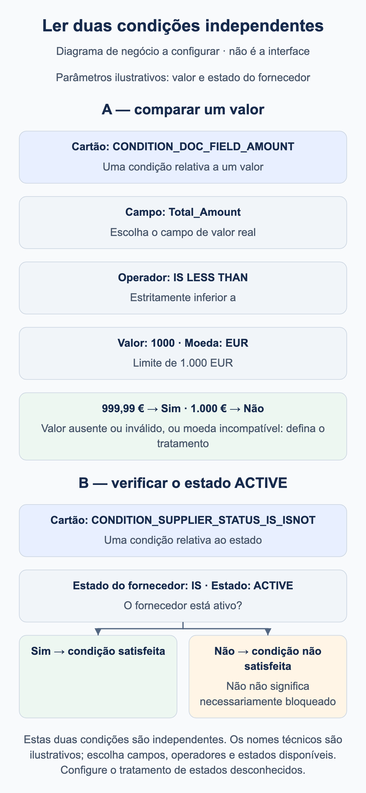<figcaption><p>Duas condições independentes: um valor estritamente inferior a 1.000 EUR e um fornecedor com estado ACTIVE. A igualdade do valor dá Não; um fornecedor inativo não está necessariamente bloqueado. Os parâmetros técnicos são ilustrativos e devem ser adaptados à configuração real.</p></figcaption></figure>

<details>
<summary>Parâmetros ilustrativos: limite de valor</summary>

```
Card: CONDITION_DOC_FIELD_AMOUNT
Field: Total_Amount
Operator: IS LESS THAN
Value: 1000
Currency: EUR
```

</details>

**Condição 2: Verificação do tipo de documento**

#### Diagrama: Tipos de documento

<figure>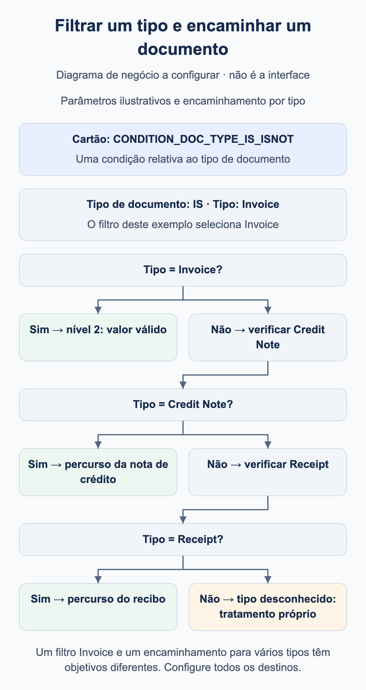<figcaption><p>O filtro Invoice e o encaminhamento por tipo ilustram aspetos complementares deste exemplo. O encaminhamento distingue fatura, nota de crédito, recibo e tipo desconhecido. Os nomes dos cartões e workflows são ilustrativos; configure todos os destinos.</p></figcaption></figure>

<details>
<summary>Parâmetros ilustrativos: tipo de documento</summary>

```
Card: CONDITION_DOC_TYPE_IS_ISNOT
Document Type: IS
Type: Invoice
```

</details>

**Condição 3: Estado do fornecedor**

Explicação visual: [parâmetros independentes](#diagrama-parametros-independentes).

<details>
<summary>Parâmetros ilustrativos: estado ativo</summary>

```
Card: CONDITION_SUPPLIER_STATUS_IS_ISNOT
Supplier Status: IS
Status: ACTIVE
```

</details>

**Condição 4: Verificação de novo fornecedor**

Neste exemplo, calcule a data de 180 dias antes da data de avaliação e compare a data da primeira transação com esse limite. «IS AFTER» significa estritamente posterior: a igualdade dá Não. Escolha o campo real e calcule ou introduza a data-limite; os nomes do cartão e do campo e o marcador {{TODAY_MINUS_180_DAYS}} são ilustrativos. Verifique separadamente se a data da primeira transação é válida e não ultrapassa a data de avaliação; configure o tratamento de valores ausentes ou inválidos.

#### Diagrama: Condição de 180 dias

<figure>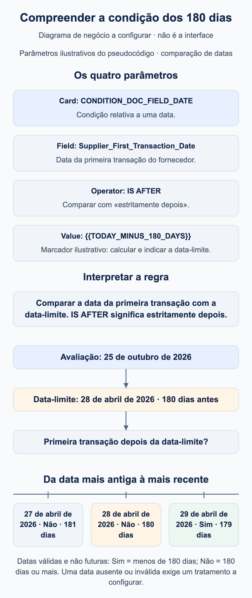<figcaption><p>Exemplo de comparação: em 25 de outubro de 2026, a data-limite é 28 de abril de 2026. «IS AFTER» exclui a igualdade: 29 de abril dá Sim; 28 e 27 de abril dão Não. Os nomes do cartão e do campo e o marcador {{TODAY_MINUS_180_DAYS}} são ilustrativos: escolha o campo real e calcule ou indique a data-limite. Pressupõem-se datas válidas e não futuras; o tratamento de uma data ausente ou inválida tem de ser configurado.</p></figcaption></figure>

<details>
<summary>Copiar os parâmetros ilustrativos do exemplo</summary>

```
Card: CONDITION_DOC_FIELD_DATE
Field: Supplier_First_Transaction_Date
Operator: IS AFTER
Value: {{TODAY_MINUS_180_DAYS}}
```

</details>


**Referência de guia:** [Guia completo de cartões de condição](../and/condition-cards-complete-guide.md)

***

### Passo 2: Construir a árvore de decisão

**Nível 1: Tipo de documento**

Explicação visual: [tipos de documento](#diagrama-tipos-de-documento).

<details>
<summary>Encaminhamento ilustrativo por tipo de documento</summary>

```
Workflow: "Invoice Processing"

IF Document_Type = "Invoice":
  → Continuar para o nível 2

ELSE IF Document_Type = "Credit Note":
  → Encaminhar para "Credit Note Processing"

ELSE IF Document_Type = "Receipt":
  → Encaminhar para "Receipt Processing"

ELSE:
  → Encaminhar para o tratamento "Unknown Document Type"
```

</details>

**Nível 2: limites de valor (faturas não urgentes, valor válido)**

Explicação visual: [faixas de valor](#diagrama-faixas-de-valor).

<details>
<summary>Quatro faixas de valor: pseudocódigo</summary>

```
IF Amount < €1,000:
  → Encaminhar para "Auto-Approve Path"

ELSE IF Amount < €10,000:
  → Encaminhar para "Manager Approval Path"

ELSE IF Amount < €50,000:
  → Encaminhar para "Director Approval Path"
  → Verificar as condições do nível 3

ELSE (Amount ≥ €50,000):
  → Encaminhar para "Executive Approval Path"
  → São necessárias duas ou três aprovações
```

</details>

**Nível 3: Análise do fornecedor (para faturas de valor elevado)**

#### Diagrama: Análise do fornecedor

<figure>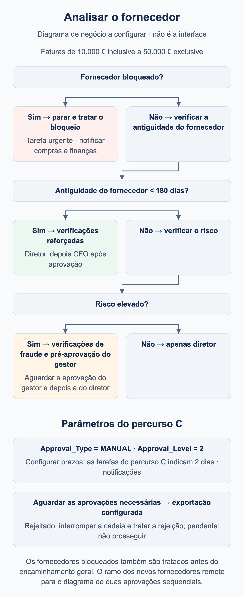<figcaption><p>Detalhe do percurso do fornecedor: tratar o bloqueio, depois a antiguidade e o risco. O ramo de fornecedores com menos de 180 dias remete para o diagrama de duas aprovações sequenciais. Configure as tarefas, prazos, notificações e ações do percurso C.</p></figcaption></figure>

<details>
<summary>Análise do fornecedor: bloqueio, antiguidade e risco</summary>

```
IF Supplier_Status = "BLOCKED":
  → PARAR o processamento
  → Criar tarefa urgente de escalamento
  → Notificar compras e finanças

ELSE IF Supplier_Age < 180 dias (novo):
  → É necessária aprovação adicional
  → Adicionar o CFO à cadeia de aprovação
  → Verificação reforçada

ELSE IF Supplier_Risk_Rating = "HIGH":
  → São necessárias verificações adicionais
  → Revisão para deteção de fraude
  → Aprovação prévia do gestor; aguardar aprovação positiva
  → Aprovação do diretor; aguardar aprovação positiva

ELSE:
  → Workflow habitual para valores elevados
```

</details>

***

### Passo 3: Criar as ações de encaminhamento

**Caminho A: Aprovação automática (montante < 1.000 €)**

#### Diagrama: Percurso automático

<figure>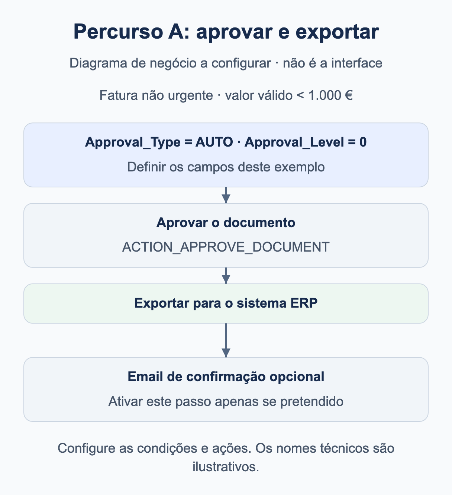<figcaption><p>Exemplo do percurso A: definir os campos de aprovação, aprovar o documento e exportar. O email de confirmação é opcional. Este diagrama descreve ações a configurar, não uma execução observada.</p></figcaption></figure>

<details>
<summary>Ações do percurso A: aprovação automática</summary>

```
Ações:
1. Definir o campo "Approval_Type" = "AUTO"
2. Definir o campo "Approval_Level" = "0"
3. ACTION_APPROVE_DOCUMENT
4. Exportar para o ERP
5. Enviar email de confirmação (opcional)
```

</details>

**Percurso B: aprovação do gestor (1.000 € ≤ valor < 10.000 €)**

#### Diagrama: Tarefa do gestor

<figure>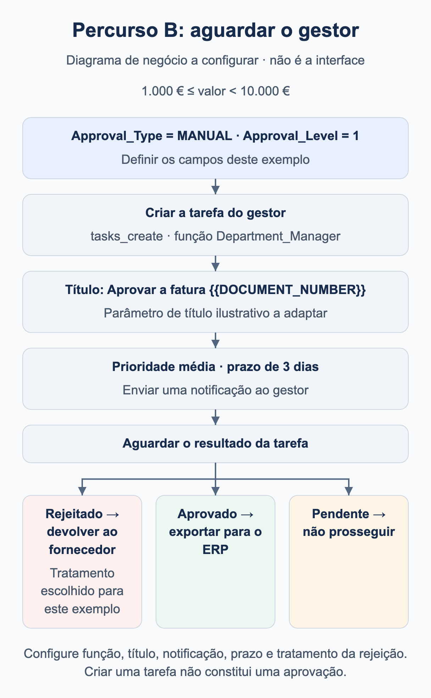<figcaption><p>Exemplo do percurso B: criar uma tarefa para o gestor, notificá-lo e aguardar o resultado. Só a aprovação permite exportar; neste exemplo, a rejeição devolve o documento ao fornecedor. O prazo de três dias e os destinatários são opções de configuração.</p></figcaption></figure>

<details>
<summary>Ações do percurso B: tarefa do gestor</summary>

```
Ações:
1. Definir o campo "Approval_Type" = "MANUAL"
2. Definir o campo "Approval_Level" = "1"
3. tasks_create:
   - Title: "Aprovar a fatura {{DOCUMENT_NUMBER}}"
   - Assign to: Department_Manager
   - Priority: Medium
   - Deadline: 3 dias
4. Enviar notificação por email ao gestor
5. Aguardar a conclusão da tarefa
6. Se aprovado: exportar para o ERP
7. Se rejeitado: devolver ao fornecedor
```

</details>

**Percurso C: aprovação do diretor (10.000 € ≤ valor < 50.000 €)**

Explicação visual: [análise do fornecedor](#diagrama-analise-do-fornecedor), [aprovações sequenciais](#diagrama-aprovacoes-sequenciais).

<details>
<summary>Ações do percurso C: verificações e aprovações necessárias</summary>

```
Ações:
1. Definir o campo "Approval_Type" = "MANUAL"
2. Definir o campo "Approval_Level" = "2"
3. Verificar Supplier_Age e Supplier_Risk_Rating:
   IF novo (< 180 dias):
     - Criar tarefa 1: aprovação do diretor
     - Aguardar a aprovação positiva da tarefa 1 antes de criar a tarefa 2: aprovação do CFO
     - Aguardar a aprovação positiva da tarefa 2 antes de continuar
     - Pendente: não continuar
     - Qualquer rejeição: parar a cadeia e tratar a rejeição conforme a configuração
     - São necessárias ambas as aprovações positivas
   ELSE IF Supplier_Risk_Rating = "HIGH":
     - Verificações de risco adicionais e aprovação prévia do gestor
     - Aguardar a aprovação positiva do gestor antes da aprovação do diretor
     - Aguardar a aprovação positiva do diretor antes de exportar
     - Pendente ou rejeitado: parar a progressão e tratar o resultado conforme a configuração
   ELSE:
     - Criar tarefa: apenas aprovação do diretor
4. Priority: High
5. Deadline: 2 dias para as tarefas de aprovação do percurso C; configurar separadamente os prazos das verificações de risco
6. Enviar notificações por email
7. Aguardar a conclusão
8. Se todos aprovarem: exportar
9. Se algum rejeitar: devolver ao fornecedor
```

</details>

#### Diagrama: Aprovações sequenciais

<figure>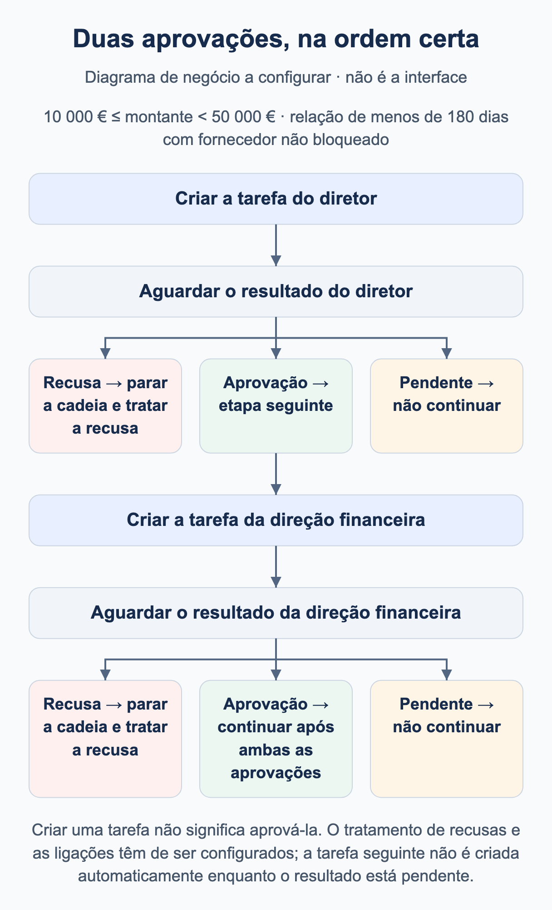<figcaption><p>Exemplo de aprovações sucessivas: criar a tarefa da direção financeira apenas após a aprovação do diretor e aguardar o respetivo resultado. Continuar apenas após ambas as aprovações. Uma recusa interrompe a cadeia e segue o tratamento configurado; um resultado pendente não permite continuar.</p></figcaption></figure>

Conforme a configuração, a rejeição pode devolver o documento ao fornecedor ou seguir outro percurso. O diagrama exige apenas a interrupção desta cadeia de aprovação; não impõe a revisão manual em todos os casos.

**Caminho D: Aprovação pela administração (≥ 50.000 €)**

#### Diagrama: Aprovação executiva

<figure>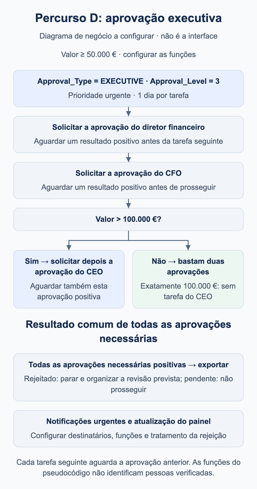<figcaption><p>Exemplo do percurso D: duas aprovações sequenciais a partir de 50.000 €, com uma terceira apenas acima de 100.000 €. Cada tarefa seguinte aguarda a aprovação anterior. Configure funções, prazos, notificações e tratamento da rejeição.</p></figcaption></figure>

<details>
<summary>Ações do percurso D: aprovação executiva</summary>

```
Ações:
1. Definir o campo "Approval_Type" = "EXECUTIVE"
2. Definir o campo "Approval_Level" = "3"
3. Aprovações sequenciais:
   - Tarefa 1: diretor financeiro
   - Tarefa 2: CFO
   - Tarefa 3: CEO (se > €100,000)
4. Priority: Urgent
5. Deadline: 1 dia por tarefa
6. Enviar notificações urgentes
7. Atualizar o painel da direção
8. Aguardar todas as aprovações
9. Se todos aprovarem: exportar
10. Se algum rejeitar: reunião de revisão da direção
```

</details>

***

## Padrões avançados de lógica de decisão

Os padrões seguintes são variantes independentes. As pontuações, os limites departamentais e as regras temporais não se acrescentam automaticamente à matriz completa acima; escolha e configure as regras adequadas ao seu caso.

### Padrão 1: Encaminhamento baseado em pontuação

**Calcular uma pontuação de risco inteira e encaminhar em conformidade neste exemplo:**

#### Diagrama: Pontuação de risco

<figure>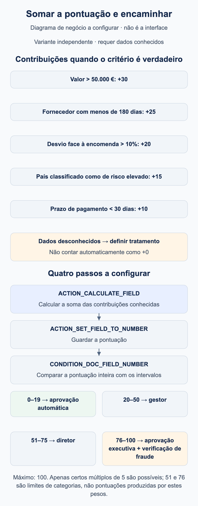<figcaption><p>Variante independente: cinco contribuições conhecidas produzem uma pontuação inteira de 0 a 100 e depois um percurso. Os limites 51 e 76 definem categorias; estes cinco pesos não produzem essas pontuações. Defina separadamente o tratamento de dados desconhecidos.</p></figcaption></figure>

<details>
<summary>Cálculo da pontuação de risco e intervalos</summary>

```
Cálculo da pontuação de risco:
  Score = 0

  IF Amount > €50,000: Score += 30
  IF Supplier_Age < 180 dias: Score += 25
  IF PO_Variance > 10%: Score += 20
  IF Supplier_Country = "High Risk Country": Score += 15
  IF Payment_Terms < 30 dias: Score += 10

  Intervalo total de Score: 0-100

Encaminhamento:
  IF Score < 20: Aprovar automaticamente
  IF Score 20-50: Aprovação do gestor
  IF Score 51-75: Aprovação do diretor
  IF Score > 75: Aprovação executiva + verificação de fraude
```

</details>

**Implementação:**

Explicação visual: [pontuação de risco](#diagrama-pontuacao-de-risco).

<details>
<summary>Implementação ilustrativa da pontuação</summary>

```
1. ACTION_CALCULATE_FIELD: Calcular a pontuação de risco
2. ACTION_SET_FIELD_TO_NUMBER: Guardar a pontuação
3. CONDITION_DOC_FIELD_NUMBER: Verificar os limites da pontuação
4. Encaminhar com base na pontuação
```

</details>

***

### Padrão 2: Matriz baseada no departamento

**Regras de aprovação diferentes por departamento:**

#### Diagrama: Matriz departamental

<figure>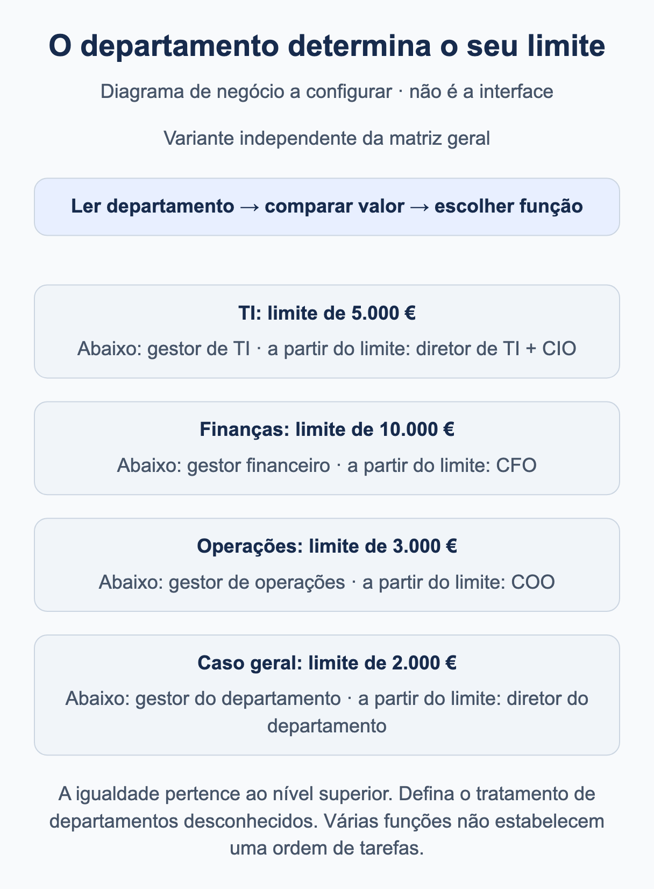<figcaption><p>Matriz departamental independente: os limites diferem para TI, finanças, operações e o caso geral. A igualdade seleciona a faixa superior. Configure as várias funções; a sua presença não comprova uma aprovação sequencial.</p></figcaption></figure>

<details>
<summary>Matriz de limites por departamento</summary>

```
Matriz departamental:

  Departamento de TI:
    Amount < €5,000: Gestor de TI
    Amount ≥ €5,000: Diretor de TI + CIO

  Departamento financeiro:
    Amount < €10,000: Gestor financeiro
    Amount ≥ €10,000: CFO

  Departamento de operações:
    Amount < €3,000: Gestor de operações
    Amount ≥ €3,000: COO

  Caso geral:
    Amount < €2,000: Gestor do departamento
    Amount ≥ €2,000: Diretor do departamento
```

</details>

**Implementação:**

Explicação visual: [matriz departamental](#diagrama-matriz-departamental).

<details>
<summary>Implementação ilustrativa da matriz departamental</summary>

```
1. Verificar o campo Department
2. Verificar o limite do montante em função do departamento
3. Encaminhar para o aprovador adequado
4. Limites diferentes por departamento
```

</details>

***

### Padrão 3: Lógica baseada no tempo

**Regras diferentes consoante o momento:**

#### Diagrama: Variantes temporais

<figure>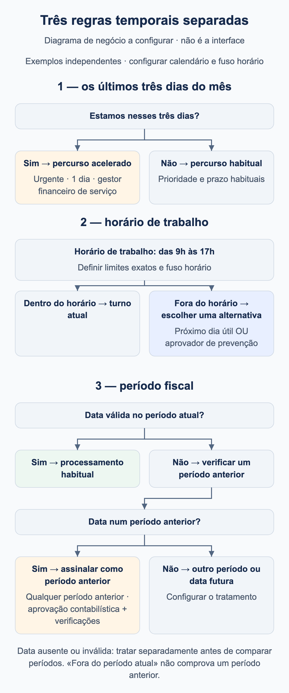<figcaption><p>Três variantes independentes: fim do mês, horário de trabalho e período fiscal. A fila e a aprovação de prevenção são alternativas a escolher. Uma data fora do período atual não é necessariamente anterior; verifique o caso separadamente.</p></figcaption></figure>

<details>
<summary>Três variantes temporais independentes</summary>

```
Processamento de fim do mês (últimos 3 dias do mês):
  IF Today está nos últimos 3 dias do mês:
    - Priority: URGENT
    - Deadline: 1 dia
    - Aprovador: gestor financeiro de serviço
    - Workflow acelerado
  ELSE:
    - Prioridade habitual
    - Prazo habitual
    - Workflow habitual

Dentro e fora do horário de trabalho:
  IF Time está entre as 9h00 e as 17h00:
    - Atribuir ao turno atual
  ELSE:
    - Colocar na fila para o próximo dia útil
    - OR encaminhar para o aprovador de prevenção

Período contabilístico (política ilustrativa independente):
  IF Document_Date está em falta ou é inválida:
    - Tratar a data inválida ou desconhecida conforme a configuração
  ELSE IF Document_Date in Current_Fiscal_Period:
    - Processamento habitual
  ELSE IF Document_Date pertence a qualquer Fiscal_Period anterior a Current_Fiscal_Period:
    - Marcar como "Prior Period"
    - Exigir aprovação da contabilidade
    - Verificações adicionais
  ELSE:
    - Período contabilístico futuro ou diferente: tratar conforme a configuração
```

</details>

***

### Padrão 4: Encaminhamento baseado em exceções

**Encaminhar as exceções separadamente:**

#### Diagrama: Gravidade das exceções

<figure>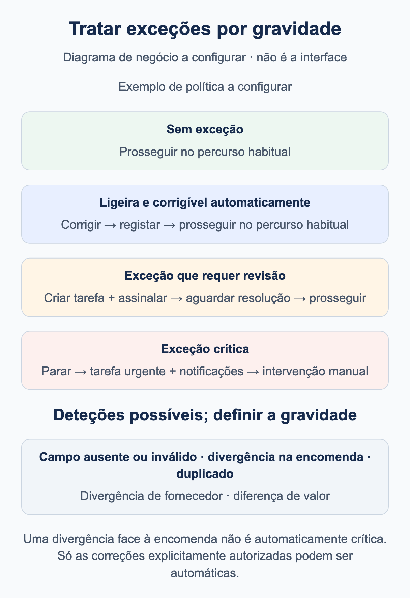<figcaption><p>Exemplo de política de gravidade: prosseguir só após a correção configurada ou a resolução esperada. Uma exceção crítica interrompe o processamento. Os exemplos de deteção, por si só, não determinam a gravidade.</p></figcaption></figure>

<details>
<summary>Política de gravidade das exceções</summary>

```
Deteção de exceções:

  Sem exceção:
    → Workflow habitual

  Exceção ligeira (corrigível automaticamente):
    → Corrigir automaticamente
    → Registar a correção
    → Continuar o workflow habitual

  Exceção média (requer revisão):
    → Criar tarefa de revisão
    → Marcar o documento
    → Após a resolução: continuar o workflow

  Exceção grave (requer escalamento):
    → Parar o processamento
    → Criar tarefa urgente
    → Notificar vários níveis
    → É necessária intervenção manual

Tipos de exceção:
  - Campo obrigatório em falta
  - Valor de campo inválido
  - Divergência com a encomenda
  - Fatura duplicada
  - Fornecedor não corresponde
  - Divergência no montante
```

</details>

***

## Diagrama completo de lógica de decisão

Os diagramas apresentam os passos essenciais. A árvore textual detalhada abaixo conserva o exemplo técnico; os destinos continuam a exigir configuração.


Explicação visual: [visão geral](#diagrama-visao-geral), [faixas de valor](#diagrama-faixas-de-valor), [análise do fornecedor](#diagrama-analise-do-fornecedor), [aprovações sequenciais](#diagrama-aprovacoes-sequenciais), [percurso automático](#diagrama-percurso-automatico), [tarefa do gestor](#diagrama-tarefa-do-gestor), [aprovação executiva](#diagrama-aprovacao-executiva).

<details>
<summary>Exemplo completo: árvore textual detalhada</summary>

```
CHEGADA DA FATURA
│
├─ NÍVEL 1: VERIFICAÇÃO DE EXCEÇÕES
│  │
│  ├─ Exceção crítica ou fornecedor com estado BLOCKED?
│  │  (Configurar a criticidade; nem toda a divergência com a encomenda é crítica.)
│  │  │
│  │  ├─ SIM → parar e escalar
│  │  │        Criar tarefa urgente
│  │  │        Notificar o administrador
│  │  │        → FIM (tratamento de exceções)
│  │  │
│  │  └─ NÃO → continuar para o nível 2
│
├─ NÍVEL 2: TIPO DE DOCUMENTO
│  │
│  ├─ Type = Invoice?
│  │  └─ SIM → continuar para o nível 3
│  │
│  ├─ Type = Credit Note?
│  │  └─ SIM → encaminhar para o workflow de notas de crédito
│  │           → FIM (percurso de notas de crédito)
│  │
│  └─ Outro tipo?
│     └─ SIM → encaminhar para o workflow adequado
│              → FIM (percurso de outro tipo)
│
├─ NÍVEL 3: VERIFICAÇÃO DA URGÊNCIA (para faturas)
│  │
│  ├─ Marca de urgência = TRUE?
│  │  │
│  │  ├─ SIM → workflow acelerado
│  │  │        Priority: URGENT
│  │  │        Deadline: 1 dia
│  │  │        Atribuir a: aprovador de nível superior
│  │  │        → FIM (percurso acelerado)
│  │  │
│  │  └─ NÃO → continuar para o nível 4
│
├─ NÍVEL 4: LIMITES DE MONTANTE
│  │
│  ├─ Amount está em falta ou é inválido?
│  │  ├─ SIM → revisão manual (política explícita deste exemplo)
│  │  └─ NÃO → continuar para os limites de montante abaixo
│  │
│  ├─ Amount < €1,000?
│  │  │
│  │  ├─ SIM → PERCURSO DE APROVAÇÃO AUTOMÁTICA
│  │  │        Definir Approval_Type = "AUTO"
│  │  │        Aprovar imediatamente
│  │  │        Exportar para o ERP
│  │  │        → FIM (aprovado automaticamente)
│  │  │
│  │  └─ NÃO → continuar
│  │
│  ├─ Amount < €10,000?
│  │  │
│  │  ├─ SIM → PERCURSO DE APROVAÇÃO DO GESTOR
│  │  │        Criar tarefa para o gestor
│  │  │        Priority: Medium
│  │  │        Deadline: 3 dias
│  │  │        → AGUARDAR o resultado; se pendente, não continuar
│  │  │           → Aprovado: continuar o processamento configurado
│  │  │           → Rejeitado: parar a cadeia e tratar a rejeição conforme a configuração
│  │  │
│  │  └─ NÃO → continuar
│  │
│  ├─ Amount < €50,000?
│  │  │
│  │  ├─ SIM → PERCURSO DE APROVAÇÃO DO DIRETOR
│  │  │        Continuar para o nível 5 (verificação do fornecedor)
│  │  │
│  │  └─ NÃO → continuar
│  │
│  └─ Amount ≥ €50,000?
│     │
│     └─ SIM → PERCURSO DE APROVAÇÃO EXECUTIVA
│              Criar tarefas sequenciais:
│              - Diretor financeiro
│              - CFO
│              - CEO (se > €100,000)
│              Priority: URGENT
│              Deadline: 1 dia por tarefa
│              → AGUARDAR todos os resultados necessários
│                 → Todos aprovados: continuar o processamento configurado
│                 → Pendente: não continuar
│                 → Qualquer rejeição: parar a cadeia e tratar a rejeição conforme a configuração
│
├─ NÍVEL 5: ANÁLISE DO FORNECEDOR (€10,000 ≤ Amount < €50,000)
│  │
│  ├─ Supplier Status = "BLOCKED"?
│  │  │
│  │  ├─ SIM → BLOQUEAR E ESCALAR
│  │  │        Parar o processamento
│  │  │        Criar tarefa urgente
│  │  │        Notificar compras e finanças
│  │  │        → FIM (fornecedor bloqueado)
│  │  │
│  │  └─ NÃO → continuar
│  │
│  ├─ Supplier Age < 180 dias (novo)?
│  │  │
│  │  ├─ SIM → SÃO NECESSÁRIAS DUAS APROVAÇÕES
│  │  │        Tarefa 1: diretor (2 dias)
│  │  │        → AGUARDAR a tarefa 1
│  │  │           IF tarefa 1 aprovada:
│  │  │             Tarefa 2: CFO (2 dias)
│  │  │             → AGUARDAR a tarefa 2
│  │  │                → Pendente: não continuar
│  │  │                → Aprovado: continuar apenas após ambas as aprovações positivas
│  │  │                → Rejeitado: parar a cadeia e tratar a rejeição conforme a configuração
│  │  │           IF tarefa 1 rejeitada:
│  │  │             → Parar a cadeia e tratar a rejeição conforme a configuração
│  │  │           IF tarefa 1 pendente:
│  │  │             → Não criar a tarefa 2 nem continuar
│  │  │
│  │  └─ NÃO → continuar
│  │
│  ├─ Supplier Risk Rating = "HIGH"?
│  │  │
│  │  ├─ SIM → APROVAÇÃO REFORÇADA
│  │  │        Verificações de fraude adicionais
│  │  │        Aprovação prévia do gestor, depois aprovação do diretor
│  │  │        Aguardar cada resultado positivo; se pendente ou rejeitado, não continuar
│  │  │        Configurar os prazos das verificações de risco; as tarefas de aprovação do percurso C indicam 2 dias
│  │  │        → FIM (percurso reforçado)
│  │  │
│  │  └─ NÃO → APROVAÇÃO HABITUAL DO DIRETOR
│  │           Criar tarefa para o diretor
│  │           Priority: High
│  │           Deadline: 2 dias
│  │           → AGUARDAR o resultado; se pendente, não continuar
│  │              → Aprovado: continuar o processamento configurado
│  │              → Rejeitado: parar a cadeia e tratar a rejeição conforme a configuração
│  │
│  └─ [Análise do fornecedor concluída]
│
└─ [Todos os níveis de decisão processados]
```

</details>


***

## Boas práticas de configuração

### 1. Manter a lógica clara e fácil de manter

A comparação seguinte apresenta uma condição simples, uma condição densa e uma política diferente por etapas. O diagrama distingue os respetivos objetivos sem afirmar equivalência.

#### Diagrama: Decisões legíveis

<figure>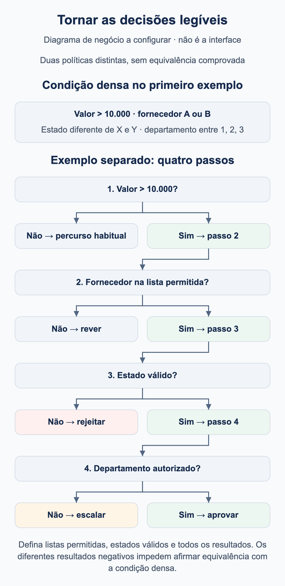<figcaption><p>O exemplo de quatro passos ilustra uma política distinta da condição densa. Torna visível cada resultado negativo; não é uma transformação lógica equivalente comprovada. Defina listas permitidas e o tratamento das saídas.</p></figcaption></figure>

✅ **Bom:**

Explicação visual: [condição simples](#diagrama-condicao-simples).

<details>
<summary>Exemplo simples: percurso para valores elevados</summary>

```
IF Amount > 10000:
  → Percurso de valor elevado
ELSE:
  → Percurso habitual
```

</details>

❌ **Mau (demasiado complexo):**

Explicação visual: [decisões legíveis](#diagrama-decisoes-legiveis).

<details>
<summary>Exemplo de condição densa</summary>

```
IF (Amount > 10000 AND (Supplier = "A" OR Supplier = "B") AND NOT (Status = "X" OR Status = "Y") AND Department IN [1,2,3]):
  → Percurso complexo
```

</details>

**Outro exemplo: uma política distinta em quatro etapas:**

Este exemplo distingue os resultados em cada etapa. Não é uma reescrita logicamente equivalente da condição densa acima: listas de fornecedores, estados válidos, departamentos permitidos e tratamento de resultados negativos têm de ser definidos para este segundo exemplo.

Explicação visual: [decisões legíveis](#diagrama-decisoes-legiveis).

<details>
<summary>Outro exemplo: política em quatro passos</summary>

```
Passo 1: IF Amount > 10000: Continuar, ELSE: Percurso habitual
Passo 2: IF Supplier está na lista permitida: Continuar, ELSE: Rever
Passo 3: IF Status é válido: Continuar, ELSE: Rejeitar
Passo 4: IF Department está autorizado: Aprovar, ELSE: Escalar
```

</details>

***

### 2. Documentar a lógica de decisão

**Incluir sempre:**

* Objetivo de cada ponto de decisão
* Regra de negócio implementada
* Resultados esperados
* Tratamento de exceções

**Exemplo de documentação:**

#### Diagrama: Registo da regra

<figure>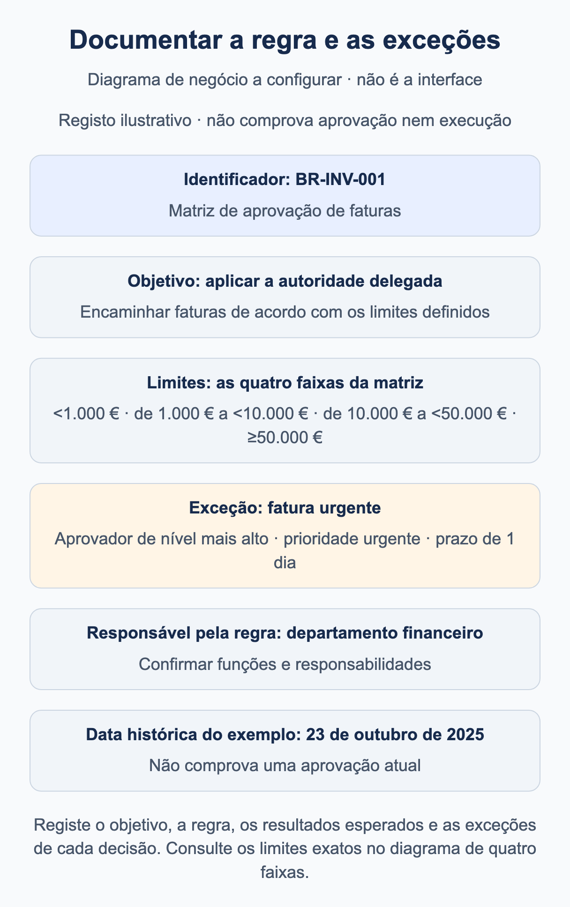<figcaption><p>Registo ilustrativo da regra BR-INV-001: objetivo, limites, exceção, responsável e data de referência. A referência às quatro faixas evita duplicar a regra; este registo não comprova aprovação nem execução.</p></figcaption></figure>

<details>
<summary>Registo ilustrativo da regra BR-INV-001</summary>

```
Ponto de decisão: verificação do limite do montante
Regra de negócio: BR-INV-001 (matriz de aprovação de faturas)
Objetivo: encaminhar faturas pelos limites de montante segundo a política da empresa
Limites:
  < €1,000: Aprovar automaticamente (limite aprovado pelo CFO neste exemplo)
  €1,000 ≤ Amount < €10,000: Aprovação do gestor (matriz de delegação)
  €10,000 ≤ Amount < €50,000: Aprovação do diretor com verificações do fornecedor
  Amount ≥ €50,000: Aprovação executiva
Exceções: faturas urgentes passam diretamente ao nível mais elevado
Atualizado: 2025-10-23
Responsável: departamento financeiro
```

</details>

***

### 3. Testar todos os caminhos

**Matriz de teste proposta — resultados esperados, não testes executados:**

Verifique estes resultados esperados na sua configuração e registe o que observar.

| Caso | Valor | Tipo | Fornecedor | Percurso esperado | Verificação |
| --- | --- | --- | --- | --- | --- |
| TC1 | 500 € | Invoice | Existente | Aprovação automática | A testar |
| TC2 | 5.000 € | Invoice | Existente | Gestor | A testar |
| TC3 | 15.000 € | Invoice | Novo | Diretor, depois CFO | A testar |
| TC4 | 60.000 € | Invoice | Existente | Executivo | A testar |
| TC5 | 2.000 € | Credit Note | Existente | Workflow de notas de crédito | A testar |
| TC6 | 100.000 € | Invoice | Bloqueado | Parar e escalar | A testar |
| TC7 | 999,99 € | Invoice | Existente | Aprovação automática | A testar |
| TC8 | 1.000 € | Invoice | Existente | Gestor | A testar |
| TC9 | 9.999,99 € | Invoice | Existente | Gestor | A testar |
| TC10 | 10.000 € | Invoice | Existente | Diretor + verificações do fornecedor | A testar |
| TC11 | 49.999,99 € | Invoice | Existente | Diretor + verificações do fornecedor | A testar |
| TC12 | 50.000 € | Invoice | Existente | Executivo | A testar |
| TC13 | Ausente ou inválido | Invoice | Existente | Revisão manual escolhida para este exemplo | A testar |
| TC14 | 15.000 € | Invoice | Novo | Diretor pendente: não criar a tarefa seguinte | A testar |
| TC15 | 15.000 € | Invoice | Novo | Diretor ou CFO rejeitado: parar a cadeia e tratar a rejeição | A testar |
| TC16 | 15.000 € | Invoice | Novo | Ambas as aprovações positivas: prosseguir com o processamento configurado | A testar |

***

### 4. Monitorizar as métricas de decisão

**Acompanhar:**

* Distribuição pelos caminhos de decisão
* Taxa de aprovação automática
* Taxa de revisão manual
* Tempo médio de processamento por caminho
* Taxas de exceção
* Utilização dos caminhos

**Métricas de exemplo fictícias:** estes valores ilustram um relatório; não comprovam o desempenho atual nem a execução deste workflow.

#### Diagrama: Métricas fictícias

<figure>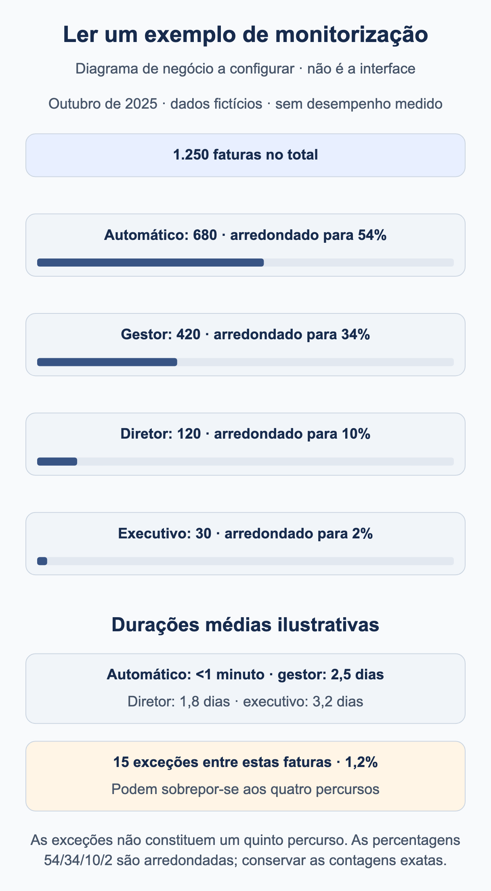<figcaption><p>Exemplo fictício: os quatro percursos totalizam 1.250 faturas. As percentagens dos percursos são arredondadas. As 15 exceções, ou 1,2%, podem referir-se às mesmas faturas; não constituem um quinto percurso. As durações não medem o desempenho do DocBits.</p></figcaption></figure>

<details>
<summary>Exemplo fictício de distribuição e durações</summary>

```
Mês: outubro de 2025
Total de faturas: 1250

Distribuição pelos percursos de decisão:
- Aprovadas automaticamente (< €1k): 680 (54%)
- Percurso do gestor (€1k ≤ Amount < €10k): 420 (34%)
- Percurso do diretor (€10k ≤ Amount < €50k): 120 (10%)
- Percurso executivo (Amount ≥ €50k): 30 (2%)

Tempo de processamento:
- Aprovar automaticamente: < 1 minuto
- Percurso do gestor: média de 2,5 dias
- Percurso do diretor: média de 1,8 dias
- Percurso executivo: média de 3,2 dias

Exceções: 15 (1,2%)
```

</details>

***

## Padrões relacionados

### Padrões que combinam bem:

* [**Padrão de Gestão de Tarefas**](task-management-pattern.md) – Criar tarefas com base em decisões
* [**Padrão de Integração de API**](api-integration-pattern.md) – Obter dados para a tomada de decisão
* [**Padrão de Correspondência de Encomendas (PO Matching)**](po-matching-pattern.md) – Utilizar os resultados do PO nas decisões
* [**Padrão de Transformação de Dados**](data-transformation-pattern.md) – Transformar dados antes das decisões

***

## Guias relacionados

### Pré-requisitos

* [Guia completo de cartões de condição](../and/condition-cards-complete-guide.md) – Todos os cartões de condição
* [Guia de manipulação de campos](../then/document-field/field-manipulation-guide.md) – Operações de campos
* [Guia de atribuição](../then/assignee/assignment-user-guide.md) – Lógica de encaminhamento

### Cartões relacionados

* **CONDITION\_DOC\_FIELD\_AMOUNT** – [Guia de cartões de condição](../and/condition-cards-complete-guide.md)
* **CONDITION\_DOC\_TYPE\_IS\_ISNOT** – [Guia de cartões de condição](../and/condition-cards-complete-guide.md)
* **CONDITION\_SUPPLIER\_STATUS\_IS\_ISNOT** – [Guia de cartões de condição](../and/condition-cards-complete-guide.md)
* **ACTION\_ASSIGN\_TO\_USER** – [Guia de atribuição](../then/assignee/assignment-user-guide.md)
* **tasks\_create** – [Guia de atribuição de tarefas](../then/task/task-assignment-guide.md)

### Próximos passos

* Criar tarefas: [Padrão de Gestão de Tarefas](task-management-pattern.md)
* Adicionar correspondência complexa: [Padrão de Correspondência de Encomendas (PO Matching)](po-matching-pattern.md)
* Integrar APIs: [Padrão de Integração de API](api-integration-pattern.md)

***

**Metadados históricos do exemplo:**

**Versão do padrão:** 1.0 **Última atualização:** 23 de outubro de 2025 **Dificuldade:** média **Tempo estimado:** 30–45 minutos

[Exemplos reais de workflows na prática](production-workflow-examples.md)
