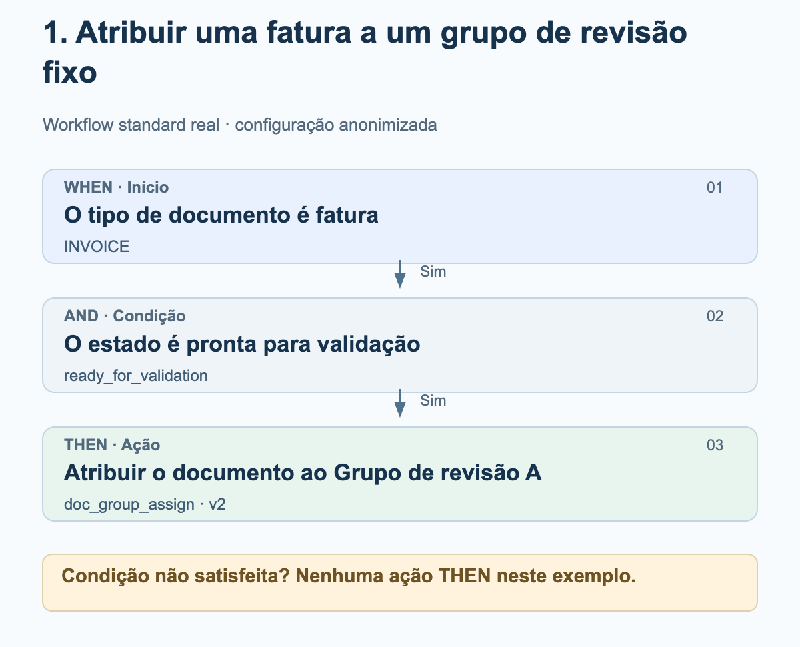
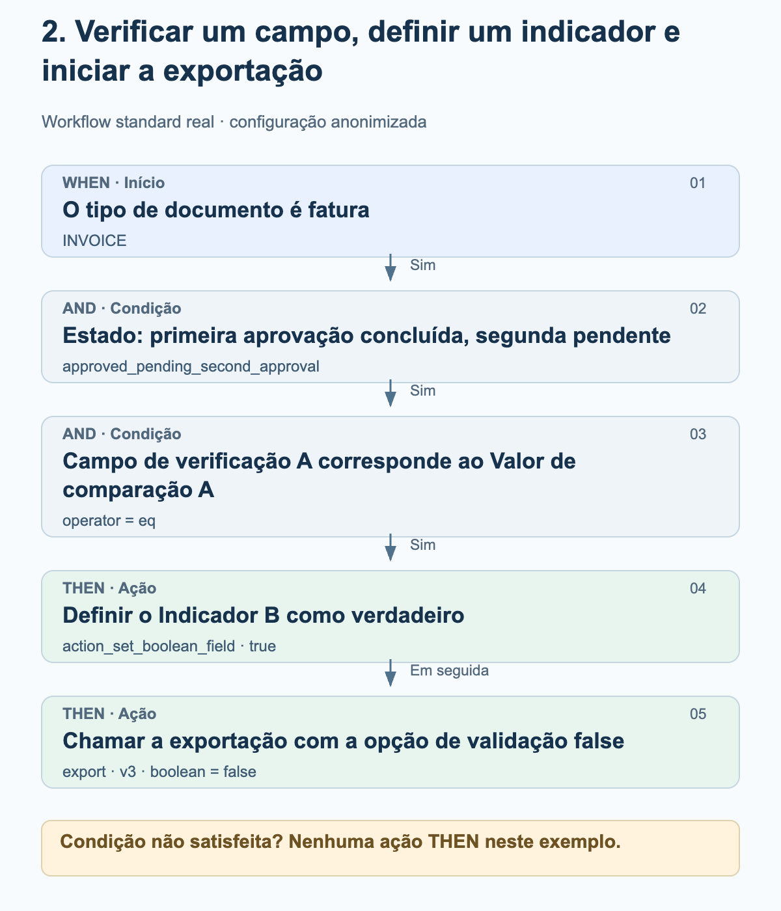
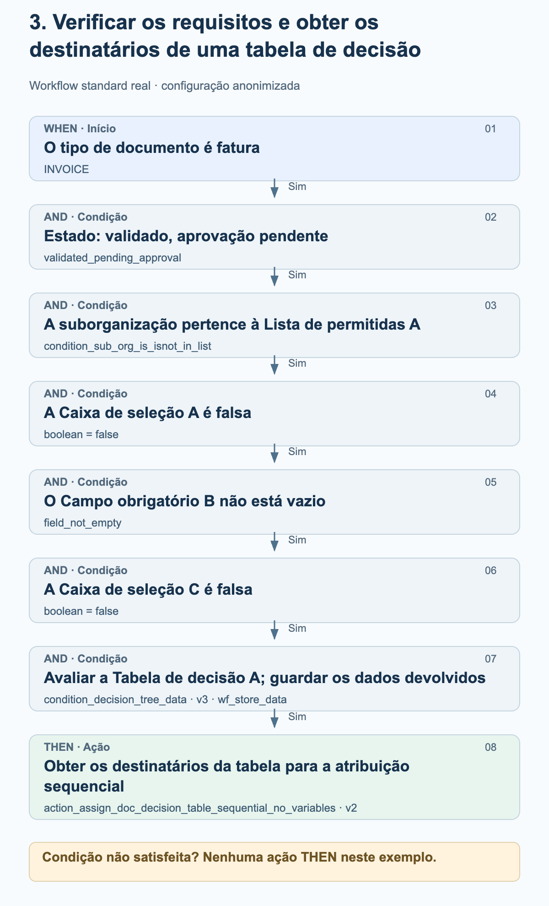

# Exemplos reais de workflows na prática

Estes três exemplos provêm de workflows standard ativados no ambiente de produção. Mostram a sequência de WHEN, AND e THEN efetivamente configurada. Os grupos, as organizações, os nomes dos campos, os valores de comparação e as tabelas de decisão foram substituídos por designações neutras. Os diagramas explicam a configuração; não são capturas de ecrã.

Situação em 27 de outubro de 2026. Os cartões utilizados, as versões, os parâmetros e a respetiva sequência foram comparados com as configurações guardadas de execuções bem-sucedidas em produção. Um registo de workflow com o resultado success não confirma uma aprovação humana nem a receção no ERP. Não foram alterados workflows nem executados workflows para fins de teste.

## Como ler os diagramas

Os exemplos utilizam o modo standard. WHEN delimita o tipo de documento; todas as condições AND têm de ser satisfeitas antes de se seguirem as ações THEN. Nestes exemplos, uma condição não satisfeita impede todas as ações THEN. As setas entre as ações mostram a sequência configurada. Não representam um passo adicional de sucesso ou de aprovação. Uma execução também pode terminar com um erro.

## 1. Atribuir uma fatura a um grupo de revisão fixo

Uma fatura deve ser enviada para revisão a um grupo configurado de forma fixa assim que atingir o estado «pronta para validação». Este exemplo não requer uma tabela de decisão.

<figure><figcaption>Fatura e estado correspondente: o documento é atribuído ao Grupo de revisão A, configurado de forma fixa. A atribuição ainda não constitui uma aprovação.</figcaption></figure>

Cartões e definições

| Fase / Cartão | Definição no exemplo | Significado |
| --- | --- | --- |
| WHEN · condition_doc_type_is_isnot_list · v2 | operator = is; doc_type = INVOICE | Apenas as faturas satisfazem esta condição. |
| AND · condition_doc_status_is_isnot · v2 | operator = is; status = ready_for_validation | O documento está pronto para validação. |
| THEN · doc_group_assign · v2 | groups = Grupo de revisão A | A versão 2 utiliza o grupo configurado. A opção de tabela de decisão não determina o comportamento desta versão do cartão. |

### O que verificar ao reproduzir

- Grupo de revisão A é uma designação anonimizada. Selecione um grupo da sua organização e confirme a sua responsabilidade.
- Verifique o tipo de documento e o estado separadamente: uma fatura noutro estado não satisfaz este exemplo.
- A atribuição de documentos, as tarefas e as aprovações são operações diferentes. Esta configuração contém apenas a atribuição.

## 2. Verificar um campo, definir um indicador e iniciar a exportação

Uma fatura num determinado estado de aprovação só continua a ser processada se o seu Campo de verificação A corresponder exatamente ao Valor de comparação A. Em seguida, o workflow tenta definir o Indicador B como verdadeiro e depois chama a exportação. Os nomes originais dos campos e o valor de comparação foram anonimizados.

<figure><figcaption>A verificação do campo permite executar as duas ações. Primeiro é chamada a ação que define o indicador; depois segue-se a chamada de exportação. O estado e as verificações de validação desativadas fazem parte desta configuração específica.</figcaption></figure>

Cartões e definições

| Fase / Cartão | Definição no exemplo | Significado |
| --- | --- | --- |
| WHEN · condition_doc_type_is_isnot_list · v2 | operator = is; doc_type = INVOICE | Apenas as faturas satisfazem esta condição. |
| AND · condition_doc_status_is_isnot · v2 | operator = is; status = approved_pending_second_approval | O estado configurado significa «primeira aprovação concluída, segunda aprovação pendente». Não é substituído aqui por um estado de aprovação mais genérico. |
| AND · condition_docfield_operator_value · v2 | field_name = Campo de verificação A; operator = eq; field_value = Valor de comparação A | O conteúdo do campo tem de corresponder ao valor configurado; a condição não verifica apenas se o campo está preenchido. |
| THEN 1 · action_set_boolean_field · v2 | field_name = Indicador B; boolean = true | Tenta definir o campo booleano configurado como verdadeiro. |
| THEN 2 · export · v3 | boolean = false | Inicia a exportação com ignore_field_validation_errors = true e validate_po_match = false. Aqui, false desativa verificações de validação, não a exportação. |

### O que verificar ao reproduzir

- A opção de exportação false é uma definição específica de um cliente, não uma recomendação geral. Antes de reproduzir o exemplo, verifique sobretudo a validação dos campos, a correspondência com a encomenda de compra (PO) e os requisitos de aprovação.
- Não está configurada qualquer condição adicional entre a definição do indicador e a exportação. A sequência, por si só, não garante que a primeira ação tenha sido bem-sucedida; as exceções e os erros das ações devem ser verificados separadamente.
- O workflow não contém um passo de espera por uma segunda aprovação humana. Uma execução bem-sucedida do workflow não substitui a comprovação da receção no ERP.

## 3. Verificar os requisitos e obter os destinatários de uma tabela de decisão

Uma fatura só deve ser atribuída através de uma tabela de decisão quando a organização, o estado, duas caixas de seleção e um campo obrigatório cumprirem os requisitos. O workflow guarda os dados devolvidos pela tabela de decisão para que a atribuição sequencial seguinte os possa utilizar.

<figure><figcaption>Todas as seis condições AND têm de ser satisfeitas. Os dados devolvidos pela tabela de decisão são guardados e depois utilizados na atribuição sequencial do documento. O diagrama não inventa destinatários nem níveis de aprovação.</figcaption></figure>

Cartões e definições

| Fase / Cartão | Definição no exemplo | Significado |
| --- | --- | --- |
| WHEN · condition_doc_type_is_isnot_list · v2 | operator = is; doc_type = INVOICE | Restringe o exemplo às faturas. |
| AND 1 · condition_doc_status_is_isnot · v2 | operator = is; status = validated_pending_approval | O documento está validado, mas a aprovação está pendente. |
| AND 2 · condition_sub_org_is_isnot_in_list · v2 | operator = is; sub_org_id = Lista de permitidas A | Apenas as suborganizações configuradas estão incluídas no âmbito de aplicação. |
| AND 3 · condition_checkbox_is · v2 | field_name = Caixa de seleção A; boolean = false | A primeira caixa de seleção configurada tem de ser falsa. |
| AND 4 · condition_docfield_status · v2 | field_name = Campo obrigatório B; field_status = field_not_empty | O campo configurado tem de estar preenchido. |
| AND 5 · condition_checkbox_is · v2 | field_name = Caixa de seleção C; boolean = false | A segunda caixa de seleção também tem de ser falsa. |
| AND 6 · condition_decision_tree_data · v3 | decision_table = Tabela de decisão A; store_data = wf_store_data | A tabela é avaliada para o documento. Os dados devolvidos são guardados para os cartões seguintes. O campo boolean adicional mais antigo está vazio e não controla esta versão. |
| THEN · action_assign_doc_decision_table_sequential_no_variables · v2 | sem variáveis próprias do cartão | Obtém os destinatários dos dados devolvidos pela tabela e guardados para a atribuição sequencial. Os destinatários e as prioridades dependem da tabela. |

### O que verificar ao reproduzir

- Caixa de seleção A, Campo obrigatório B e Caixa de seleção C designam três campos configurados distintos. As designações neutras substituem os nomes originais.
- Verificar que um campo não está vazio ainda não confirma que o seu conteúdo esteja correto do ponto de vista funcional.
- Verifique a tabela de decisão efetiva, incluindo os destinatários e as prioridades. As suas regras não são publicadas aqui; não são inventados limites de montante nem funções.
- Uma avaliação bem-sucedida da tabela não garante que os destinatários sejam utilizáveis. A atribuição seguinte requer saídas válidas de utilizadores ou grupos.
- Uma atribuição sequencial não comprova uma aprovação humana concluída. Este workflow não contém uma chamada de exportação.

## Do exemplo à sua própria configuração

Defina os campos, grupos e tabelas de decisão adequados na sua própria organização. Não interprete as designações neutras como campos já existentes no produto. Teste cada condição, tanto nos casos positivos como nos negativos, e os erros das ações num ambiente de teste adequado. Verifique as aprovações e as exportações pelos resultados efetivos; só ative um workflow após a validação funcional.

[Exemplos avançados de workflows em produção](advanced-production-workflow-examples.md)
