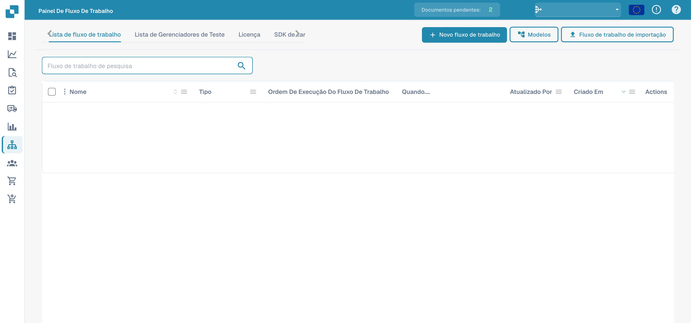
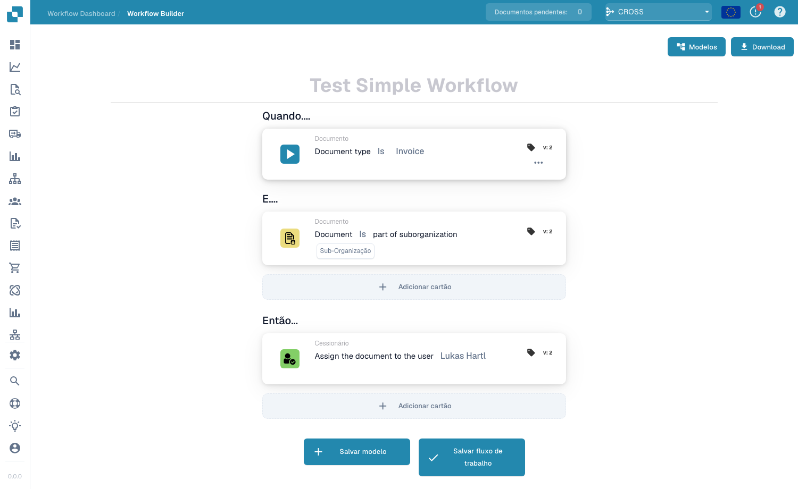
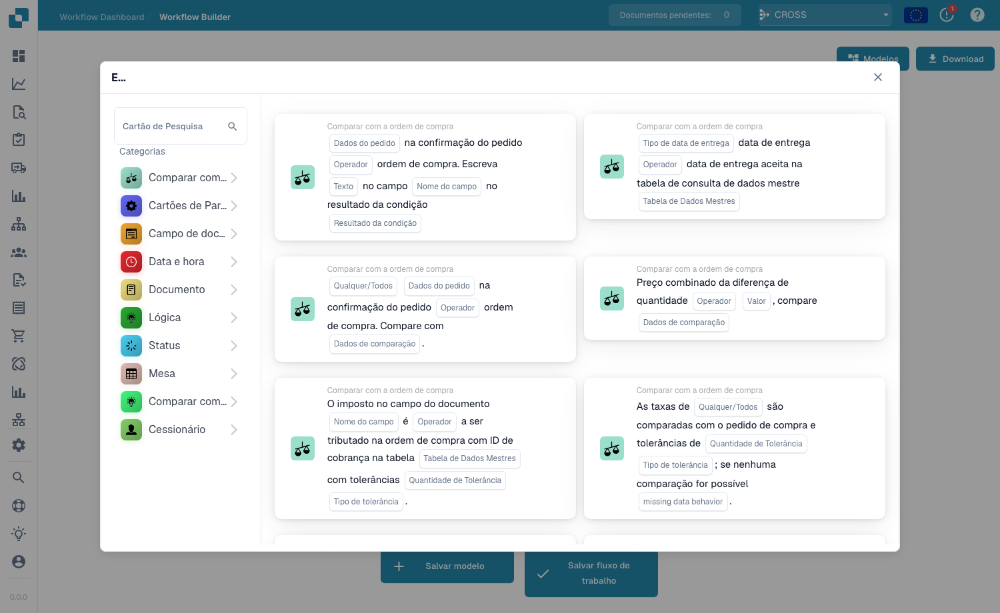

# Fluxo padrão

O construtor **Standard Workflow** é o editor linear, baseado em cartões, para automatizar o processamento de documentos. Um fluxo de trabalho é composto por três grupos de cartões — **Quando** (o gatilho), **E** (condições adicionais) e **Então** (as ações a executar). Quando um documento corresponde às condições When/And, as ações Then são executadas automaticamente.

## Criar e testar um Standard Workflow 

Crie um Standard Workflow completo na interface real do DocBits: selecione a fatura, verifique o número e um montante superior a 1000, atribua um revisor e altere o estado. Guarde a regra, execute três cenários de teste e confirme o resultado real no documento.



[Ver com legendas](https://docbits-videos.fra1.cdn.digitaloceanspaces.com/settings-assistant/standard-workflow-admin/v2/pt.html) · [Abrir vídeo](https://docbits-videos.fra1.cdn.digitaloceanspaces.com/settings-assistant/standard-workflow-admin/v2/pt.mp4) · [Legendas (WebVTT)](https://docbits-videos.fra1.cdn.digitaloceanspaces.com/settings-assistant/standard-workflow-admin/v2/pt.vtt) · [Transcrição](https://docbits-videos.fra1.cdn.digitaloceanspaces.com/settings-assistant/standard-workflow-admin/v2/pt.txt) · 3:42

Capítulos e transcrição

| Capítulo | Início |
| --- | --- |
| O que faz este workflow | [0:00](https://docbits-videos.fra1.cdn.digitaloceanspaces.com/settings-assistant/standard-workflow-admin/v2/pt.mp4#t=0.000) |
| Dar um nome ao workflow | [0:14](https://docbits-videos.fra1.cdn.digitaloceanspaces.com/settings-assistant/standard-workflow-admin/v2/pt.mp4#t=14.750) |
| When: tipo de documento | [0:24](https://docbits-videos.fra1.cdn.digitaloceanspaces.com/settings-assistant/standard-workflow-admin/v2/pt.mp4#t=24.375) |
| And: número de fatura | [0:36](https://docbits-videos.fra1.cdn.digitaloceanspaces.com/settings-assistant/standard-workflow-admin/v2/pt.mp4#t=36.167) |
| And: montante superior a 1000 | [0:50](https://docbits-videos.fra1.cdn.digitaloceanspaces.com/settings-assistant/standard-workflow-admin/v2/pt.mp4#t=50.000) |
| Then: atribuir um revisor | [1:04](https://docbits-videos.fra1.cdn.digitaloceanspaces.com/settings-assistant/standard-workflow-admin/v2/pt.mp4#t=64.042) |
| Then: alterar o estado | [1:17](https://docbits-videos.fra1.cdn.digitaloceanspaces.com/settings-assistant/standard-workflow-admin/v2/pt.mp4#t=77.292) |
| Verificar e guardar | [1:29](https://docbits-videos.fra1.cdn.digitaloceanspaces.com/settings-assistant/standard-workflow-admin/v2/pt.mp4#t=89.000) |
| Verificar a regra guardada | [1:43](https://docbits-videos.fra1.cdn.digitaloceanspaces.com/settings-assistant/standard-workflow-admin/v2/pt.mp4#t=103.958) |
| Preparar o cenário de teste | [1:56](https://docbits-videos.fra1.cdn.digitaloceanspaces.com/settings-assistant/standard-workflow-admin/v2/pt.mp4#t=116.167) |
| Executar o caso positivo | [2:16](https://docbits-videos.fra1.cdn.digitaloceanspaces.com/settings-assistant/standard-workflow-admin/v2/pt.mp4#t=136.583) |
| Testar o valor limite | [2:35](https://docbits-videos.fra1.cdn.digitaloceanspaces.com/settings-assistant/standard-workflow-admin/v2/pt.mp4#t=155.917) |
| Testar outro número de fatura | [2:52](https://docbits-videos.fra1.cdn.digitaloceanspaces.com/settings-assistant/standard-workflow-admin/v2/pt.mp4#t=172.375) |
| Verificar o resultado no documento | [3:09](https://docbits-videos.fra1.cdn.digitaloceanspaces.com/settings-assistant/standard-workflow-admin/v2/pt.mp4#t=189.292) |
| Ativar a regra testada | [3:26](https://docbits-videos.fra1.cdn.digitaloceanspaces.com/settings-assistant/standard-workflow-admin/v2/pt.mp4#t=206.875) |

**O que faz este workflow**

Bem, vou criar um Standard Workflow completo para uma fatura de formação. Acima de mil, o documento deve ser atribuído a um revisor e aguardar aprovação. Um número de fatura próprio limita o exemplo ao documento pretendido.

**Dar um nome ao workflow**

Na lista, clico em Novo workflow. Defino um nome claro antes de adicionar cartões. Esta organização abre diretamente o designer Standard.

**When: tipo de documento**

Em Quando, abro a biblioteca e seleciono o cartão do tipo de documento. Escolho o operador É e o tipo Fatura. Assim defino o tipo de documento verificado pela regra.

**And: número de fatura**

Em E, adiciono uma condição de campo do documento. Seleciono invoice_id, escolho Igual e introduzo o número da fatura de formação. Esta condição adicional limita a demonstração à fatura pretendida.

**And: montante superior a 1000**

Outra condição E verifica total_amount. Escolho Maior que e introduzo mil. Exatamente mil não satisfaz esta condição. O montante e a moeda devem corresponder ao documento de formação.

**Then: atribuir um revisor**

Em Então, escolho a ação para atribuir o documento a um utilizador. Seleciono Docs User A2, o nosso revisor de teste da documentação. Esta ação atribui o documento sem criar uma notificação por email.

**Then: alterar o estado**

A segunda ação altera o estado para A aguardar aprovação. Defino Acionar workflows como falso. Este exemplo não precisa de outra execução quando a própria ação altera o estado.

**Verificar e guardar**

Antes de guardar, volto a ler a regra completa. Devem corresponder Fatura, o número exato e um montante acima de mil. Depois, as duas ações seguem a ordem apresentada. Guardo o workflow e verifico a confirmação.

**Verificar a regra guardada**

Na lista, verifico o workflow guardado e o seu estado ativo. Guardar pode ativar um workflow imediatamente. Desativo esta regra de formação enquanto preparo os testes.

**Preparar o cenário de teste**

No Test Manager, adiciono um cenário e seleciono o workflow guardado. Defino um nome claro e carrego os ficheiros JSON de entrada e resultado esperado. A entrada contém o número da fatura, o montante mil setecentos e oitenta e cinco e o estado Pronto para validação. O estado esperado é A aguardar aprovação.

**Executar o caso positivo**

Envio o cenário e escolho Executar teste no menu. Volto a abrir a lista para carregar o resultado guardado. O teste aprovado compara o estado esperado do documento. Neste sandbox, o painel dos cartões não apresenta as mensagens individuais de forma fiável, por isso verifico também o documento real.

**Testar o valor limite**

Depois testo exatamente mil. O número e o tipo de documento continuam a corresponder, mas Maior que deve ser falso. Nesta entrada de teste, o estado esperado mantém-se Pronto para validação. Guardo e executo este cenário separado e verifico o resultado.

**Testar outro número de fatura**

Outro cenário utiliza um número de fatura diferente e um montante acima de mil. O montante, por si só, não deve iniciar as ações. Guardo e executo o cenário com o estado inicial como resultado esperado. Estes casos negativos verificam os limites da regra.

**Verificar o resultado no documento**

No Dashboard, encontro o documento de formação. O estado real é A aguardar aprovação e está atribuído a Docs User A2. Isto confirma o resultado visível das duas ações. Esta alteração resulta do teste manual e não comprova o processamento automático.

**Ativar a regra testada**

Na lista de workflows, ativo a regra testada e confirmo o interruptor ligado. Antes de colocar em serviço, verifico condições, destinatários e resultados. Depois da demonstração, volto a desativar a regra de formação.

## Como aceder

Abra o **Workflow Dashboard → Workflow List** e clique em **Adicionar fluxo de trabalho** para criar um novo fluxo de trabalho Standard, ou clique num fluxo de trabalho existente para o editar.

<figure><figcaption>
Lista de fluxos e ações de importação.
</figcaption></figure>

## O modelo When / And / Then

<figure><figcaption>
A tela do Standard Workflow. Este exemplo é acionado por faturas numa sub-organização e atribui-as a um utilizador.
</figcaption></figure>

- **Quando** — o gatilho que inicia o fluxo de trabalho (por exemplo, *o tipo de documento é Fatura*).
- **E** — condições adicionais que também têm de ser verdadeiras (por exemplo, *o documento faz parte de uma sub-organização*). Deixe vazio para executar em todas as correspondências do cartão When.
- **Então** — as ações a realizar (por exemplo, *atribuir o documento ao utilizador*, criar uma tarefa, chamar uma API, enviar um e-mail).

## Adicionar cartões

Clique em **Adicionar cartão** em qualquer grupo para abrir a biblioteca de cartões. Os cartões estão organizados por categoria para que possa encontrar o bloco de construção de que precisa:

<figure><figcaption>
A biblioteca <strong>Add Card</strong> — cartões de condição, cartões de comparação, cartões de ação e mais, agrupados por categoria.
</figcaption></figure>

Guarde com **Salvar fluxo de trabalho** ou guarde o esquema como um modelo reutilizável com **Salvar modelo**.

## Próximos passos

- Veja o que cada cartão faz na secção **Cartas**.
- Combine cartões em soluções comprovadas com os **Workflow Pattern Guides**.
- Para fluxos com ramificações e caminhos paralelos (Wait ALL / Wait ANY / OR), utilize o construtor **Fluxo de trabalho avançado**.
