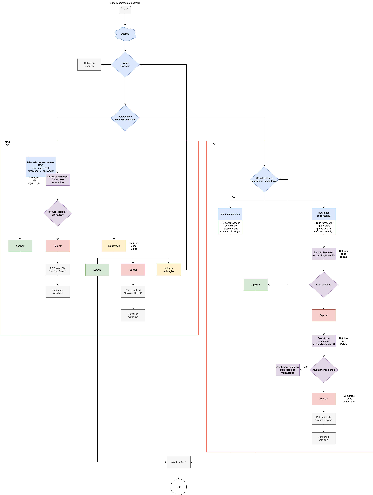

# Fluxo de trabalho padrão

<figure><figcaption>
Exemplo de workflow de faturas com e sem encomenda. Os percursos de aprovação, o prazo de dois dias e a ligação ao ERP fazem parte deste exemplo e devem corresponder à configuração da organização.
</figcaption></figure>

#### Visão geral dos componentes do fluxo de trabalho:

* **Receção de faturas por e-mail**: O processo começa provavelmente com uma fatura recebida por e-mail.
* **DocBits**: Esta ferramenta pode ser utilizada para tarefas iniciais de gestão de documentos, tais como a captura e a digitalização de faturas.
* **Revisão financeira**: As faturas são submetidas a uma revisão financeira, onde se tomam decisões quanto à sua validade e exatidão.

#### Etapas do fluxo de trabalho:

1. **Revisão inicial**:
   * As faturas são recebidas e inicialmente processadas com o DocBits.
   * São depois revistas pela equipa financeira para garantir que são removidas do fluxo de trabalho caso estejam completas, ou encaminhadas para processamento adicional.
2. **Faturas com e sem pedido de compra**:
   * O fluxo de trabalho distingue entre faturas associadas a PO e faturas sem PO.
   * As faturas sem PO são encaminhadas para aprovação ou rejeição adicional com base em critérios predefinidos, como o ID do fornecedor, a quantidade, o preço unitário e o número do artigo.
3. **Correspondências e divergências**:
   * As faturas são confrontadas com as receções de mercadorias para garantir que os detalhes correspondem (como o ID do fornecedor e a quantidade).
   * Se ocorrerem discrepâncias, a fatura fica sujeita a uma revisão adicional e, possivelmente, à rejeição.
4. **Revisão financeira e pelo comprador**:
   * No caso de faturas associadas a PO, é realizado um processo de correspondência detalhado que envolve uma revisão por parte do comprador.
   * Poderão ser necessários ajustes às ordens de compra ou às receções de mercadorias.
5. **Decisões finais**:
   * As faturas que passam em todas as verificações são aprovadas e integradas nos sistemas financeiros para efeitos de arquivo.
   * As faturas rejeitadas desencadeiam notificações, e o comprador poderá solicitar uma nova fatura.
6. **Integração com Infor IDM e LN+M3**:
   * As faturas aprovadas são provavelmente enviadas para o Infor IDM para gestão de documentos e para o LN para registo contabilístico.
   * Esta integração garante que todos os registos financeiros estão atualizados e que o fluxo de trabalho alimenta de forma transparente o sistema ERP mais alargado.

#### Pontos de decisão:

* Ao longo do fluxo de trabalho, existem vários pontos de decisão em que uma fatura pode ser aprovada, rejeitada ou devolvida para obtenção de informações adicionais. São enviadas notificações após atrasos, garantindo um processamento atempado.

Estes fluxos de trabalho serão incluídos no Standard Workflow
