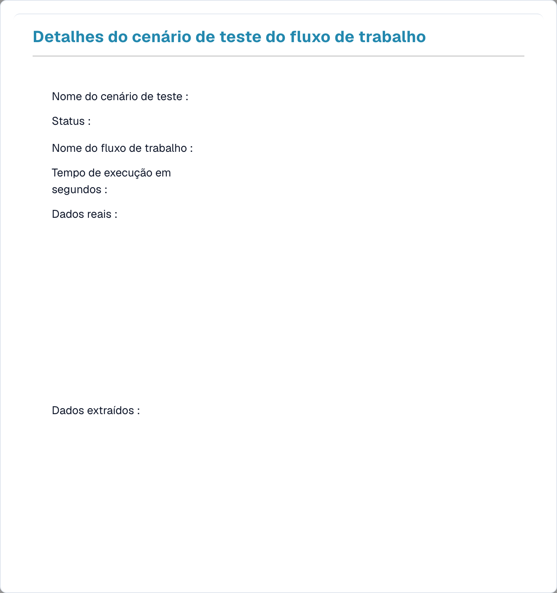

# Gestão de testes

O **Gestão de testes** permite-lhe guardar **cenários de teste** reutilizáveis para os seus fluxos de trabalho e executá-los em conjunto — para que possa confirmar que um fluxo de trabalho continua a funcionar corretamente depois de o alterar. Funciona tanto para fluxos de trabalho Standard como Advanced.

Abra-o a partir de **Painel de fluxos → Lista de testes**.

<figure><figcaption>
A Test Manager List — cada cenário guardado mostra um resultado de aprovação/reprovação.
</figcaption></figure>

## O que é um cenário de teste

Um cenário de teste captura um fluxo de trabalho, uma entrada de exemplo e o **resultado esperado**. Quando o executa, o Test Manager reproduz o fluxo de trabalho contra essa entrada e compara o resultado com o que esperava — tornando a linha **verde** (aprovação) ou **vermelha** (reprovação).

## Trabalhar com cenários

- **Adicionar cenário de teste** — crie um novo cenário a partir de um fluxo de trabalho e de um documento de exemplo.
- **Executar todos os testes** — execute todos os cenários de uma só vez e veja, de relance, que fluxos de trabalho continuam aprovados.
- **Ver detalhes** — abra um cenário para inspecionar o seu resultado.

<figure><figcaption>
Detalhes de um cenário de teste; dados ocultos.
</figcaption></figure>

A vista de detalhes mostra o nome do cenário e o **estado**, o **nome do fluxo de trabalho**, o **tempo de execução** e os dados **reais** e **extraídos** que a execução produziu — para que possa ver exatamente por que motivo um cenário foi aprovado ou reprovado.

## Test Manager vs. testar no construtor

São duas coisas diferentes:

- **Gestão de testes** (esta página) — cenários *guardados e repetíveis* com resultados esperados, executados em conjunto com **Executar todos os testes**. Use-o para testes de regressão após alterações.
- **Testar no construtor** — os controlos inline **Validar** e **Teste** dentro do construtor de Advanced Workflow, para verificações rápidas enquanto está a construir. Consulte [Validação e Testes](advanced-workflow/validation-and-testing.md).
