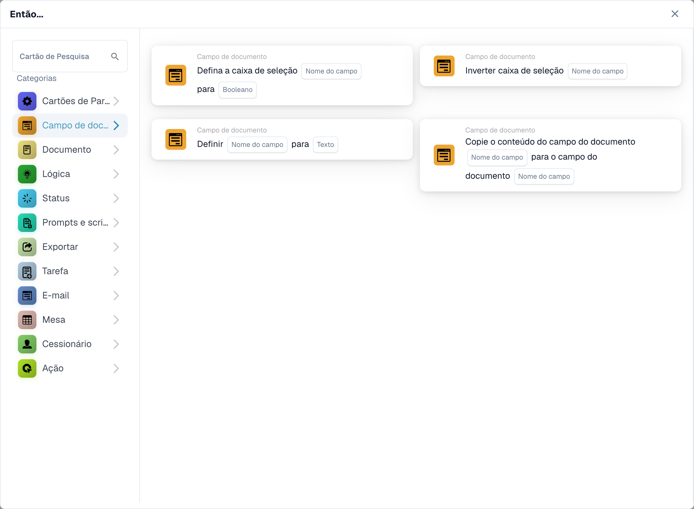
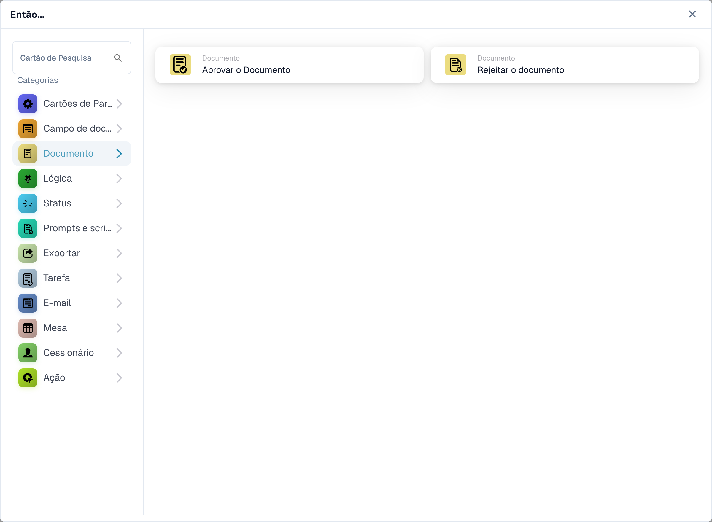
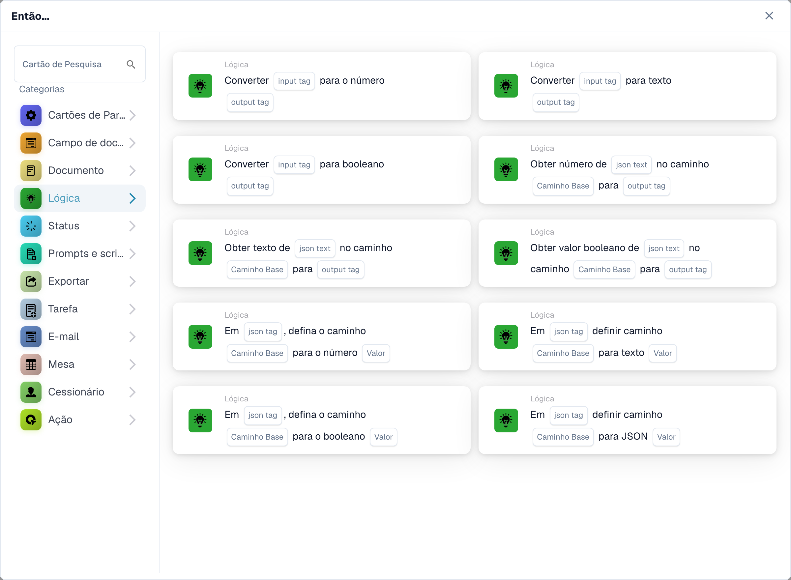
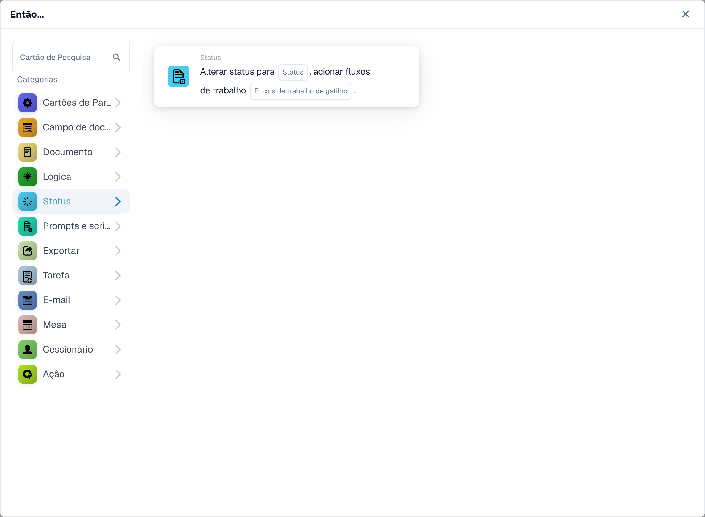
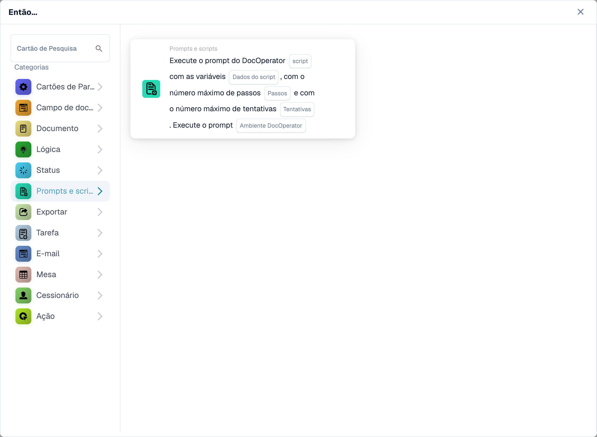
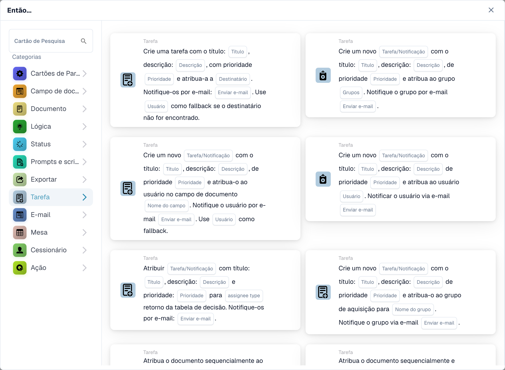
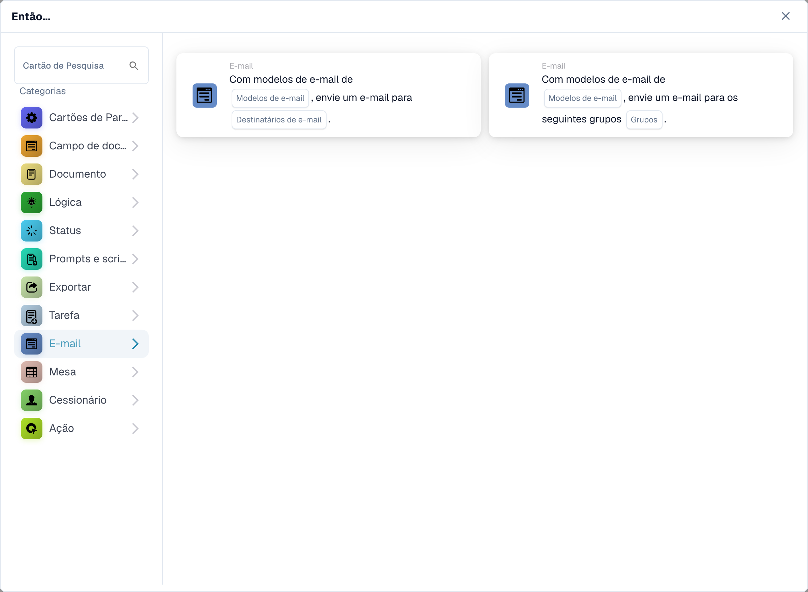
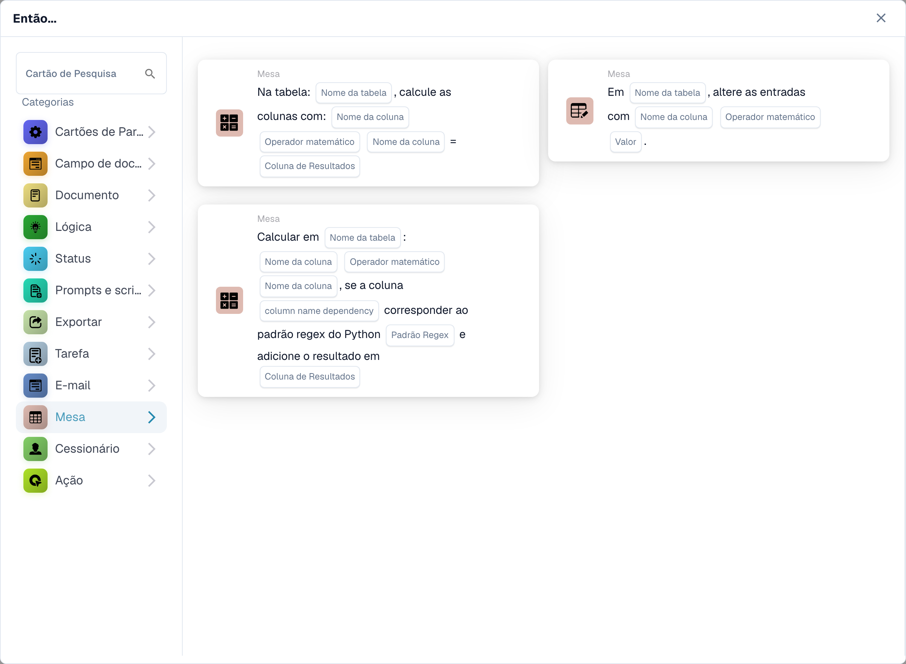
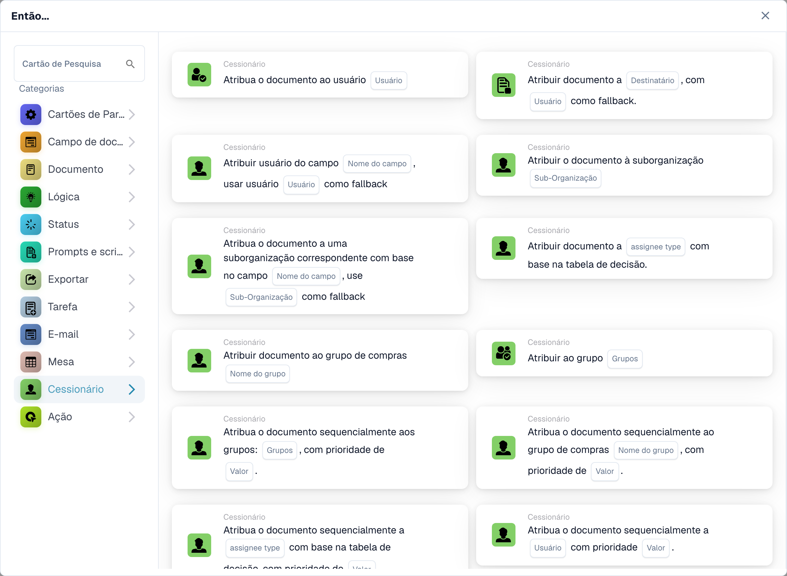

# Então

Um cartão **Então** informa a um fluxo de trabalho o que fazer após seu acionador **Quando** e quaisquer condições **E**. No **Construtor de fluxo de trabalho**, selecione **Adicionar cartão** em **Então...**. Escolha uma categoria à esquerda ou digite um nome em **Cartão de pesquisa**. Selecione uma visualização do cartão para adicioná-lo, preencha os campos mostrados no cartão e salve o fluxo de trabalho. Role no seletor para ver mais cartões. Selecione **×** para fechá-lo sem adicionar um cartão. Consulte [Workflow](..) para a sequência completa.

As visualizações abaixo mostram as ações disponíveis, mas as configurações não concluídas. Escolha a ação que corresponde ao resultado desejado.

## Campo do documento

Defina ou inverta uma caixa de seleção, coloque texto em um campo ou copie um campo para outro. Escolha os nomes dos campos e o valor solicitado pelo cartão. Consulte [Campo do documento](document-field).

<figure><figcaption>
Cartões disponíveis na categoria selecionada. Configure os campos antes de utilizar. Algumas etiquetas desta versão da interface ainda não estão traduzidas ou têm uma tradução incorreta. As explicações desta página usam os termos corretos; a imagem mostra a interface real.
</figcaption></figure>

## Documento

Escolha **Aprovar o Documento** ou **Rejeitar o Documento** quando o fluxo de trabalho deve tomar essa decisão. Use uma condição **E** primeiro se a aprovação depender de uma verificação. Veja [Documento](document).

<figure><figcaption>
Cartões disponíveis na categoria selecionada. Configure os campos antes de utilizar. Algumas etiquetas desta versão da interface ainda não estão traduzidas ou têm uma tradução incorreta. As explicações desta página usam os termos corretos; a imagem mostra a interface real.
</figcaption></figure>

## Lógica

Use esses cartões para converter valores entre formatos numéricos, de texto e booleanos ou ler um valor de JSON. Escolha os campos de entrada e saída no cartão selecionado.

<figure><figcaption>
Cartões disponíveis na categoria selecionada. Configure os campos antes de utilizar. Algumas etiquetas desta versão da interface ainda não estão traduzidas ou têm uma tradução incorreta. As explicações desta página usam os termos corretos; a imagem mostra a interface real.
</figcaption></figure>

## Estado

Escolha **Alterar status** para mover o documento para um status selecionado. O cartão também pode acionar outro fluxo de trabalho. Consulte [Status](status).

<figure><figcaption>
Cartões disponíveis na categoria selecionada. Configure os campos antes de utilizar. Algumas etiquetas desta versão da interface ainda não estão traduzidas ou têm uma tradução incorreta. As explicações desta página usam os termos corretos; a imagem mostra a interface real.
</figcaption></figure>

## Solicitações e scripts

Escolha esta categoria para executar um script de prompt do DocOperator. Selecione o script e as variáveis ​​solicitadas pelo cartão. O cartão também oferece configurações de execução, como novas tentativas.

<figure><figcaption>
Cartões disponíveis na categoria selecionada. Configure os campos antes de utilizar. Algumas etiquetas desta versão da interface ainda não estão traduzidas ou têm uma tradução incorreta. As explicações desta página usam os termos corretos; a imagem mostra a interface real.
</figcaption></figure>

## Exportar

Inicie uma exportação, exporte com uma configuração escolhida ou coloque uma exportação final na fila. Escolha a configuração de exportação e a opção de tarefa pendente mostrada no seu cartão. Consulte [Exportar](export).

<figure><figcaption>
Cartões disponíveis na categoria selecionada. Configure os campos antes de utilizar. Algumas etiquetas desta versão da interface ainda não estão traduzidas ou têm uma tradução incorreta. As explicações desta página usam os termos corretos; a imagem mostra a interface real.
</figcaption></figure>

## Tarefa

Crie uma tarefa ou notificação e atribua-a a um usuário ou grupo. Insira o título, a descrição, a prioridade e as configurações de notificação solicitadas pelo cartão. Alguns cartões são atribuídos sequencialmente. Consulte [Tarefa](task).

<figure><figcaption>
Cartões disponíveis na categoria selecionada. Configure os campos antes de utilizar. Algumas etiquetas desta versão da interface ainda não estão traduzidas ou têm uma tradução incorreta. As explicações desta página usam os termos corretos; a imagem mostra a interface real.
</figcaption></figure>

## E-mail

Envie um email usando um modelo selecionado, para destinatários ou grupos. Escolha o modelo e o destino no cartão.

<figure><figcaption>
Cartões disponíveis na categoria selecionada. Configure os campos antes de utilizar. Algumas etiquetas desta versão da interface ainda não estão traduzidas ou têm uma tradução incorreta. As explicações desta página usam os termos corretos; a imagem mostra a interface real.
</figcaption></figure>

## Tabela

Altere entradas ou calcule valores em uma tabela de documento. Selecione a tabela, colunas, operador e coluna de resultados solicitados pelo cartão. Veja [Tabela](table).

<figure><figcaption>
Cartões disponíveis na categoria selecionada. Configure os campos antes de utilizar. Algumas etiquetas desta versão da interface ainda não estão traduzidas ou têm uma tradução incorreta. As explicações desta página usam os termos corretos; a imagem mostra a interface real.
</figcaption></figure>

## Responsável

Atribua o documento a um usuário, grupo, destinatário ou suborganização. Alguns cartões usam um campo ou uma tabela de decisão e oferecem um comportamento alternativo. Configure o destino e esse comportamento no cartão selecionado. Consulte [Responsável](assignee).

<figure><figcaption>
Cartões disponíveis na categoria selecionada. Configure os campos antes de utilizar. Algumas etiquetas desta versão da interface ainda não estão traduzidas ou têm uma tradução incorreta. As explicações desta página usam os termos corretos; a imagem mostra a interface real.
</figcaption></figure>

## Ação

Execute outro fluxo de trabalho, envie uma solicitação HTTPS, chame uma API ou use o cartão de cálculo de aumento de custos. Estas ações podem afetar outros sistemas; pergunte ao seu administrador qual endpoint e configurações usar. Consulte [Ação](action).

<figure><figcaption>
Cartões disponíveis na categoria selecionada. Configure os campos antes de utilizar. Algumas etiquetas desta versão da interface ainda não estão traduzidas ou têm uma tradução incorreta. As explicações desta página usam os termos corretos; a imagem mostra a interface real.
</figcaption></figure>

[Campos detalhados do cartão lógico, caminhos JSON, gatilhos e testes](../cards-overview/logic-cards-guide.md).
