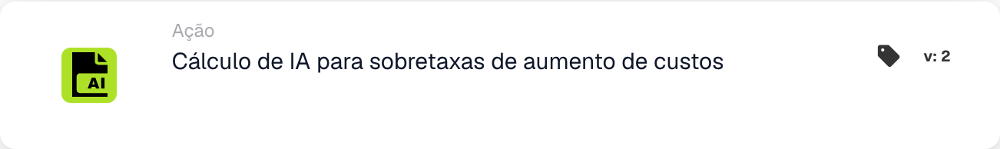

# Cálculo de IA para sobretaxas de aumento de custos

<figure><figcaption>
Campos do cartão na versão apresentada. Os campos ainda não estão configurados.
</figcaption></figure>

## Quando usar este cartão

Use esta ação para solicitar o cálculo configurado da sobretaxa de material e energia MTZ/ETZ para o documento atual. Prepare primeiro os dados do documento e a configuração do serviço de cálculo exigidos pela sua organização.

## Configuração real

O cartão exibido não possui entradas de Fator de Aumento de Custo, Campo de Custo Base ou Campo de Sobretaxa. Delega o cálculo ao serviço configurado. Não procure esses controles de cartão inexistentes nem presuma uma fórmula de porcentagem fixa a partir do nome do cartão.

## Resultado e verificação

Uma resposta de serviço bem-sucedida marca o sucesso do cartão. Um tempo limite ou uma resposta malsucedida produz um erro no cartão. Consultar o registo do cartão e os dados de sobretaxa resultantes do documento; o sucesso da chamada por si só não documenta um valor específico.

No modo de teste de cartão, a chamada é ignorada e o sucesso é simulado. Isso é útil para testar a estrutura do fluxo de trabalho, mas não prova que o serviço foi executado ou que qualquer sobretaxa foi calculada.

<!-- workflow-card-practical-example-20261021 -->

## Exemplo prático

**Quando usar:** Solicite o cálculo configurado da sobretaxa de material/energia para uma fatura preparada.

**Configuração:** Use a fatura sintética `DEMO-001` com os dados exigidos pelo seu serviço MTZ/ETZ configurado. Adicione esta ação após as condições de validação do documento.

**Resultado esperado e contra-exemplo:** Uma resposta de serviço bem-sucedida marca o cartão como bem-sucedido; um tempo limite ou uma resposta malsucedida produz um erro no cartão. Inspecione os campos do documento e o resultado do cálculo separadamente. O modo de teste de cartão simula o sucesso e não chama o serviço, portanto não pode comprovar um resultado real de sobretaxa.

Esta é uma configuração ilustrativa e resultado esperado. Utilize campos, usuários e grupos configurados em sua organização de teste; não é uma afirmação de que este exemplo foi executado.
