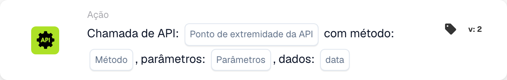

# Chamar a API DocBits

<figure><figcaption>
Campos do cartão na versão apresentada. Os campos ainda não estão configurados.
</figcaption></figure>

<!-- workflow-card-api-guide-contract-20261022 -->

Cartão observado: `call_api`, modelo `6ca5e621-af72-4f55-aa2e-b3caa288722a`, versão `1`. Utilize a versão efetivamente disponível na sua organização.

## Objetivo

Utilize `call_api` para chamar um endpoint da API DocBits configurada. O caminho relativo é acrescentado ao endereço base. Um URL externo arbitrário não configura uma integração com outra API.

## Configuração

Introduza o caminho, o método HTTP, os parâmetros de consulta e os dados aceites pelo endpoint. O pedido utiliza o contexto do utilizador DocBits atual. Os valores em falta de `org_id` e `triggered_by_docflow` são acrescentados automaticamente. Os objetos de parâmetros e de dados, ou a respetiva representação textual suportada, devem respeitar o formato desta versão. Não existe um mapeamento geral dos campos de uma resposta JSON.

## Resultado e limites

O texto da resposta é convertido num booleano: apenas `true`, `1`, `yes` ou `on` produz verdadeiro; uma resposta não reconhecida, incluindo um objeto JSON arbitrário, produz falso por predefinição. O estado HTTP, por si só, não determina este booleano. Um tempo limite excedido ou um erro do pedido produz falso. O teste do cartão simula a chamada e devolve verdadeiro sem enviar o pedido; não comprova autenticação, acessibilidade nem comportamento do endpoint.

## Exemplo prático

Utilize este cartão após as condições necessárias quando precisar de um booleano de um endpoint configurado da API DocBits. Num teste isolado, escolha um endpoint existente, documentado e apenas de leitura, com o contrato de resposta booleano pretendido e o método adequado, por exemplo `GET`. Utilize apenas os parâmetros de demonstração suportados.

Resultado esperado e contraexemplo: uma resposta HTTP `200` hipotética cujo texto completo seja `true` produz verdadeiro; `false` produz falso. Um objeto como `{"approved": true}` não é automaticamente convertido em verdadeiro. Verifique separadamente a resposta real e os registos. Exemplo verificado no código de execução; não foi executado qualquer pedido ou fluxo.

## Resolução de problemas

O cartão de pedido HTTPS utiliza um URL HTTPS configurado e cabeçalhos próprios. `call_api` utiliza um caminho relativo da API DocBits e o contexto do utilizador atual; o resultado deriva do texto da resposta. Escolha pelo endpoint e pelo contrato de resposta, não por uma distinção entre API simples e complexa.

[Referência](call-api.md)
