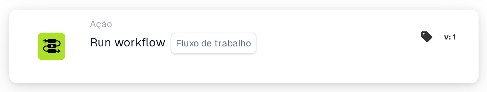
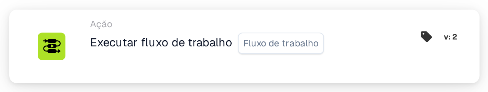

# Executar fluxo de trabalho

<figure><figcaption>
Versão 1
</figcaption></figure>

<figure><figcaption>
Versão 2
</figcaption></figure>

## Propósito:

O cartão **"Executar fluxo de trabalho"** permite aos utilizadores executar dinamicamente um fluxo de trabalho selecionado a partir de uma lista de fluxos de trabalho disponíveis. Este cartão é útil para automatizar processos em que vários fluxos de trabalho estão interligados, permitindo operações simplificadas.

## Componentes do cartão:

1. **Fluxo de trabalho**
   * **Descrição:** Especifica o fluxo de trabalho a executar quando as condições forem avaliadas como verdadeiras.
   * **Detalhe:** É disponibilizada uma lista pendente com todos os fluxos de trabalho disponíveis para seleção.

## Funcionalidade:

* **Avaliação da condição:** O cartão executa o fluxo de trabalho selecionado apenas se tanto a secção **"Quando"** como as **"E Seções"** forem avaliadas como verdadeiras.
  * Se alguma das condições for falsa, não é tomada qualquer ação e o fluxo de trabalho não é acionado.
* **Execução do fluxo de trabalho:**
  * Quando as condições são cumpridas, o fluxo de trabalho especificado é acionado automaticamente.
  * Se as condições não forem cumpridas, não é executado qualquer fluxo de trabalho.

## Configuração:

1. **Selecionar o fluxo de trabalho:** Escolha o fluxo de trabalho a acionar a partir da **lista pendente** de fluxos de trabalho disponíveis.
2. **Definir condições:** Configure as secções **"Quando"** e **"E Seções"** para especificar os critérios que têm de ser cumpridos para que o fluxo de trabalho seja executado.

## Conclusão:

O cartão **"Executar fluxo de trabalho"** oferece uma forma cómoda e eficiente de ligar fluxos de trabalho, automatizando processos de vários passos com facilidade. Ao assegurar que as condições nas secções **"Quando"** e **"E Seções"** são cumpridas, os utilizadores podem executar fluxos de trabalho de forma dinâmica e reduzir a intervenção manual.

<!-- workflow-card-practical-example-20261021 -->

## Exemplo prático

**Quando usar:** Reutilize um fluxo de trabalho de validação existente.

**Configuração:** Selecione um fluxo de trabalho filho de demonstração configurado que defina `routing_result` como `checked`.

**Resultado esperado e contra-exemplo:** O fluxo de trabalho selecionado é invocado em seu contexto de execução suportado. Verifique seu próprio log e resultado de campo; não o vincule de volta ao pai em um loop.

Esta é uma configuração ilustrativa e resultado esperado. Utilize campos, usuários e grupos configurados em sua organização de teste; não é uma afirmação de que este exemplo foi executado.
