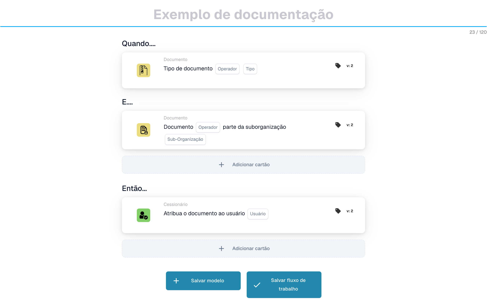

# Enviar e-mail para grupos

***

Adicione este cartão ao grupo **Então** do Workflow Builder — as ações que são executadas quando as condições Quando/E correspondem:

<figure><figcaption><p>Exemplo não guardado com cartões Quando, E e Então. Configure todos os campos antes da execução. Algumas etiquetas desta versão da interface ainda não estão traduzidas ou têm uma tradução incorreta. As explicações desta página usam os termos corretos; a imagem mostra a interface real.</p></figcaption></figure>

***

## 📌 Informações da versão

**Estado:** ✅ Versão única (sem alterações significativas) **Versão mais recente:** v1 (ativo) **Nota:** Este cartão usa modelo de versão única com suporte a vários idiomas por meio de chaves de tradução.

📖 [Banco de dados completo do cartão](../../cards-overview/export-cards-guide.md)

***

## Objetivo

Este cartão envia automaticamente notificações por e-mail para grupos de usuários. Em vez de atribuir trabalho a pessoas individuais, você envia a mensagem a um grupo e todos os membros desse grupo a recebem.

**Exemplo do mundo real:** Quando uma fatura de alto valor chegar, envie automaticamente uma notificação por e-mail para todos no grupo "Equipe Financeira" para que eles saibam que ela precisa ser revisada.

***

## Quando usar este cartão

Use este cartão quando precisar:

* Notifique várias pessoas ao mesmo tempo
* Envie alertas para grupos de equipe
* Transmitir atualizações para departamentos
* Notificar grupos sobre alterações no status do documento
* Envie lembretes aos membros do grupo

**Cenários comuns:**

* Notificar a equipe de compras sobre novos fornecedores
* Alerte a equipe financeira sobre faturas de alto valor
* Notificar a equipe do armazém sobre remessas
* Transmitir alterações no status do documento

***

## Como funciona

1. **Verificação de condição**: O fluxo de trabalho verifica as condições "Quando" e "E"
2. **Preparar Email**: Sistema prepara o email usando modelo
3. **Obter membros do grupo**: O sistema encontra todos os membros do grupo especificado
4. **Send**: O e-mail é enviado para cada membro do grupo
5. **Log**: O envio de e-mail é registrado

***

## Parâmetros explicados

### Modelo de e-mail

A mensagem de e-mail a ser enviada

**Opções:**

* Escolha entre modelos existentes
* Cada modelo tem assunto, corpo e formatação predefinidos
* Os modelos podem incluir espaços reservados como {document\_number}, {supplier\_name}

**Exemplo de modelo:**

```
Subject: Document {document_number} requires review

Body:
Dear Team,

A new invoice has arrived and requires review:
- Document: {document_number}
- Supplier: {supplier_name}
- Amount: {amount} {currency}
- Date: {date}

Please login to DocBits to review.

Best regards,
DocBits Automation
```

### Grupo

O grupo de usuários para o qual enviar o e-mail

**Exemplos de grupos:**

* Equipe Financeira
* Equipe de compras
* Equipe do Armazém
* Comitê de Aprovação
* Grupo de Gestão

***

## Etapas de configuração

### Etapa 1: escolha o modelo de e-mail

1. Clique em "Selecionar modelo de e-mail"
2. Escolha o modelo da lista
3. Verifique assunto e conteúdo

### Etapa 2: selecione o grupo

1. Clique em "Selecionar Grupo"
2. Escolha o grupo que você deseja notificar
3. Verifique os membros do grupo (geralmente mostra a contagem)

### Etapa 3: definir condições

1. Adicionar condição: "Quando \[condição] for verdadeira"
2. Exemplo: "Quando o valor da fatura for superior a 5.000€"

### Etapa 4: teste

1. Teste com documento de amostra
2. Verifique o envio de e-mail para o grupo
3. Verifique a renderização do modelo

***

## Exemplos de modelos de e-mail

### Modelo 1: Alerta de fatura de alto valor

```
Subject: High-Value Invoice Alert - {document_number}

Body:
Team,

An invoice exceeding €10,000 has been received:

Document Number: {document_number}
Supplier: {supplier_name}
Amount: {amount} EUR
Received Date: {date}
Status: {status}

This requires immediate review and approval.

---
Sent automatically by DocBits
```

### Modelo 2: Alteração de status do fornecedor

```
Subject: Supplier Status Update - {supplier_name}

Body:
Procurement Team,

The following supplier's status has been updated:

Supplier: {supplier_name}
Supplier Code: {supplier_code}
New Status: {status}
Effective Date: {date}

Please update your systems accordingly.

---
Sent automatically by DocBits
```

### Modelo 3: Documento Pronto para Exportação

```
Subject: Document Approved for Export - {document_number}

Body:
Export Team,

The following document has been approved and is ready for export:

Document Number: {document_number}
Invoice Number: {invoice_number}
Supplier: {supplier_name}

Please proceed with export to {destination_system}.

---
Sent automatically by DocBits
```

***

## Casos de uso comuns

### Caso de uso 1: alertas de controle de qualidade

**Acionador:** Quando é encontrada discrepância entre a fatura e o pedido de compra

**Grupo de e-mail:** Equipe de qualidade

**Conteúdo:**

```
Invoice {number} has quality issues:
- Unit Price variance: 12% (exceeds 5% tolerance)
- Please review and take action
```

### Caso de uso 2: Notificações de aprovação

**Gatilho:** Quando o documento atinge determinado status

**Grupo de e-mail:** Comitê de Aprovação

**Conteúdo:**

```
Document {number} is awaiting approval:
- Amount: {amount}
- Supplier: {supplier_name}
- Please login to approve/reject
```

### Caso de uso 3: notificações de exceção

**Gatilho:** Quando as condições não são atendidas

**Grupo de e-mail:** Gerentes

**Conteúdo:**

```
Exception alert for document {number}:
- Supplier code missing
- Delivery date invalid
- Manual review required
```

### Caso de uso 4: atualizações de status

**Acionador:** Quando o status do documento muda

**Grupo de e-mail:** Equipe responsável pela próxima etapa

**Conteúdo:**

```
Document {number} status changed to: {status}
Assigned to: {assigned_user}
Next steps: {next_steps}
```

***

## Solução de problemas

### "E-mail não recebido"

**Possíveis causas:**

* [] Os usuários do grupo não possuem endereços de e-mail
* [ ] E-mail bloqueado por filtro de spam
* [] O endereço de e-mail está incorreto no grupo
* [] O grupo não tem membros

**Soluções:**

1. Verifique se todos os membros do grupo têm endereços de e-mail
2. Verifique a pasta de spam/lixo eletrônico
3. Verifique se a associação ao grupo está correta
4. Adicione usuários ao grupo, se estiver faltando
5. Verifique com a TI se o serviço de e-mail está funcionando

### "O modelo não é renderizado corretamente"

**Causa:** Variáveis de espaço reservado não encontradas

**Solução:**

* [] Verifique se os nomes dos campos correspondem exatamente
* [] Verifique se o campo possui valor no documento
* [] Use o formato de espaço reservado correto: {field\_name}
* [] Teste com documento de amostra que contém todos os campos

### “Algumas pessoas recebem e-mail, outras não”

**Causa:** Associação incompleta ao grupo ou e-mails inválidos

**Soluções:**

* [] Verifique se todos os membros têm e-mail válido
* [] Verifique se alguns usuários cancelaram
* [] Verifique se a associação ao grupo é atual
* [] Entre em contato com a TI para validar endereços de e-mail

### "Deseja adicionar/remover pessoas do grupo"

**Solução:**

* Entre em contato com seu administrador
* Os grupos são gerenciados nas configurações do sistema
* Não pode ser alterado neste cartão
* Solicitar alterações nos membros do grupo em TI

***

## Personalização de modelo de e-mail

### Espaços reservados disponíveis

```
{document_number} - Document ID
{invoice_number} - Invoice ID
{supplier_name} - Supplier name
{supplier_code} - Supplier code
{amount} - Invoice amount
{currency} - Currency (EUR, USD, etc.)
{date} - Document date
{status} - Current status
{assigned_user} - Assigned person
{assigned_group} - Assigned group
{next_steps} - What needs to happen next
{reason} - Reason for exception/alert
{comment} - Comments or notes
```

### Criando espaços reservados personalizados

Se você precisar de dados adicionais em e-mails:

1. Entre em contato com seu administrador
2. Solicitar novo espaço reservado
3. Adicione o campo necessário ao documento
4. Atualizar modelo de e-mail

***

## Melhores Práticas

✅ **Fazer:**

* Mantenha o conteúdo do e-mail breve e claro
* Incluir itens de ação (o que os destinatários devem fazer?)
* Incluir link ou instruções para acessar o documento
* Modelo de teste com dados de amostra
* Envie para o grupo certo (não notifique demais)
* Use modelos para consistência

❌ **Não:**

* Envie muitos e-mails (cansaço de notificação)
* Incluir dados confidenciais em e-mails
* Envie para grupos que não precisam de informações
* Use linhas de assunto pouco claras
* Esqueça de incluir como agir
* Envie e-mails para indivíduos (use o grupo)

***

## Notas de desempenho

* Cada e-mail leva \~1 segundo para ser enviado
* Grupos grandes podem levar algum tempo (100 pessoas = \~100 segundos)
* Não crie loops que enviam milhares de e-mails
* Monitore a capacidade do serviço de e-mail
* Considere agrupar em lote se houver muitos documentos

***

## Cartões Relacionados

* **ACTION\_SEND\_EMAIL** - Enviar para pessoa física
* **ACTION\_ASSIGN\_TASK\_TO\_PROCUREMENT\_GROUP** - Atribua tarefa em vez de apenas notificar
* **ACTION\_CREATE\_TASK\_FOR\_GROUP\_SEQUENTIAL** - Criar tarefa e notificar
* **STAUS\_CHANGE** - Alterar status e notificar

***

## Exemplo típico de fluxo de trabalho

```
Document Arrives
    ↓
Check Condition: "Is amount > €10,000?"
    ↓
YES: Send Email to Finance Team
     "High value invoice alert"
    ↓
Send Email to Procurement Team
     "New invoice from supplier"
    ↓
Workflow Continues
```

***

## Perguntas frequentes

**Q: Posso enviar para vários grupos?** R: Crie cartões separados para cada grupo

**Q: E se o e-mail de alguém for devolvido?** R: O e-mail é registrado como falha, a TI pode solucionar o problema

**Q: Posso alterar o modelo de e-mail?** R: Entre em contato com seu administrador para modificar os modelos

**Q: Posso enviar com base nas condições?** R: Sim! Use as condições "Quando" e "E" para controlar quando os e-mails são enviados

**Q: Como posso saber se o e-mail foi recebido?** R: Verifique os registros de e-mail no DocBits para ver o status de envio
