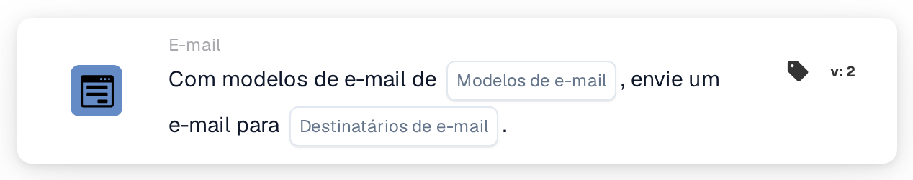

# Enviar e-mail

<figure><figcaption>
Versão 2
</figcaption></figure>

## Propósito:

Este cartão de fluxo de trabalho envia um e-mail com base num ou mais modelos de e-mail. Os destinatários não são introduzidos como endereços fixos: são escolhidos pelo seu papel no fluxo de trabalho, por exemplo o utilizador ou grupo ao qual o documento está atribuído, ou os utilizadores e grupos devolvidos por uma tabela de decisão. Assim, o fluxo de trabalho mantém-se válido quando as pessoas que desempenham estes papéis mudam.

Para enviar, em alternativa, um e-mail a grupos de utilizadores selecionados, pode ser utilizado o cartão **Send Email to Groups**; consulte [Send Email to Groups](send-email-groups-guide.md).

## Componentes do cartão:

1. **Modelos de e-mail**
   * **Descrição:** Os modelos de e-mail utilizados para o e-mail.
   * **Detalhe:** Podem ser selecionados um ou mais modelos de e-mail da organização. Cada modelo selecionado é enviado a cada destinatário. Quando o fluxo de trabalho é executado para um documento, um modelo configurado para um tipo de documento específico só é enviado se o documento tiver esse tipo de documento.
2. **Destinatários de e-mail**
   * **Descrição:** Quem recebe o e-mail.
   * **Opções:** Pode ser selecionada uma ou mais das seguintes:
     * **Usuário/grupo de documento atribuído:** O utilizador ou grupo ao qual o documento está atualmente atribuído.
     * **Usuário/grupo retornado da tabela de decisão:** Os utilizadores e grupos devolvidos por uma tabela de decisão avaliada anteriormente no mesmo fluxo de trabalho, por exemplo com o cartão **Decision Table has Returns**.
     * **Usuário atribuído ao fornecedor:** O utilizador atribuído do fornecedor, em fluxos de trabalho iniciados por uma alteração do estado de um fornecedor.
     * **Referenciador do fornecedor:** O referenciador do fornecedor, em fluxos de trabalho iniciados por uma alteração do estado de um fornecedor.

## Funcionalidade:

* **Recolha dos destinatários:** O cartão recolhe os destinatários de todas as opções selecionadas. Um destinatário que resulte de mais de uma opção recebe o e-mail apenas uma vez.
* **Execução da ação:** O e-mail é enviado com os modelos selecionados. Quando o fluxo de trabalho é executado para um documento, os modelos podem utilizar os valores dos campos do documento. O resultado é registado no registo do fluxo de trabalho, juntamente com os nomes dos destinatários.
* **Sem documento:** O cartão também pode ser executado em fluxos de trabalho que não são iniciados para um documento, por exemplo fluxos de trabalho iniciados por uma alteração do estado de um fornecedor. Num fluxo de trabalho deste tipo, a opção **Usuário/grupo de documento atribuído** não acrescenta nenhum destinatário.
* **Dados em falta:**
  * Se não estiver selecionado nenhum modelo de e-mail ou nenhuma opção de destinatário no cartão, o cartão não é executado e regista os dados em falta no registo do fluxo de trabalho.
  * Se uma opção selecionada não conduzir a ninguém, por exemplo porque o documento não tem responsável ou a tabela de decisão não devolveu ninguém, essa opção não acrescenta nenhum destinatário.
* **Erros:** Se o serviço de e-mail rejeitar o pedido ou não responder a tempo, o cartão termina com um erro.

## Configuração:

* Os modelos de e-mail deverão ser configurados na organização antes de poderem ser selecionados no cartão.
* O cartão pode ser adicionado a partir da categoria **E-mail**. Em seguida, são selecionados um ou mais modelos em **Modelos de e-mail** e uma ou mais opções em **Destinatários de e-mail**.
* Para a opção **Usuário/grupo retornado da tabela de decisão**, deverá ser avaliada uma tabela de decisão anteriormente no mesmo fluxo de trabalho.

## Conclusão:

O cartão de fluxo de trabalho "Send Email" informa automaticamente as pessoas envolvidas num processo de documento ou de fornecedor, utilizando modelos preparados. Como os destinatários são escolhidos pelo seu papel, o mesmo fluxo de trabalho continua a chegar às pessoas certas quando as atribuições mudam.
