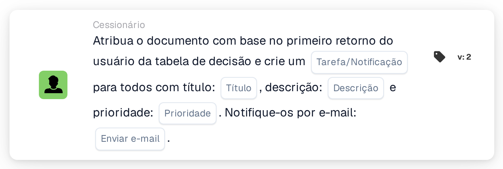

# Atribuir documento ao primeiro utilizador da tabela de decisão e criar tarefas

<figure><figcaption>
Versão 2
</figcaption></figure>

## Propósito:

Este cartão de fluxo de trabalho utiliza os utilizadores devolvidos por uma tabela de decisão de duas formas: o documento é atribuído ao primeiro utilizador devolvido, e cada utilizador devolvido, incluindo o primeiro, recebe uma tarefa ou notificação sobre o documento. Desta forma, uma pessoa torna-se responsável pelo documento, enquanto as outras são informadas ou também solicitadas a agir.

Os utilizadores provêm de uma tabela de decisão avaliada anteriormente no mesmo fluxo de trabalho, por exemplo com o cartão **Decision Table has Returns**, configurado para utilizar os dados devolvidos nos cartões seguintes.

## Componentes do cartão:

1. **Tarefa/Notificação**
   * **Descrição:** Define se é criada uma tarefa ou uma notificação para os utilizadores devolvidos.
   * **Opções:**
     * **Tarefa:** É criada uma tarefa para cada utilizador.
     * **Notificação:** É criada uma notificação para cada utilizador.
2. **Título**
   * **Descrição:** O título da tarefa ou notificação.
   * **Detalhe:** Um texto curto que identifica a tarefa ou notificação.
3. **Descrição**
   * **Descrição:** Mais detalhes sobre a tarefa ou notificação.
   * **Detalhe:** Um texto que descreve o que deverá ser feito ou por que motivo os utilizadores são informados.
4. **Prioridade**
   * **Descrição:** A urgência da tarefa ou notificação.
   * **Opções:**
     * **peso elevado:** A tarefa ou notificação é criada com prioridade elevada.
     * **peso médio:** A tarefa ou notificação é criada com prioridade média.
     * **baixo peso:** A tarefa ou notificação é criada com prioridade baixa.
5. **Enviar e-mail**
   * **Descrição:** Define se os utilizadores são também informados por e-mail sobre a tarefa ou notificação.
   * **Opções:**
     * **Verdadeiro:** É enviada uma notificação por e-mail.
     * **Falso:** Não é enviada qualquer notificação por e-mail.

## Funcionalidade:

* **Leitura da tabela de decisão:** O cartão lê os utilizadores devolvidos pela tabela de decisão anteriormente no fluxo de trabalho. Apenas são tidos em conta os utilizadores devolvidos, não os grupos.
* **Atribuição do documento:** O documento é atribuído ao primeiro utilizador devolvido.
* **Criação de tarefas:** Para cada utilizador devolvido, é criada uma tarefa ou notificação com o título, a descrição e a prioridade do cartão. Cada utilizador recebe a sua própria tarefa. As tarefas são criadas mesmo que a atribuição do documento não tenha sido bem-sucedida; o registo do fluxo de trabalho mostra o resultado da atribuição e de cada tarefa.
* **Valores predefinidos:** Se não for definida nenhuma prioridade, é utilizado **peso médio**. Se **Enviar e-mail** não estiver definido, não é enviado nenhum e-mail. Se **Tarefa/Notificação** não estiver definido, é criada uma tarefa e o registo do fluxo de trabalho indica a definição em falta.
* **Dados em falta:**
  * Se a tabela de decisão não tiver devolvido nenhum utilizador, nada é atribuído e o cartão regista os dados em falta no registo do fluxo de trabalho.
  * Se o título ou a descrição estiverem vazios, o documento não é atribuído, não é criada nenhuma tarefa e o cartão regista os dados em falta.

## Configuração:

* Uma tabela de decisão que devolva utilizadores deverá ser avaliada anteriormente no fluxo de trabalho, por exemplo com o cartão **Decision Table has Returns**. A ordem dos utilizadores devolvidos é relevante, porque o primeiro recebe o documento.
* O cartão pode ser adicionado a partir da categoria **Cessionário**. Em seguida, podem ser configurados o tipo (**Tarefa** ou **Notificação**), o título, a descrição, a prioridade e a definição de e-mail.

## Conclusão:

O cartão de fluxo de trabalho "Assign Document to First Decision Table User and Create Tasks" combina uma responsabilidade clara pelo documento com informação para todas as pessoas indicadas pela tabela de decisão. É útil quando uma pessoa deverá ser responsável pelo documento, enquanto outras precisam de ser envolvidas ou mantidas a par.
