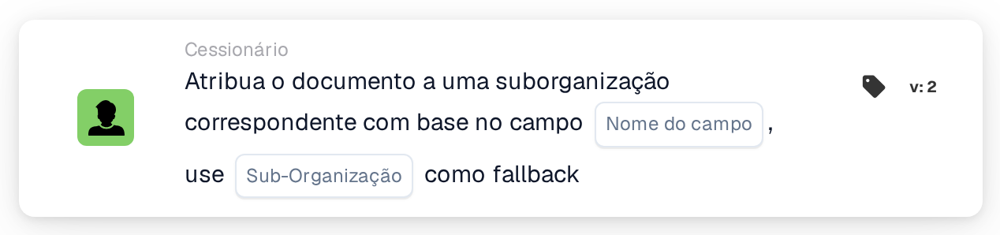

# Atribuir documento à suborganização correspondente

<figure><figcaption>
Versão 2
</figcaption></figure>

## **Propósito:**

O cartão de fluxo de trabalho **"Atribuir documento à suborganização correspondente com base no campo"** atribui um documento a uma sub-organização de forma dinâmica, com base num campo especificado do documento. Se não for encontrada nenhuma sub-organização correspondente, o cartão utiliza uma sub-organização alternativa predefinida.

## **Componentes do cartão:**

1. **Nome do campo**
   * **Descrição:** Especifica o campo do documento a utilizar para determinar a sub-organização correspondente.
   * **Detalhe:** O cartão procura um valor no campo especificado para corresponder a uma sub-organização disponível.
2. **Suborganização (alternativa)**
   * **Descrição:** Define a sub-organização alternativa a utilizar caso não seja encontrada correspondência no campo especificado.
   * **Detalhe:** Se o valor do campo não corresponder a nenhuma sub-organização, o documento será atribuído à sub-organização alternativa selecionada.

## **Funcionalidade:**

* **Avaliação da condição:**\
  O cartão só executa a sua ação se tanto a secção **"Quando"** como as **"E Seções"** forem avaliadas como verdadeiras.
* **Atribuição dinâmica:**\
  O cartão verifica o valor do campo especificado e atribui o documento à sub-organização que corresponde a esse valor.
* **Mecanismo alternativo:**\
  Se não for encontrada nenhuma sub-organização correspondente, o documento é atribuído à sub-organização alternativa.

## **Configuração:**

* **Selecionar o Nome do Campo:**\
  Escolha o campo do documento que contém o valor a corresponder a uma sub-organização.
* **Selecionar a sub-organização alternativa:**\
  Escolha a sub-organização que será utilizada caso não seja encontrada correspondência no campo do documento.

## **Conclusão:**

O cartão de fluxo de trabalho **"Atribuir documento à suborganização correspondente com base no campo"** oferece flexibilidade ao encaminhar dinamicamente os documentos para a sub-organização adequada, com uma opção alternativa adicional para assegurar que nenhum documento fica por atribuir.

<!-- workflow-card-practical-example-20261021 -->

## Exemplo prático

**Quando usar:** Escolha uma unidade de negócios de um campo de roteamento extraído.

**Configuração:** Defina o campo de roteamento `business_unit` para o nome da suborganização configurada `Demo North` e escolha `Demo Default` como fallback.

**Resultado esperado e contra-exemplo:** Um valor de campo correspondente seleciona `Demo North`. Um nome desconhecido usa `Demo Default`; teste o substituto antes de ativar o fluxo de trabalho.

Esta é uma configuração ilustrativa e resultado esperado. Utilize campos, usuários e grupos configurados em sua organização de teste; não é uma afirmação de que este exemplo foi executado.
