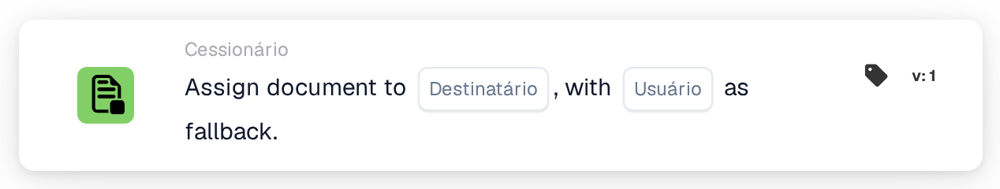
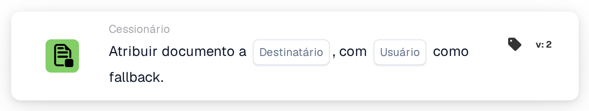

# Atribuir documento ao destinatário

<figure><figcaption>
Versão 1
</figcaption></figure>

<figure><figcaption>
Versão 2
</figcaption></figure>

## **Propósito:**

O cartão de fluxo de trabalho **"Atribuir Documento ao Disponente/Comprador"** atribui um documento a um **Disponent** ou a um **Comprador**. Se não for encontrado nenhum utilizador válido, é selecionado um utilizador alternativo para assegurar que o documento é sempre atribuído a alguém.

## **Componentes do cartão:**

1. **Disponente/Comprador**
   * **Descrição:** Especifica se o documento será atribuído a um Disponent ou a um Purchaser.
   * **Opções:**
     * **Disponent:** Atribui o documento ao Disponent.
     * **Comprador:** Atribuir o documento ao Comprador.
2. **Usuário substituto**
   * **Descrição:** Especifica um utilizador alternativo caso o documento não possa ser atribuído ao Disponent ou Purchaser selecionado.
   * **Detalhe:** A lista pendente de utilizadores disponíveis permite escolher um utilizador alternativo para assegurar que o documento é atribuído mesmo que o utilizador principal não possa ser determinado.

## **Funcionalidade:**

* **Avaliação da condição:**\
  O cartão só executa a sua ação se tanto a secção **"Quando"** como as **"E Seções"** forem avaliadas como verdadeiras.
* **Atribuição do documento:**\
  O cartão atribui o documento ao **Disponent** ou ao **Comprador**, conforme selecionado. Se a pessoa selecionada estiver indisponível ou não for válida, o documento é atribuído ao utilizador alternativo.

## **Configuração:**

* **Selecionar Disponente/Comprador:**\
  Escolha se pretende atribuir o documento ao **Disponent** ou ao **Comprador**.
* **Selecionar usuário substituto:**\
  Escolha um utilizador alternativo a partir da lista pendente que receberá o documento caso a atribuição principal não seja possível.

## **Conclusão:**

O cartão de fluxo de trabalho **"Atribuir Documento ao Disponente/Comprador"** assegura que o documento é sempre atribuído, seja ao Disponent/Purchaser selecionado ou, se necessário, ao utilizador alternativo. Isto minimiza interrupções no fluxo de trabalho e assegura que o processamento de documentos continua de forma fluida.

<!-- workflow-card-practical-example-20261021 -->

## Exemplo prático

**Quando usar:** Atribua um documento ao destinatário resolvido, com um substituto seguro.

**Configuração:** Selecione a origem do destinatário e o usuário substituto `Demo Reviewer A`.

**Resultado esperado e contra-exemplo:** Um destinatário resolvível recebe a tarefa. Se o destinatário não puder ser resolvido, o substituto configurado será usado. Verifique ambos os caminhos.

Esta é uma configuração ilustrativa e resultado esperado. Utilize campos, usuários e grupos configurados em sua organização de teste; não é uma afirmação de que este exemplo foi executado.
