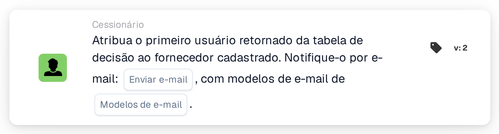

# Atribuir o primeiro utilizador da tabela de decisão ao fornecedor

<figure><figcaption>
Versão 2
</figcaption></figure>

## Propósito:

Este cartão de fluxo de trabalho define o utilizador atribuído de um fornecedor registado com base numa tabela de decisão. O primeiro utilizador devolvido pela tabela de decisão passa a ser o utilizador atribuído do fornecedor, o contacto interno responsável pelo fornecedor. Os utilizadores devolvidos podem também ser informados por e-mail.

Tal como **Assign User to Supplier**, o cartão não atua sobre um documento: destina-se a fluxos de trabalho que são iniciados por uma alteração do estado de um fornecedor, por exemplo com o cartão When **Supplier status changed**. O utilizador é determinado por uma tabela de decisão avaliada anteriormente no mesmo fluxo de trabalho, por exemplo com o cartão **Decision Table has Returns**, em vez de ser selecionado no cartão.

## Componentes do cartão:

1. **Enviar e-mail**
   * **Descrição:** A definição de e-mail do cartão.
   * **Opções:** **Verdadeiro** ou **Falso**.
   * **Detalhe:** Com **Verdadeiro**, os e-mails são enviados com os modelos de e-mail selecionados. Com **Falso**, não é enviado nenhum e-mail. Se **Enviar e-mail** não estiver definido, também não é enviado nenhum e-mail.
2. **Modelos de e-mail**
   * **Descrição:** Os modelos de e-mail utilizados para o e-mail.
   * **Detalhe:** Podem ser selecionados um ou mais modelos de e-mail da organização. Os modelos são utilizados quando **Enviar e-mail** está definido como **Verdadeiro**.

## Funcionalidade:

* **Leitura da tabela de decisão:** O cartão lê os utilizadores devolvidos pela tabela de decisão anteriormente no fluxo de trabalho. Apenas são tidos em conta os utilizadores devolvidos, não os grupos.
* **Notificação por e-mail:** Quando são enviados e-mails, estes vão para todos os utilizadores devolvidos pela tabela de decisão, não apenas para o primeiro. Os e-mails são enviados antes de o utilizador ser atribuído ao fornecedor.
* **Execução da ação:** O primeiro utilizador devolvido é guardado como utilizador atribuído do fornecedor cujo estado mudou. Se o fornecedor já tiver um utilizador atribuído, esse utilizador é substituído. O resultado é registado no registo do fluxo de trabalho.
* **Dados em falta:**
  * Se a tabela de decisão não tiver devolvido nenhum utilizador, nada é atribuído e o cartão regista os dados em falta no registo do fluxo de trabalho.
  * Se **Enviar e-mail** estiver definido como **Verdadeiro** mas não estiver selecionado nenhum modelo de e-mail, o cartão para sem atribuir o utilizador e regista os dados em falta.
  * Se **Enviar e-mail** não estiver definido, o registo do fluxo de trabalho indica a definição em falta e o utilizador é atribuído sem e-mail.
* **Erros:** Se o serviço de e-mail ou de fornecedores rejeitar o pedido ou não responder a tempo, o cartão termina com um erro. Se o envio dos e-mails falhar, o utilizador não é atribuído ao fornecedor.

## Configuração:

* O cartão pode ser utilizado num fluxo de trabalho que é iniciado por uma alteração do estado de um fornecedor. Uma tabela de decisão que devolva utilizadores deverá ser avaliada anteriormente no mesmo fluxo de trabalho.
* O cartão pode ser adicionado a partir da categoria **Cessionário**. Em seguida, pode ser definido **Enviar e-mail** e podem ser selecionados um ou mais modelos de e-mail.

## Conclusão:

O cartão de fluxo de trabalho "Assign First Decision Table User to Supplier" atribui um contacto responsável a um fornecedor de acordo com regras mantidas numa tabela de decisão. O e-mail opcional permite informar de imediato os utilizadores devolvidos sobre o fornecedor.
