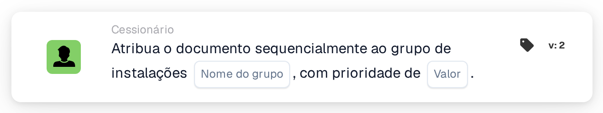

# Atribuir sequencialmente ao grupo da instalação

<figure><figcaption>
Versão 2
</figcaption></figure>

## Propósito:

Este cartão de fluxo de trabalho acrescenta o grupo responsável pela instalação da ordem de compra do documento à atribuição sequencial do documento. Tal como **Assign Document to Facility Group**, determina o grupo através do código da instalação das ordens de compra associadas. Em vez de atribuir o documento de imediato, acrescenta o grupo à ordem de aprovadores com uma prioridade, de modo que vários cartões sequenciais num fluxo de trabalho possam formar uma cadeia de atribuições.

## Componentes do cartão:

1. **Nome do grupo**
   * **Descrição:** A parte do nome que os grupos de instalações têm em comum.
   * **Detalhe:** Um texto que é comparado com os nomes dos grupos de utilizadores da organização. Um grupo corresponde se o seu nome contiver este texto e o código da instalação da ordem de compra. A comparação não distingue maiúsculas de minúsculas. Por exemplo, com o nome de grupo **Approver** e uma ordem de compra para a instalação **1000**, corresponderia um grupo chamado **Approver 1000**.
2. **Valor**
   * **Descrição:** A prioridade do grupo na atribuição sequencial.
   * **Detalhe:** Um número inteiro. Os números mais baixos vêm primeiro, sendo 0 a prioridade mais elevada. Se não for introduzido nenhum valor, ou se for introduzido um valor negativo, é utilizada a prioridade 1.

## Funcionalidade:

* **Determinação da instalação:** O cartão lê as ordens de compra com as quais o documento está associado e recolhe o código da instalação (a localização da ordem de compra) de cada uma delas.
* **Determinação do grupo:** Para cada código de instalação, o cartão procura grupos de utilizadores cujo nome contenha tanto o **Nome do grupo** indicado no cartão como o código da instalação. Os códigos de instalação para os quais não é encontrado nenhum grupo são listados no registo do fluxo de trabalho.
* **Execução da ação:** Cada grupo correspondente é acrescentado à atribuição sequencial com a prioridade do campo **Valor**. A atribuição propriamente dita ocorre no fim da execução do fluxo de trabalho: a entrada com o número de prioridade mais baixo é atribuída primeiro, e todas as entradas, incluindo a primeira, são guardadas no documento como os seus pedidos de aprovação. Os passos seguintes da sequência são obtidos a partir delas por ordem crescente de prioridade. Se outro cartão já tiver atribuído o documento diretamente na mesma execução, esta primeira atribuição sequencial é ignorada.
* **Dados em falta:**
  * Se não for introduzido nenhum nome de grupo no cartão, o cartão não é executado e regista os dados em falta no registo do fluxo de trabalho.
  * Se o documento não estiver associado a uma ordem de compra, o cartão regista os dados em falta em vez de acrescentar um grupo.
  * Se nenhum grupo corresponder a qualquer dos códigos de instalação, não é acrescentado nenhum grupo e o registo do fluxo de trabalho indica que não foi encontrado nenhum grupo correspondente.

## Configuração:

* Os grupos de utilizadores deverão ser nomeados de forma a que cada nome contenha a parte comum do nome e o código da instalação, por exemplo **Approver 1000**, **Approver 2000**.
* O cartão pode ser adicionado a partir da categoria **Cessionário**. Em seguida, a parte comum do nome dos grupos é introduzida no campo **Nome do grupo** e a prioridade no campo **Valor**.
* Para formar uma cadeia de aprovadores, podem ser combinados vários cartões sequenciais no fluxo de trabalho, cada um com a sua própria prioridade, por exemplo o grupo da instalação com prioridade 1 e um grupo central com prioridade 2.

## Conclusão:

O cartão de fluxo de trabalho "Assign Sequentially to Facility Group" coloca a equipa responsável pela instalação numa posição definida de uma aprovação sequencial. Em conjunto com outros cartões sequenciais, permite cadeias de aprovação em que a equipa da instalação é um de vários passos.
