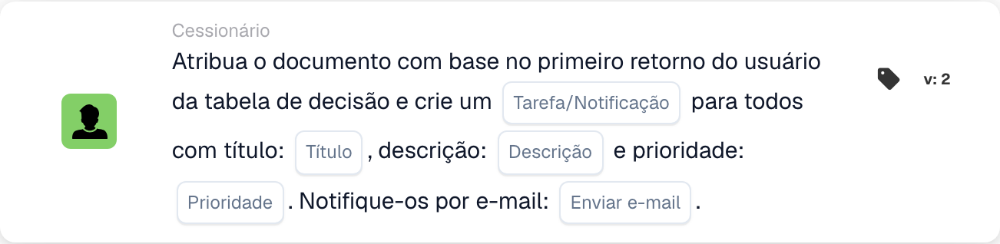
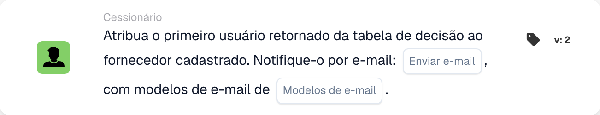

# Atribuição de documentos e cartões de usuário

## Atribuição de Documentos e Cartões de Usuário - Guia Completo

**Capas:** 13 cartões de tarefas e relacionados ao usuário

***

Os cartões nesta página vão para o grupo **Então** do Workflow Builder — as ações que são executadas quando as condições Quando/E correspondem:

<figure><figcaption><p>Exemplo não guardado com cartões Quando, E e Então. Configure todos os campos antes da execução. Algumas etiquetas desta versão da interface ainda não estão traduzidas ou têm uma tradução incorreta. As explicações desta página usam os termos corretos; a imagem mostra a interface real.</p></figcaption></figure>

***

### 📌 Informações da versão

**Cartões multiversão:** DOC\_USER\_ASSIGN (v2 mais recente, v3 obsoleto), DOC\_GROUP\_ASSIGN (v2 mais recente, v3 obsoleto), OC\_ASSIGN\_DOC (v2)

**Importante:** versões v3 adicionaram suporte à árvore de decisão, mas agora estão obsoletas **Recomendação:** Use v2 para DOC\_USER\_ASSIGN e DOC\_GROUP\_ASSIGN

📖 [Histórico completo da versão](../../release.md) | [Versões e comportamento das cartas](../../cards-overview/card-versions-guide.md)

***

## Atribuição Básica de Documentos

### Cartão: DOC\_USER\_ASSIGN / Atribuir documento ao usuário

#### Objetivo

Atribui documento a uma pessoa específica para sua ação

#### Quando usar

* O documento precisa da revisão de uma pessoa específica
* Transferência para membro individual da equipe
* Acompanhamento de responsabilidade
* Atribuir trabalho a uma pessoa nomeada

#### Como funciona

```
Document is "assigned to" = John Smith
Only John can see it as assigned to him
John is responsible for this document
```

#### Exemplo

```
Invoice arrives
    ↓
Assign Document to: John Smith (Finance Manager)
    ↓
Only John sees "Assigned to Me"
John must take action on it
```

#### Parâmetros

```
User: [Select which person]
```

#### Nota

Atribuir significa:

* O documento aparece como "atribuído a mim" para essa pessoa
* Essa pessoa é responsável
* Outros ainda podem ver o documento (mas não conforme atribuído a eles)
* Uma tarefa por vez por documento

***

### Cartão: DOC\_GROUP\_ASSIGN / Atribuir documento ao grupo

#### Objetivo

Atribui documento a um grupo (todos os membros o veem como atribuído a eles)

#### Quando usar

* Documento para equipe, não individual
* Várias pessoas podem lidar
* Responsabilidade compartilhada
* Distribuição da carga de trabalho da equipe

#### Como funciona

```
Document is "assigned to" = Finance Team (10 people)
All 10 team members see "Assigned to My Group"
Any team member can take action
```

#### Exemplo

```
New vendor invoice
    ↓
Assign Document to: Procurement Team
    ↓
All procurement team members see it
First available person handles it
```

#### Parâmetros

```
Group: [Select which group]
```

#### Diferença

```
Individual Assignment:
- One person responsible
- That person sees "Assigned to Me"
- Others don't see assignment

Group Assignment:
- Team responsible
- All members see "Assigned to My Group"
- Anyone can claim/process
```

***

### Cartão: ACTION\_ASSIGN\_DOC\_BASED\_ON\_DECISION\_TABLE

#### Objetivo

Atribui documento com base na lógica da tabela de decisão

#### Quando usar

* Fornecedores diferentes precisam de manipuladores diferentes
* Atribuição baseada no valor
* Lógica de roteamento complexa
* Múltiplas condições para atribuição

#### Como funciona

```
Decision Table Logic:
  If Supplier = "ABC Corp" → Assign to: Procurement Team
  If Supplier = "XYZ Inc" → Assign to: Direct Manager
  If Amount > €10000 → Assign to: Finance Director

Document arrives
    ↓
Check: Which condition matches?
    ↓
Assign accordingly
```

#### Exemplo: Atribuição Baseada em Valor

```
Invoice: €2000 from ABC Corp

Decision Table checks:
  Is amount > €10000? NO
  Is amount > €5000? NO
  Is amount > €1000? YES

Result: Assign to: Finance Manager
```

#### Exemplo: Atribuição Baseada em Fornecedor

```
Invoice from: Preferred Supplier

Decision Table:
  If preferred supplier → Finance Team
  If new supplier → Procurement Manager
  If blacklisted → Director Review

Result: Assign to: Finance Team
```

#### Parâmetros

```
Decision Table: [Select decision table]
(Decision table contains assignment logic)
```

***

### Cartão: ACTION\_ASSIGN\_DOC\_DECISION\_TABLE\_SEQUENTIAL

#### Objetivo

Atribui documentos sequencialmente com base na tabela de decisão com prioridades

#### Quando usar

* Múltiplas aprovações sequenciais
* Pessoas diferentes em níveis diferentes
* Cadeia de aprovação com base no valor
* Caminho de escalonamento

#### Como funciona

```
First Decision: Who approves first?
    ↓
Assign to: Person 1
    ↓
Person 1 approves
    ↓
Second Decision: Who approves next?
    ↓
Assign to: Person 2
    ↓
Person 2 approves (final)
    ↓
Document Complete
```

#### Sistema Prioritário

```
Priority 1: First assignment
Priority 2: Second assignment
Priority 3: Third assignment
(etc.)

Each must complete before next begins
```

#### Exemplo: Aprovação Multinível

```
Invoice: €50,000

Decision Table:
  €1k-€5k → Assign to: Finance Manager (Priority 1)
  €5k-€20k → Then: Assign to: Finance Director (Priority 2)
  €20k+ → Then: Assign to: CFO (Priority 3)

Invoice Flow:
1. Finance Manager reviews → approves
2. Finance Director reviews → approves
3. CFO reviews → approves final

Each step depends on previous completion
```

#### Parâmetros

```
Decision Table: [Select]
Priority Order: [Determined by decision table]
```

***

### Cartão: ACTION\_ASSIGN\_DOC\_TO\_USER\_SEQUENTIAL

#### Objetivo

Atribui documento ao usuário com prioridade sequencial

#### Quando usar

* O documento precisa de uma pessoa específica
* Processamento sequencial claro
* Atribuição única com pedido

#### Como funciona

```
Assign Document to: User A (Priority 1)
    ↓
User A processes
    ↓
Then: Assign to User B (Priority 2)
    ↓
User B processes
```

#### Exemplo

```
Invoice processing:
1. Assign to: Accounts Payable Clerk
2. Then: Assign to: Finance Manager
3. Then: Assign to: Director

Each person has their turn
```

***

### Cartão: ACTION\_ASSIGN\_DOC\_TO\_GROUP\_SEQUENTIAL

#### Objetivo

Atribui documentos sequencialmente aos grupos

#### Quando usar

* Aprovações de vários grupos
* Diferentes departamentos em cada etapa
* Processamento sequencial baseado em equipe

#### Como funciona

```
Step 1: Assign to Group A (Quality Team)
        Quality verifies
    ↓
Step 2: Assign to Group B (Finance Team)
        Finance reviews
    ↓
Step 3: Assign to Group C (Procurement)
        Procurement approves
```

#### Exemplo

```
New Supplier Onboarding:

Step 1: Quality Team
  - Evaluate supplier capability
  - Check certifications

Step 2: Finance Team
  - Check payment terms
  - Verify pricing

Step 3: Procurement Team
  - Approve supplier
  - Set up in system

Document passes through all three
```

***

### Cartão: ACTION\_ASSIGN\_DOC\_TO\_FACILITY\_GROUP

<!-- workflow-facility-example-direct-20261022 -->

Esta ação do workflow atribui um documento a um grupo com base nos locais dos pedidos de compra correspondentes. Na versão 2, `group_name` é um fragmento de texto pesquisado nos nomes dos grupos.

Exemplo: um documento sintético corresponde ao pedido `DEMO-PO-100`, com `location_id=BERLIN`. Os grupos configurados são `Receiving BERLIN` e `Receiving MUNICH`. Introduza `Receiving` em `group_name`. O nome do grupo deve conter tanto esse fragmento como o local do pedido; a pesquisa não distingue maiúsculas de minúsculas.

Resultado esperado: o documento é atribuído diretamente a `Receiving BERLIN`, se o seu estado permitir a atribuição. Sem um pedido correspondente ou um grupo compatível, a atribuição não é bem-sucedida; consulte os registos do workflow. Evite nomes ambíguos: se vários grupos corresponderem, este cartão não garante uma ordem fixa de seleção.

Esta é uma configuração ilustrativa; nenhum workflow foi executado.

***

### Cartão: ACTION\_ASSIGN\_DOC\_TO\_FACILITY\_GROUP\_SEQUENTIAL

<!-- workflow-facility-example-sequential-20261022 -->

Esta ação do workflow adiciona os grupos de local correspondentes à fila de atribuição sequencial com uma prioridade configurada. Não representa a movimentação de mercadorias entre fábricas ou armazéns.

Exemplo: utilize o mesmo pedido sintético, local e grupos do exemplo anterior. Defina `group_name=Receiving` e a prioridade `value=10`. A versão 2 lê o local do pedido correspondente e encontra `Receiving BERLIN`.

Resultado esperado: um pedido de atribuição a esse grupo é adicionado à fila com prioridade `10`. Se vários grupos corresponderem, todos recebem a mesma prioridade; os nomes não determinam a ordem de processamento. Verifique separadamente a fila e a aprovação posterior. Sem correspondência, não é criada uma atribuição bem-sucedida.

Esta é uma configuração ilustrativa; nenhum workflow foi executado.

***

### Cartão: ACTION\_ASSIGN\_DOC\_TO\_PROCUREMENT\_GROUP

#### Objetivo

Atribui documento ao departamento de compras

#### Quando usar

* Tratamento da equipe de compras
* Trabalho relacionado ao fornecedor
* Pedido de compra relacionado

#### Exemplo

```
Vendor evaluation document
    ↓
Assign to: Procurement Group
    ↓
Procurement team evaluates vendor
```

***

### Cartão: ACTION\_ASSIGN\_DOC\_TO\_PROCUREMENT\_GROUP\_SEQUENTIAL

#### Objetivo

Atribuição sequencial dentro de compras

#### Quando usar

* Processo de aquisição em várias etapas
* Cadeia de aprovação em compras

#### Exemplo

```
Purchase Requisition:

Step 1: Buyer (Creates PO)
Step 2: Approver (Reviews)
Step 3: Director (Final sign-off)

Each step in sequence
```

***

### Cartão: ACTION\_CHANGE\_DOC\_SUBORG / Alterar Suborganização de Documento

#### Objetivo

Atribui documento a diferentes suborganizações

#### Quando usar

* Organização errada selecionada
* Precisa mudar para o departamento correto
* Reestruturação organizacional

#### Como funciona

```
Current Sub-Org: Finance Department
    ↓
Change to: Accounting Department
    ↓
Document now belongs to Accounting
```

#### Exemplo

```
Document for: Berlin Office
    ↓
Realize should be: Munich Office
    ↓
Change Sub-Organization to: Munich Office
```

***

### Cartão: ACTION\_CHANGE\_DOC\_SUBORG\_BY\_FIELD\_TEXT

#### Objetivo

Altera a suborganização com base no valor do campo do documento

#### Quando usar

* Suborganização armazenada no campo
* Combine a localização do documento com o campo
* Atribuição automática de organização

#### Como funciona

```
Document Field: "Delivery_Location" = "Berlin"
    ↓
Decision Table:
  If location = "Berlin" → Assign to: Berlin Sub-Org
  If location = "Munich" → Assign to: Munich Sub-Org

    ↓
Document assigned to: Berlin Sub-Org
```

#### Exemplo

```
Invoice field: "Cost Center: CC-Berlin-001"
    ↓
System recognizes: Berlin location
    ↓
Change document to: Berlin Sub-Organization
```

***

### Cartão: ACTION\_ASSIGN\_USER\_FROM\_FIELD\_WITH\_FALLBACK

#### Objetivo

Atribui o documento ao usuário do campo, com fallback se o usuário não for encontrado

#### Quando usar

* Nome de usuário armazenado no campo do documento
* Pode não existir no sistema
* Precisa de backup se o usuário não estiver disponível

#### Como funciona

```
Document Field: "Approver: John Smith"
    ↓
Try to assign to: John Smith
    ↓
If John doesn't exist:
    ↓
Use Fallback: Sarah Johnson (Manager)
    ↓
Document assigned to: Sarah Johnson
```

#### Parâmetros

```
Source Field: [Field containing user name]
Fallback User: [If source user not found]
```

#### Exemplo

```
Invoice has field: "Contact Person: Mike Johnson"

Try to assign to: Mike Johnson
    ↓
If Mike not in system:
    ↓
Fallback to: Finance Manager (Robert)
```

***

### Cartão: ACTION\_ASSIGN\_USER\_TO\_SUPPLIER

#### Objetivo

Atribui documento ao usuário que gerencia esse fornecedor

#### Quando usar

* Usuário vinculado ao fornecedor
* Gerente de contas de fornecedores
* Proprietário do relacionamento com fornecedor

#### Como funciona

```
Document Supplier: ABC Corp
    ↓
System checks: Who manages ABC Corp?
    ↓
Assign to: John Smith (ABC Corp Account Manager)
```

***

## Árvores de decisão de atribuição

### Exemplo 1 de tabela de decisão: com base no valor

```
Amount ≤ €1000
  → Assign to: Finance Team

Amount €1000-€5000
  → Assign to: Finance Manager

Amount €5000-€20000
  → Assign to: Finance Director

Amount > €20000
  → Assign to: CFO
```

### Exemplo 2 de tabela de decisão: com base no fornecedor

```
Supplier Type = "Preferred"
  → Assign to: Account Manager

Supplier Type = "New"
  → Assign to: Procurement Manager

Supplier Type = "Problem"
  → Assign to: Procurement Director
```

### Exemplo de tabela de decisão 3: baseado em tipo de documento

```
Document Type = "Invoice"
  → Assign to: Accounts Payable Team

Document Type = "Credit Memo"
  → Assign to: Finance Manager

Document Type = "PO"
  → Assign to: Procurement Team
```

***

## Exemplos de fluxo de trabalho de atribuição

### Exemplo 1: Roteamento Simples

```
Document Arrives
    ↓
Check: Supplier = "ABC Corp"? YES
    ↓
Assign to: John Smith
(John handles ABC Corp)
    ↓
John reviews and approves
```

### Exemplo 2: Aprovação Sequencial

```
Document Arrives
    ↓
Assign to: Finance Manager (Step 1)
    ↓
Manager reviews
    ↓
Passes to: Finance Director (Step 2)
    ↓
Director reviews
    ↓
Passes to: CFO (Step 3)
    ↓
CFO approves final
```

### Exemplo 3: Roteamento Baseado em Valor

```
Invoice: €50,000
    ↓
Decision Table: Amount > €20k?
    ↓
YES → Assign to: CFO
    ↓
CFO approves directly
```

### Exemplo 4: Baseado em Instalações

```
Shipment for: Berlin Office
    ↓
Assign to: Berlin Warehouse Team
    ↓
Then assign to: Berlin Distribution Team
    ↓
Both teams process in sequence
```

***

## Práticas recomendadas para tarefas

✅ **Fazer:**

* Mantenha as tabelas de decisão simples
* Teste a lógica de roteamento com amostras
* Certifique-se de que todos os caminhos levem a algum lugar
* Tenha substituto para usuários ausentes
* Decisões de roteamento de documentos

❌ **Não:**

* Crie atribuições circulares (A→B→A)
* Atribuir a usuários inexistentes (sem substituto)
* Torne o roteamento muito complexo
* Esqueci de testar o roteamento
* Atribuir a pessoas indisponíveis

***

## Tarefa de solução de problemas

### "Documento não atribuído"

**Causa:** Condição não atendida ou usuário não existe

**Solução:**

* Verifique se a condição é verdadeira
* Verifique se o usuário existe no sistema
* Verifique as configurações de substituto
* Revise a lógica da tabela de decisão

### "Pessoa errada designada"

**Causa:** Tabela de decisão ou lógica de roteamento incorreta

**Solução:**

* Tabela de decisão de teste
* Verifique as condições
* Verifique o mapeamento do usuário
* Revise os valores dos campos

### "A tarefa parece ignorar alguém"

**Causa:** Ordem sequencial incorreta

**Solução:**

* Verifique os números prioritários
* Verifique se a sequência está correta
* Teste com amostra
* Revise a ordem da tabela de decisão

***

## Comparação de cartões de atribuição

| Cartão                                                    | Atribuir a               | Tipo de rota  | Caso de uso                   |
| ------------------------------------------------------- | ------------------------ | ----------- | -------------------------- |
| DOC\_USER\_ASSIGN                                       | Individual               | Direto      | Atribuição simples          |
| DOC\_GROUP\_ASSIGN                                      | Grupo                    | Direto      | Atribuição de equipe            |
| ACTION\_ASSIGN\_DOC\_BASED\_ON\_DECISION\_TABLE         | Resultado da decisão          | Condicional | Roteamento complexo            |
| ACTION\_ASSIGN\_DOC\_DECISION\_TABLE\_SEQUENTIAL        | Múltiplo (Sequencial)    | Condicional | Cadeia de aprovação             |
| ACTION\_ASSIGN\_DOC\_TO\_USER\_SEQUENTIAL               | Usuário (Sequencial)        | Encomendado     | Etapas sequenciais do usuário      |
| ACTION\_ASSIGN\_DOC\_TO\_GROUP\_SEQUENTIAL              | Grupos (sequenciais)      | Encomendado     | Etapas de grupo sequenciais     |
| ACTION\_ASSIGN\_DOC\_TO\_FACILITY\_GROUP                | Grupo de instalações           | Direto      | Específico da instalação          |
| ACTION\_ASSIGN\_DOC\_TO\_FACILITY\_GROUP\_SEQUENTIAL    | Instalações (Sequencial)  | Encomendado     | Multi-instalações             |
| ACTION\_ASSIGN\_DOC\_TO\_PROCUREMENT\_GROUP             | Aquisições              | Direto      | Fluxo de trabalho de compras       |
| ACTION\_ASSIGN\_DOC\_TO\_PROCUREMENT\_GROUP\_SEQUENTIAL | Aquisição (Sequencial) | Encomendado     | Cadeia de aprovação de aquisições |
| ACTION\_CHANGE\_DOC\_SUBORG                             | Suborganização         | Direto      | Mudança de departamento          |
| ACTION\_CHANGE\_DOC\_SUBORG\_BY\_FIELD\_TEXT            | Suborganização por campo         | Condicional | Atribuição baseada em campo     |
| ACTION\_ASSIGN\_USER\_FROM\_FIELD\_WITH\_FALLBACK       | Campo/substituto           | Condicional | Atribuição dinâmica de usuário    |

***

## Cartões Relacionados

* **ACTION\_CREATE\_TASK\_FOR\_USER** - Atribuir tarefa à mesma pessoa
* **ACTION\_SEND\_EMAIL** - Notificar a pessoa designada
* **CONDITION\_USER\_IS\_ISNOT** - Verifique se a pessoa correta foi atribuída
* **CONDITION\_GROUP\_IS\_ISNOT** - Verifique se o grupo correto foi atribuído

<!-- workflow-card-example-action_assign_doc_to_first_user_and_tasks-20261021 -->

### Atribua o documento ao primeiro usuário retornado e crie tarefas

<figure><figcaption><p>Campos do cartão na versão apresentada. Os campos ainda não estão configurados. Algumas etiquetas desta versão da interface ainda não estão traduzidas ou têm uma tradução incorreta. As explicações desta página usam os termos corretos; a imagem mostra a interface real.</p></figcaption></figure>

`ACTION_ASSIGN_DOC_TO_FIRST_USER_AND_TASKS` · versão 2

Use uma regra de tabela de decisão de demonstração retornando os usuários configurados `Demo Reviewer A` e `Demo Reviewer B` nessa ordem. Selecione a opção tarefa/notificação, título `Review invoice`, descrição, prioridade e preferência de e-mail. O primeiro usuário retornado é o destino de atribuição de documento e as tarefas/notificações configuradas têm como alvo os usuários retornados. Verifique ambas as saídas; um retorno vazio não deve ser tratado como uma atribuição.

<!-- workflow-card-example-action_assign_supplier_user_first_return_of_dt-20261021 -->

### Atribuir o primeiro usuário retornado ao fornecedor

<figure><figcaption><p>Campos do cartão na versão apresentada. Os campos ainda não estão configurados. Algumas etiquetas desta versão da interface ainda não estão traduzidas ou têm uma tradução incorreta. As explicações desta página usam os termos corretos; a imagem mostra a interface real.</p></figcaption></figure>

`ACTION_ASSIGN_SUPPLIER_USER_FIRST_RETURN_OF_DT` · versão 2

Use um fornecedor de demonstração registrado e uma regra de tabela de decisão cujo primeiro resultado do usuário seja `Demo Supplier Owner`. Selecione a tabela de decisão e, se necessário, modelos de email. A associação fornecedor-usuário utiliza o primeiro usuário retornado; não é a mesma operação que atribuir o documento. Verifique o resultado do fornecedor separadamente e teste um retorno de regra vazio.
