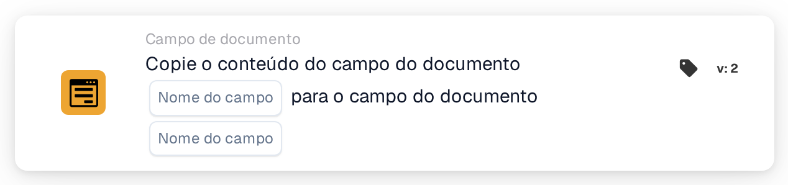

# Copiar campo do documento para campo do documento

<figure><figcaption>
Versão 2
</figcaption></figure>

## Propósito:

Este cartão de fluxo de trabalho copia o conteúdo de um campo do documento para outro campo do mesmo documento. Pode ser utilizado, por exemplo, para preencher um campo necessário para uma exportação ou para um cartão posterior com um valor que já foi extraído para um campo diferente.

## Componentes do cartão:

1. **Nome do campo** (primeiro)
   * **Descrição:** O campo do documento cujo conteúdo é copiado.
   * **Detalhe:** O nome de um campo do documento. O nome é comparado de forma exata, incluindo maiúsculas e minúsculas. O campo propriamente dito não é alterado.
2. **Nome do campo** (segundo)
   * **Descrição:** O campo do documento para o qual o conteúdo é copiado.
   * **Detalhe:** O nome de um campo do documento. O seu conteúdo atual é substituído pelo conteúdo copiado.

## Funcionalidade:

* **Leitura do valor:** O cartão procura o primeiro campo entre os campos do documento e lê o seu valor. O valor encontrado é anotado no registo do fluxo de trabalho.
* **Execução da ação:** O valor é escrito no segundo campo e o documento é guardado. O valor copiado é transferido tal como está, sem conversão. Se o segundo campo ainda não existir no documento, é acrescentado. Após uma cópia bem-sucedida, os cartões posteriores do fluxo de trabalho trabalham com o novo valor.
* **Dados em falta:**
  * Se um dos dois nomes de campo não estiver definido no cartão, o cartão não é executado e regista os dados em falta no registo do fluxo de trabalho.
  * Se o documento não tiver nenhum campo com o primeiro nome, nada é copiado e o cartão indica que o campo não foi encontrado no documento.
* **Erros:** Se não for possível guardar o documento, por exemplo porque o seu estado atual não permite alterações, o cartão termina com um erro e o segundo campo mantém o conteúdo anterior.

## Configuração:

* O cartão pode ser adicionado a partir da categoria **Campo de documento**. Em seguida, o campo de origem é definido no primeiro espaço **Nome do campo** e o campo de destino no segundo.
* Como o valor é copiado sem conversão, os dois campos deverão conter o mesmo tipo de dados, por exemplo texto para texto ou uma data para uma data.

## Conclusão:

O cartão de fluxo de trabalho "Copy Document Field into Document Field" transfere valores entre campos sem trabalho manual. Mantém os campos relacionados consistentes e permite que os passos seguintes de um fluxo de trabalho utilizem um valor com o nome de campo que esperam.
