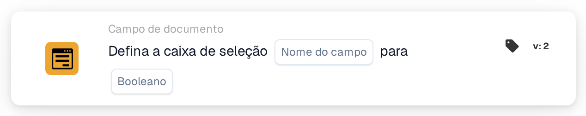

# Definir caixa de seleção como

<figure><figcaption>
Versão 2
</figcaption></figure>

## **Propósito:**

Este cartão de fluxo de trabalho foi concebido para definir um campo de caixa de verificação para um valor especificado (true ou false) com base nas condições definidas nas secções **"Quando"** e **"E"**. Oferece uma forma simples mas eficaz de automatizar atualizações de caixas de verificação quando determinados critérios são cumpridos, assegurando um processamento de documentos simplificado.

## **Componentes do cartão:**

1. **Nome do campo:**
   * **Descrição**: Especifica o campo onde a caixa de verificação será definida.
   * **Detalhe**: O campo de caixa de verificação a atualizar é identificado pelo nome do campo.
2. **Booleano**
   * **Descrição**: Define o valor para o qual o campo de caixa de verificação será definido quando as condições nas secções **Onde** e **E Seções** forem ambas verdadeiras.
   * **Opções**:
     * **True**: A caixa de verificação será definida como **true** se as condições forem cumpridas.
     * **False**: A caixa de verificação será definida como **false** se as condições forem cumpridas.

## **Funcionalidade:**

* **Avaliação da condição**: O sistema avalia as condições tanto na secção **"Quando"** como na **"E"**
* **Execução da ação**: Se tanto a secção **"Quando"** como as **"E Seções"** forem avaliadas como verdadeiras, o campo de caixa de verificação será atualizado para o valor especificado (true ou false). Se alguma das condições for falsa, não é tomada qualquer ação e a caixa de verificação permanece como estava.

## **Configuração:**

Para configurar este cartão, os utilizadores precisam de:

1. **Especificar o campo de caixa de verificação de destino** que será definido como true ou false quando as condições forem cumpridas.
2. **Escolher o valor (true ou false)** para o qual a caixa de verificação será definida após a avaliação da condição.
3. O cartão só executa a sua ação se ambas as condições nas secções **"Quando"** e **"E Seções"** forem avaliadas como verdadeiras.

## **Conclusão:**

O cartão de fluxo de trabalho **"Set Checkbox"** é uma ferramenta de automação simples e eficaz para atualizar campos de caixa de verificação com base em condições específicas. Ao assegurar que tanto a secção **"Quando"** como as **"E Seções"** são cumpridas, permite aos utilizadores automatizar processos e reduzir a intervenção manual, assegurando um processamento de documentos mais fluido e eficiente.

<!-- workflow-card-practical-example-20261021 -->

## Exemplo prático

**Quando usar:** Marque uma validação bem-sucedida com um sinalizador explícito.

**Configuração:** Selecione o campo da caixa de seleção `review_complete` e defina-o como `true`.

**Resultado esperado e contra-exemplo:** O campo fica marcado. Execute a ação com `false` em um teste separado quando precisar limpar o sinalizador.

Esta é uma configuração ilustrativa e resultado esperado. Utilize campos, usuários e grupos configurados em sua organização de teste; não é uma afirmação de que este exemplo foi executado.
