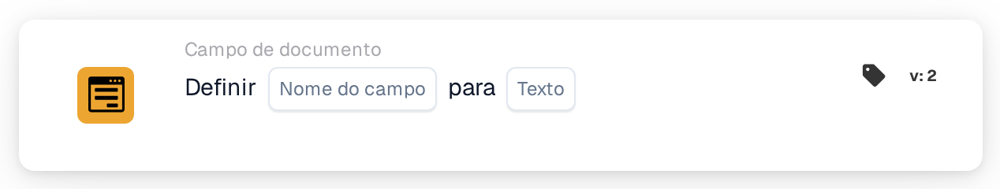

# Definir como

<figure><figcaption>
Versão 2
</figcaption></figure>

## **Propósito:**

Este cartão de fluxo de trabalho foi concebido para definir automaticamente um campo especificado do documento para um valor de texto predefinido com base nas condições definidas nas secções **"Quando"** e **"E seções."** Permite aos utilizadores simplificar a introdução de dados, assegurando que os campos são preenchidos com valores consistentes quando determinados critérios são cumpridos.

## **Componentes do cartão:**

1. **Nome do campo**
   * **Descrição**: Especifica o campo que será atualizado com o valor de texto.
   * **Detalhe**: O campo selecionado será atualizado com o valor de texto especificado se as condições nas secções **"Quando"** e **"E Seções"** forem cumpridas.
2. **Texto**
   * **Descrição**: Define o valor de texto que será definido no campo de destino quando as condições forem avaliadas como verdadeiras.
   * **Detalhe**: Pode ser uma mensagem personalizada, um estado ou um valor predefinido que o utilizador pretenda escrever no campo. O texto deve estar alinhado com o formato de entrada esperado do campo (por exemplo, alfanumérico, data ou outros tipos de informação textual).

## **Funcionalidade:**

* **Avaliação da condição**: O sistema avalia as condições nas secções **"Quando"** e **"E Seções"**:
  * Se **ambas as condições forem verdadeiras**, as ações definidas na **"Então Seção"** serão executadas. Especificamente, o campo de destino (Field Name) será preenchido com o texto especificado.
  * Se **a secção "Where" ou a "And" for falsa**, não é tomada qualquer ação e o campo permanece inalterado. As ações da **Então Seção** são totalmente ignoradas se alguma das condições for falsa.
* **Execução da ação**: Se ambas as condições nas secções **"Quando"** e **"E Seções"** forem cumpridas, o sistema preenche automaticamente o campo especificado com o valor de texto escolhido. Se as condições não forem cumpridas, não são feitas alterações ao campo.

## **Configuração:**

Para configurar este cartão:

1. **Selecionar o campo** (Field Name) que será atualizado com o valor de texto. Os campos disponíveis no documento são listados para seleção.
2. **Especificar o valor de texto** que será escrito no campo de destino quando as condições forem verdadeiras.
3. A ação só será executada se ambas as condições nas secções **"Quando"** e **"E Seções"** forem avaliadas como verdadeiras.

## **Conclusão:**

O cartão de fluxo de trabalho **"Definir campo como texto"** oferece uma forma direta de automatizar o preenchimento de valores de texto em campos específicos do documento com base em condições predefinidas. Isto reduz a introdução manual de dados e assegura consistência no processamento de documentos, tornando-o uma ferramenta útil para automatizar fluxos de trabalho e aumentar a eficiência.

<!-- workflow-card-practical-example-20261021 -->

## Exemplo prático

**Quando usar:** Escreva um resultado de roteamento em um campo do documento.

**Configuração:** Selecione o campo de texto `routing_result` e defina o texto como `manual review`.

**Resultado esperado e contra-exemplo:** O campo contém exatamente `manual review`. Uma condição igual subsequente pode usar esse valor; é um campo de documento e não uma variável de organização.

Esta é uma configuração ilustrativa e resultado esperado. Utilize campos, usuários e grupos configurados em sua organização de teste; não é uma afirmação de que este exemplo foi executado.
