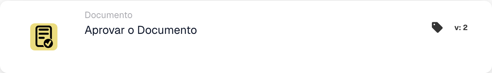

# Aprovar o documento

<figure><figcaption>
Campos do cartão na versão apresentada. Os campos ainda não estão configurados.
</figcaption></figure>

## **Propósito:**

O cartão de fluxo de trabalho **"Aprovar o documento"** é utilizado para marcar um documento como aprovado. Permite que o documento avance para a fase seguinte do fluxo de trabalho, possibilitando a execução de fluxos de processamento ou aprovação automatizados. Este cartão ajuda a simplificar os processos de gestão de documentos, assegurando que apenas os documentos aprovados avançam para ações adicionais.

## **Componentes do cartão:**

1. **Status de aprovação**
   * **Descrição**: Este componente marca o documento como aprovado.
   * **Detalhe**: Quando este cartão é acionado, o estado de aprovação do documento é atualizado para indicar a aprovação. Esta ação pode ser definida com base nas condições definidas nas secções **"Quando"** e **"E seções."**

## **Funcionalidade:**

* **Avaliação da condição**: O sistema avalia as condições definidas nas secções **"Quando"** e **"E Seções"**.
  * Se **ambas as condições forem verdadeiras**, o documento será marcado como aprovado.
  * Se **alguma das condições for falsa**, o cartão não será executado e o estado de aprovação do documento permanecerá inalterado.
* **Execução da ação**: Quando as condições são cumpridas, o documento é aprovado. Esta alteração reflete-se no estado do documento, permitindo-lhe continuar no fluxo de trabalho.

## **Conclusão:**

O cartão de fluxo de trabalho **"Aprovar o documento"** é um componente fundamental para automatizar a aprovação de documentos nos fluxos de trabalho de negócio. Ao assegurar que apenas os documentos que cumprem critérios específicos são aprovados, ajuda a manter a consistência, reduz a supervisão manual e permite um processamento de documentos mais fluido.

<!-- workflow-card-practical-example-20261021 -->

## Exemplo prático

**Quando usar:** Aprovar um documento após todas as condições de revisão exigidas terem sido aprovadas.

**Configuração:** Coloque esta ação após as condições de revisão na ramificação bem-sucedida. Use um documento de demonstração aguardando aprovação.

**Resultado esperado e contraexemplo:** A ação aprova esse documento. Um documento que não cumpra uma condição anterior nunca atinge esta ação; a aprovação por si só não é prova de uma exportação de ERP concluída.

Esta é uma configuração ilustrativa e resultado esperado. Utilize campos, usuários e grupos configurados em sua organização de teste; não é uma afirmação de que este exemplo foi executado.
