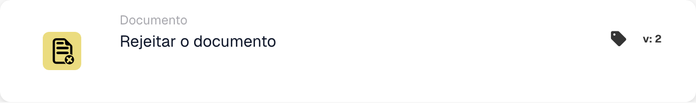

# Rejeitar o documento

<figure><figcaption>
Campos do cartão na versão apresentada. Os campos ainda não estão configurados.
</figcaption></figure>

## **Propósito:**

O cartão de fluxo de trabalho **"Rejeitar o documento"** é utilizado para marcar um documento como rejeitado dentro de um fluxo de trabalho. Esta ação interrompe o avanço do documento e impede-o de passar para a fase seguinte do fluxo de trabalho. Assegura que os documentos que não cumprem as condições ou os critérios necessários são assinalados e impedidos de prosseguir o processamento.

## **Componentes do cartão:**

1. **Status de rejeição**
   * **Descrição**: Este componente marca o documento como rejeitado, indicando que não cumpriu as condições exigidas para a aprovação.
   * **Detalhe**: Quando acionado, este cartão atualiza o estado do documento para "rejeitado". Esta decisão é tomada com base nas condições definidas nas secções **"Quando"** e **"E seções."**

## **Funcionalidade:**

* **Avaliação da condição**: O sistema avalia as condições definidas nas secções **"Quando"** e **"E Seções"**.
  * Se **ambas as condições forem verdadeiras**, o documento será rejeitado.
  * Se **alguma das condições for falsa**, o cartão não será executado e o estado do documento permanecerá inalterado.
* **Execução da ação**: Quando as condições são cumpridas, o documento é marcado como rejeitado. Esta ação assegura que apenas os documentos que cumprem critérios específicos prosseguem, enquanto os restantes são assinalados e interrompidos para revisão ou correção.

## **Conclusão:**

O cartão de fluxo de trabalho **"Rejeitar o documento"** é uma ferramenta essencial para controlar o fluxo de documentos em processos automatizados. Ao permitir a rejeição de documentos não conformes, assegura que apenas os documentos válidos e precisos continuam no fluxo de trabalho, melhorando a eficiência e a precisão na gestão de documentos.

<!-- workflow-card-practical-example-20261021 -->

## Exemplo prático

**Quando usar:** Rejeite um documento que atenda a uma regra de rejeição definida.

**Configuração:** Roteie um documento de demonstração deliberadamente inválido para esta ação, por exemplo, após uma decisão de rejeição explícita.

**Resultado esperado e contra-exemplo:** O documento foi rejeitado. Um documento válido deve seguir uma ramificação diferente e não deve executar esta ação.

Esta é uma configuração ilustrativa e resultado esperado. Utilize campos, usuários e grupos configurados em sua organização de teste; não é uma afirmação de que este exemplo foi executado.
