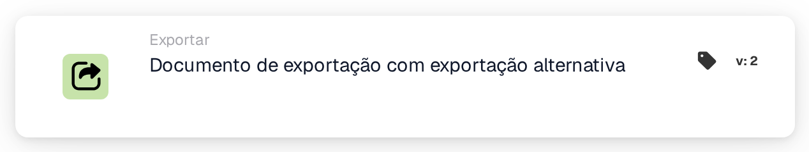

# Exportar com exportação alternativa

<figure><figcaption>
Versão 2
</figcaption></figure>

## Quando usar este cartão

Use esta ação Então para a exportação alternativa configurada no tipo de documento atual. Configure e valide essa rota antes de adicionar a ação.

## A configuração vem do tipo de documento

O cartão não possui seletor de configuração de exportação. Ele lê se a exportação alternativa está habilitada, a configuração da exportação alternativa e o status após a exportação nas configurações de tipo de documento. Internamente são `DOC_ALTERNATE_EXPORT_SETTING`, `DOC_ALTERNATE_EXPORT_EXPORT_CONFIG` e `DOC_ALTERNATE_EXPORT_STATUS`.

Uma exportação alternativa explicitamente desabilitada produz uma condição de falha. Dados de ativação, configuração ou status de resultado ausentes são relatados em vez de substituir silenciosamente a rota padrão. A solicitação de exportação verifica as tarefas pendentes.

## Verifique o resultado

Inspecione o registro do cartão, o histórico de exportação, o status do documento e o destino de teste autorizado. Uma solicitação, tempo limite ou alteração de status por si só não estabelece que os dados chegaram ao destino. Verifique o histórico de exportação antes de tentar novamente uma operação que possa criar duplicatas.

<!-- workflow-card-complete-example-20261021 action_alternate_export -->

### Exemplo de exportação alternativa

**Configuração:** Prepare o tipo de documento sintético `DEMO_INVOICE` com exportação alternativa habilitada, uma configuração de exportação de teste autorizada e o status do resultado desejado em suas configurações de tipo de documento. Adicione esta ação Then após as verificações necessárias. Este cartão lê essas configurações; ele não oferece um seletor de configuração de exportação.

**Resultado esperado e contra-exemplo:** A ação solicita a exportação através dessa configuração alternativa e verifica as tarefas pendentes. Verifique o resultado da exportação e o destino do teste separadamente. Desabilitar a exportação alternativa causa uma condição de falha; uma definição ou configuração de ativação ausente não é uma exportação bem-sucedida. Não execute este exemplo em um destino de contabilidade.

Esta é uma configuração de teste ilustrativa e resultado esperado; não foi executado. Use dados e destinatários configurados na sua organização de teste.
