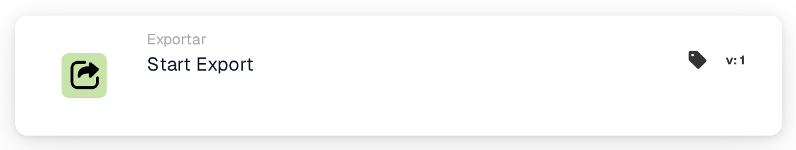
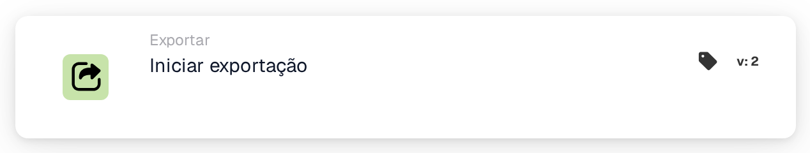
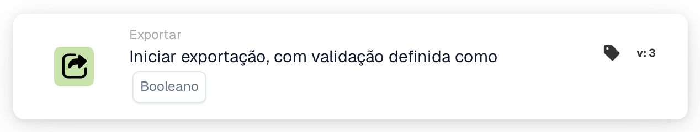
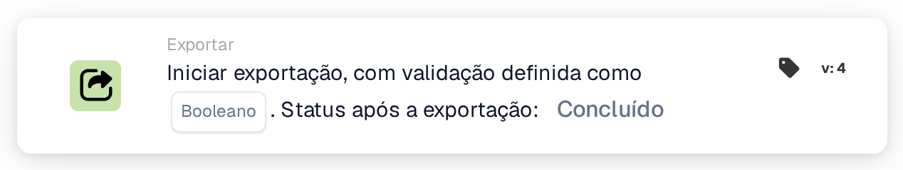

# Iniciar exportação

<figure><figcaption>
Versão 1
</figcaption></figure>

<figure><figcaption>
Versão 2
</figcaption></figure>

<figure><figcaption>
Versão 3
</figcaption></figure>

<figure><figcaption>
Versão 4
</figcaption></figure>

## **Objetivo:**

O cartão de fluxo de trabalho **"Iniciar exportação"** foi projetado para iniciar o processo de exportação de um documento. Este cartão funciona como um gatilho no fluxo de trabalho para iniciar perfeitamente a operação de exportação assim que as condições das seções anteriores forem atendidas.

## **Componentes do cartão:**

1. **Ação**
   1. **Descrição**: Inicia o processo de exportação do documento.
   2. **Detalhe**: O cartão usa as configurações de exportação definidas no sistema para processar e exportar o documento.

## **Funcionalidade:**

* **Avaliação de Condição**: O sistema avalia as condições definidas em **"Quando"** e **"E Seções"** do fluxo de trabalho. Se todas as condições forem verdadeiras, o processo de exportação será iniciado.
* **Exportação de Documento**: O documento é processado e exportado usando a configuração de exportação padrão ou definida anteriormente.

## **Instalação e configuração:**

Versões anteriores utilizam as configurações de exportação já definidas no sistema. Na versão 4, configure a validação e selecione Status após exportação. Verifique também se:

1. As condições **"Quando"** e **"E Seções"** estão configuradas corretamente, pois o cartão só é executado se essas condições forem avaliadas como verdadeiras.
2. Uma configuração de exportação válida está associada ao documento no sistema.

## **Conclusão:**

O cartão de fluxo de trabalho **"Iniciar exportação"** fornece uma maneira simplificada e automatizada de acionar o processo de exportação. Ao confiar em configurações pré-configuradas e avaliações condicionais, garante um processamento de documentos eficiente e preciso.

## Versões do cartão e status dos resultados

A afirmação acima sobre nenhuma configuração específica de cartão se aplica ao cartão Iniciar Exportação anterior. Iniciar exportação com validação v4 inclui validação e **Status após exportação**. Escolha `finished` para fechar um documento exportado com sucesso ou `exported` para mantê-lo aberto para processamento posterior. Versões anteriores mantêm `finished`. Consulte [Exportar cartões e status de resultados](../../cards-overview/export-cards-guide.md) para padrões, erros e testes.

<!-- workflow-card-practical-example-20261021 -->

## Exemplo prático

**Quando usar:** Exporte um documento depois que as verificações exigidas forem aprovadas.

**Configuração:** Selecione o status pós-exportação suportado, por exemplo `exported` quando o documento deve permanecer disponível para processamento adicional. Certifique-se de que o exportador configurado e os dados necessários estejam prontos.

**Resultado esperado e contra-exemplo:** Após a exportação bem-sucedida, o status do resultado selecionado é aplicado. Um erro do exportador não é uma exportação concluída; inspecione seu log e teste o branch com falha.

Esta é uma configuração ilustrativa e resultado esperado. Utilize campos, usuários e grupos configurados em sua organização de teste; não é uma afirmação de que este exemplo foi executado.
