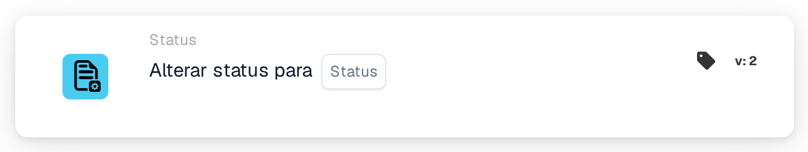
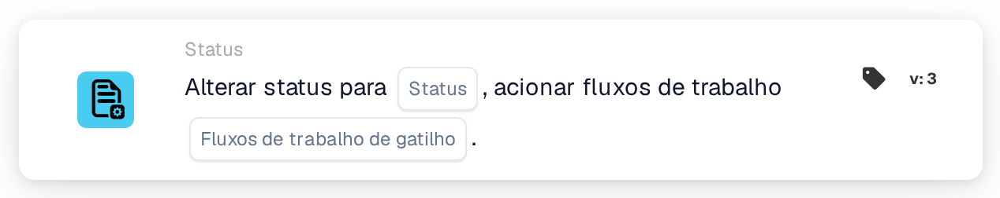

# Alterar status para

<figure><figcaption>
Versão 1
</figcaption></figure>

<figure><figcaption>
Versão 2
</figcaption></figure>

<figure><figcaption>
Versão 3
</figcaption></figure>

## **Propósito:**

O cartão de fluxo de trabalho **"Change Status"** é utilizado para alterar o estado de um documento para um dos estados predefinidos — **Erro, Rejeitado, Pronto para Validação, Aprovação Pendente, Segunda Aprovação Pendente** — e, opcionalmente, acionar fluxos de trabalho associados com base na alteração de estado. Este cartão automatiza o processo de atualização de estados e de acionamento de fluxos de trabalho, assegurando uma gestão de documentos eficiente e um tratamento de erros adequado.

## **Componentes do cartão:**

1. **Estado**
   * **Descrição**: Especifica o novo estado a aplicar ao documento.
   * **Opções**:
     * **Error**: Marca o documento como tendo encontrado um erro.
     * **Rejeitado**: Indica que o documento foi rejeitado e não prosseguirá.
     * **Pronto para validação**: Define o documento para ser revisto e validado pelo utilizador ou processo de sistema seguinte.
     * **Aprovação pendente**: Coloca o documento num estado pendente de aprovação.
     * **Segunda aprovação pendente**: Coloca o documento em espera para um segundo nível de aprovação, se aplicável.
2. **Acionar fluxos de trabalho**
   * **Descrição**: Determina se devem ser acionados quaisquer fluxos de trabalho subsequentes após a alteração de estado.
   * **Opções**:
     * **True**: Inicia quaisquer fluxos de trabalho relevantes com base na alteração de estado.
     * **False**: Impede a execução de fluxos de trabalho após a alteração de estado.

## **Funcionalidade:**

* **Avaliação da condição**: O sistema avalia as condições definidas nas secções **"Quando"** e **"E seções."** Se estas condições forem verdadeiras, o cartão procede à alteração do estado do documento para o valor selecionado.
* **Atualização de estado**: Uma vez cumpridas as condições, o estado do documento é atualizado para uma das opções predefinidas (Error, Rejected, Ready for Validation, Pending Approval, Pending Second Approval), consoante a seleção do utilizador.
* **Ação de acionamento de fluxos de trabalho**: Se **Acionar fluxos de trabalho** estiver definido como **True**, o sistema inicia automaticamente quaisquer fluxos de trabalho associados após a atualização de estado. Se estiver definido como **False**, não são acionados fluxos de trabalho adicionais e o processo termina com a alteração de estado.

## **Configuração:**

Para configurar este cartão, os utilizadores precisam de:

1. Especificar o **Estado** pretendido para o qual o documento será definido após a avaliação da condição (Error, Rejected, Ready for Validation, Pending Approval ou Pending Second Approval).
2. Escolher se devem **Acionar fluxos de trabalho** após a alteração de estado, selecionando **True** ou **False**.
3. O cartão só executa a sua ação se ambas as condições nas secções **"Quando"** e **"E Seções"** forem avaliadas como verdadeiras.

## **Conclusão:**

O cartão de fluxo de trabalho **"Change Status"** oferece uma abordagem simplificada para gerir os estados dos documentos e acionar fluxos de trabalho relacionados. Assegura que os documentos são automaticamente encaminhados para o estado correto e que as ações necessárias são tomadas, consoante a alteração de estado. Ao definir condições claras para a execução, reduz o esforço manual e aumenta a eficiência do fluxo de trabalho.

<!-- workflow-card-practical-example-20261021 -->

## Exemplo prático

**Quando usar:** Encaminhar um documento verificado para a etapa de aprovação.

**Onde:** Designer de fluxos padrão → Então → Status → Alterar status para.

**Configuração:** Selecione a versão 3 de `staus_change`, o estado Aprovação pendente (`validated_pending_approval`) e defina a ativação de outros fluxos como `false` (`trigger_docflow=false`). Utilize uma fatura sintética isolada que cumpra as verificações anteriores.

**Resultado esperado e contraexemplo:** Uma atualização permitida e bem-sucedida coloca o documento no estado escolhido. Se uma condição anterior for falsa, esta ação não é alcançada e não altera o estado. Uma atualização da API recusada ou falhada não é um sucesso: verifique o estado real e os registos. O cartão não executa por si só uma exportação.

### Versões do cartão

O controlo explícito para ativar outros fluxos está disponível na v3. As versões 1 e 2 não o disponibilizam; o seu caminho de atualização anterior utiliza o comportamento de ativação predefinido. Não presuma que uma definição `false` da v3 se aplica ao mudar para uma versão anterior.

Configuração e resultado esperado verificados no código de execução. Não foi executado qualquer fluxo ou alteração de estado.
