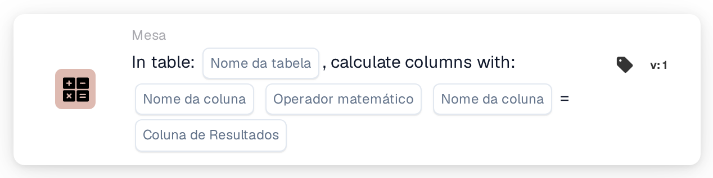
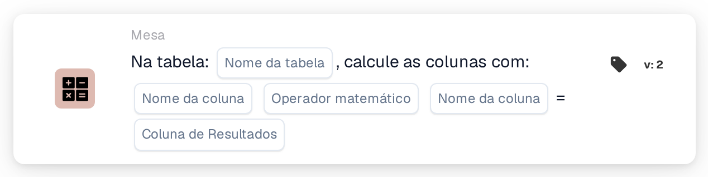

# Calcular colunas com

<figure><figcaption>
Versão 1
</figcaption></figure>

<figure><figcaption>
Versão 2
</figcaption></figure>

## Propósito:

Este cartão de fluxo de trabalho calcula, linha a linha, um valor a partir de duas colunas de uma tabela do documento e guarda o resultado numa coluna de resultado. Pode ser utilizado, por exemplo, para calcular totais de linha a partir da quantidade e do preço unitário.

## Vídeo de administração:



[Ver com legendas em português](https://docbits-videos.fra1.cdn.digitaloceanspaces.com/settings-assistant/workflow-card-calc-columns-admin/v1/pt.html) · [Ler a transcrição](https://docbits-videos.fra1.cdn.digitaloceanspaces.com/settings-assistant/workflow-card-calc-columns-admin/v1/pt.txt)

## Componentes do cartão:

1. **Tabela**
   * **Descrição:** A tabela do documento na qual o cálculo é executado.
2. **Primeira coluna**
   * **Descrição:** A coluna com o primeiro valor de cada linha.
3. **Operação**
   * **Opções:**
     * **+** soma o segundo valor ao primeiro.
     * **-** subtrai o segundo valor do primeiro.
     * **\*** multiplica os dois valores.
     * **/** divide o primeiro valor pelo segundo.
4. **Segunda coluna**
   * **Descrição:** A coluna com o segundo valor de cada linha.
5. **Coluna de resultado**
   * **Descrição:** A coluna na qual o resultado de cada linha é guardado.
   * **Detalhe:** O nome é guardado em maiúsculas, com os espaços substituídos por sublinhados (`total amount` passa a `TOTAL_AMOUNT`). Se a coluna ainda não existir, o cartão adiciona-a; se existir, os seus valores são substituídos.

As versões 1 e 2 do cartão têm as mesmas definições e funcionam da mesma forma.

## Funcionalidade:

* **Cálculo:** Para cada linha da tabela, o cartão lê as duas colunas (maiúsculas e minúsculas nos nomes das colunas não importam), aplica a operação e escreve o resultado na coluna de resultado. Os resultados são arredondados a quatro casas decimais. Em seguida, o documento é guardado com os novos valores.
  * Um valor vazio ou em falta conta como `0`. Se ambos os valores de uma linha estiverem vazios, o resultado dessa linha fica vazio.
  * Uma divisão por zero deixa vazio o resultado dessa linha.
  * Com **+**, dois valores que não são números são unidos com um espaço em vez de somados. Com as outras operações, um valor que não é um número provoca um erro e nenhum resultado é guardado.
* **Execução da ação:** Se o cálculo e a gravação forem bem-sucedidos, o fluxo de trabalho continua com os cartões seguintes. Se a tabela não existir no documento, se não for possível calcular um valor ou se não for possível guardar o documento, o cartão comunica um erro no registo do fluxo de trabalho.
* **Test Card:** Quando o cartão é executado com **Test Card**, o cálculo é apenas simulado e o documento não é alterado.

## Configuração:

* O cartão pode ser adicionado como ação Then a partir da categoria **Tabela**. Em seguida, selecionam-se a tabela, as duas colunas, a operação e a coluna de resultado.
* **Exemplo:** Tabela `INVOICE_TABLE`, `QUANTITY` **\*** `UNIT_PRICE`, coluna de resultado `TOTAL_AMOUNT`. Uma linha com quantidade 2 e preço unitário 10 obtém 20; uma linha com 3 e 4 obtém 12.
* Como um valor vazio conta como `0`, um preço em falta dá um resultado de `0`. Verificar se as colunas de entrada estão preenchidas, por exemplo com uma condição antes deste cartão, pode ajudar a evitar totais errados.
* Na subtração e na divisão, a ordem das duas colunas é importante.

## Conclusão:

O cartão de fluxo de trabalho "Calculate Columns with" acrescenta automaticamente valores calculados às linhas da tabela. Os totais de linha e valores semelhantes ficam disponíveis para os cartões seguintes e para a exportação, sem cálculo manual.
